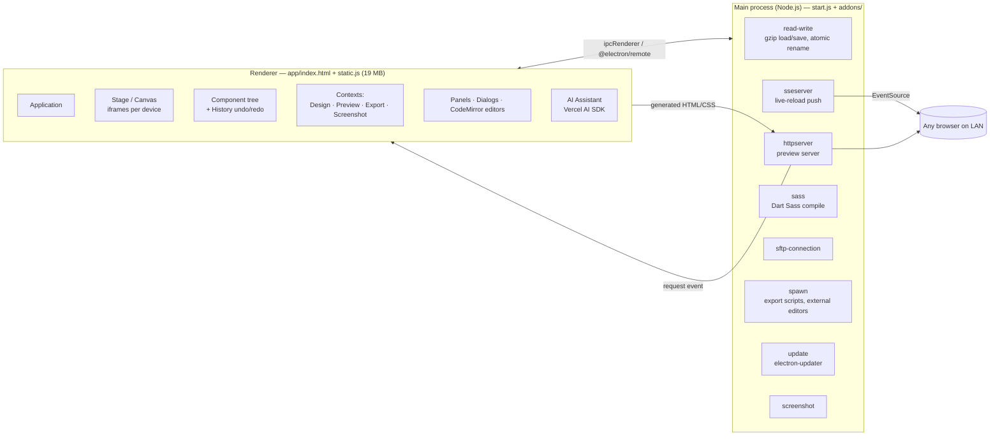
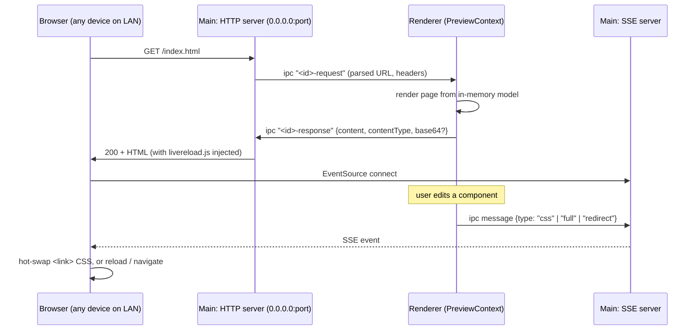

# Bootstrap Studio — Internal Architecture

Based on the shipped main-process source (readable, not minified), the minified renderer bundle, and an architecture note (`CLAUDE.md`) that the developers accidentally shipped inside `app.asar`. Their note describes the source tree that is *not* shipped (646 component files etc.); the parts I could verify against shipped code are marked ✅.

## Process model

✅ **The main process is deliberately dumb.** Each addon registers either IPC handlers or a `global.createXServer()` factory that the renderer calls via `@electron/remote`. All the domain logic lives in the renderer.

## The component model (renderer)

✅ Confirmed by the `.bsdesign` JSON and bundle strings:
- A page is a **tree of typed component instances**: `HTML > Body > NavBar > NavBarCollapse > Nav > NavItem …`. Each node has `class` (component type), `properties` (option values), `cssClasses`, `overrides` (raw HTML attributes keyed by sub-element path, e.g. `"/": {"id": "mainNav"}`), `flags` (canBeMoved/Deleted/Edited…), `customProperties`, `label`, `comment`.
- Each **component class** (per CLAUDE.md) extends `Component`, `ComponentWithChildren` or `ComponentWithInlineEditing`. It has three methods:
  - `defineOptions()` declares the Options-panel controls (checkbox, textbox, select… with `visible()`, `badge()`, `tooltip`, `valueType: "override"`).
  - `initialize()` sets defaults.
  - `update()` rebuilds the DOM from properties.
- **Options map to Bootstrap classes.** A `Column` stores `colmd: "8", colxl: "6"`, which is emitted as `class="col-md-8 col-xl-6"`. Responsive variants are separate properties per breakpoint (`text-md-alignment`, `display-sm`…).
- **Framework adapters**: components are registered per framework (`bootstrap3`, `bootstrap4`, `bootstrap5`, `reflow`, `reflow2`). The same tree concept produces different markup per framework.
- **Rich text** is a mixed array of plain strings and `InlineCharacter` format markers (bold/italic/link/colour/sub/sup), edited with `contenteditable` on the canvas.
- **Linked Components** (`linkID`): a navbar or footer reused across pages; edits propagate to all linked copies. Parts can be marked as "unlinked areas".
- **History / ActionManager**: command pattern with undo/redo; CLAUDE.md says it uses operational transformation.
- **Versioned format with converters**: `designFormatVersion = 87`, `componentFormatVersion = 79` in v8. Each bump ships a `design_XtoY.js` migration that walks the tree. Your 2023 backups are version 75, so they would be migrated forward on open.

## Contexts (rendering modes)

The same component tree renders through different **contexts**:

| Context | Purpose | Notes |
|---|---|---|
| `DesignContext` | Editable canvas | Injects `<base href="http://bss.design/">` and `bs-system-element` helpers. Missing images at `bss.design/*` are redirected to a placeholder by `capture-requests.js` ✅ |
| `PreviewContext` | Clean output for live preview | Served over HTTP ✅ |
| `ExportContext` | Final static files | Minification (clean-css, terser), optional export script ✅ |
| `ScreenshotContext` | Thumbnails for designs and library items | Uses a hidden `render-worker.html` window + `capturePage()` ✅ |

**Lesson:** one model, many renderers. The canvas is not "the HTML". It is a projection of the model.

## The editing canvas
- The **Stage** hosts the page inside iframes (256 `iframe` references), one per device width (phone/tablet/laptop/desktop breakpoints).
- Selection, drag-and-drop and hover outlines are overlays drawn by the editor around nodes in the iframe.
- Inline text editing uses `contenteditable` (+ `execCommand`) on `ComponentWithInlineEditing` nodes.
- Side panels (per docs index): **Component** (palette + user Library), **Options** (typed property controls), **Overview** (DOM tree), **Design** (pages, CSS, JS, fonts, images assets), **Editor** (CodeMirror for HTML/CSS/SASS/JS), **Styles/Attributes**, **AI Assistant** (new in 8.0).

## Live preview: how it works ✅

This is the most reusable idea in the codebase.

- **Nothing is written to disk for preview.** The HTTP server is a pure proxy that asks the renderer for every URL, so preview always reflects unsaved state.
- It binds `0.0.0.0`, so phones on the same Wi-Fi can open the preview (the bundled `qrcode` library is likely used to show a scannable preview link).
- `livereload.js` distinguishes **CSS-only updates** (swap stylesheet hrefs, no page reload) from full reloads and page redirects (keeps the browser on the page being edited). It defers reloads while the tab is hidden.

## Saving and loading ✅
- `read-write.js` gzips JSON and streams it in chunks over IPC (`create-writable-chunk-session` / `send-file-chunk`). Writes go to `file.tmp` and are then renamed, with a Windows EPERM/EACCES retry loop borrowed from graceful-fs. That makes saves atomic.
- Automatic **backups** go to `%USERPROFILE%\Bootstrap Studio Backups\<Name> (Backup <epoch-ms>).bsdesign`.
- See [03-project-file-format.md](03-project-file-format.md).

## Export and publishing
- **Export** writes static HTML/CSS/JS + assets to a folder, with options for minification, asset paths and an **Export Script** (an arbitrary `.bat/.cmd/.ps1`/executable run with the export path as its argument via `spawn.js`). Errors are logged to `error.log` in the export folder.
- **Publish** targets: their own hosting (`*.bss.design` subdomain or custom domain with verification, password protection, custom 404, quota per license), **SFTP**, and docs for GitHub Pages.
- **External editors**: the user can open CSS/JS in VS Code etc. (`spawn-editor`), and changes sync back.

## AI Assistant (8.0, Feb 2026)
- Runs on the **Vercel AI SDK** with bring-your-own key for OpenAI, Anthropic, Google, OpenRouter (via gateway) or local **Ollama**. Requests go straight from the app to the provider.
- Its system prompt gives it tools (`readFiles`, `fetchURL`, `imageGenerator`) and makes it emit **Aider-style SEARCH/REPLACE blocks** against the HTML/CSS/JS *files*. The app applies them with the `diff` package and re-imports the HTML into the component tree. `data-bss-id` attributes map HTML back to tree nodes.
- Known weakness (from their forum): AI edits can break Linked Components, because the HTML round-trip loses that metadata.

## Startup and licensing
- `singleinstance.js`: a named pipe/unix socket forwards argv (file to open) to the running instance.
- `windowsize` and `settings` (custom title bar) are JSON files in userData.
- License activation (key + computer name) is checked against bootstrapstudio.io. Updates are only offered for an active license (the update feed URL carries the token).
