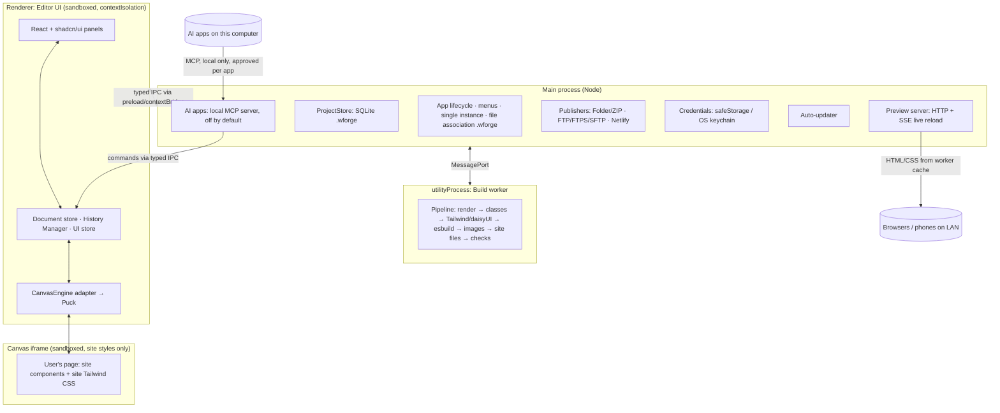

# Webforge Architecture

**Version:** 1.0 (consolidated from research, 2026-10-19)
**Status:** Baseline. Items marked 🔬 must be confirmed by the prototype spikes ([02-mvp-spec.md](02-mvp-spec.md#6-milestones))
**Sources of truth:** decisions are referenced by ID (e.g. **C5**, **X1**) and link back to the research notes in [`../research/`](../research/README.md). The full register is at the end of this document.

## 1. What Webforge is
A **paid, closed-source desktop app** (Windows 10/11 x64 + macOS 13+ on Apple Silicon) that lets **DIY small-business owners** build responsive websites visually:
- **Building:** drag-and-drop sections and elements, click-to-edit text, themes.
- **Output:** a **self-contained static site** (flat HTML/CSS/JS, no server, no CDN) that can be uploaded anywhere or opened from disk.
- **Publishing:** to a folder/ZIP, FTP/FTPS/SFTP or Netlify.

## 2. Technology stack

| Layer | Choice | Decision |
|---|---|---|
| Desktop shell | **Electron 44** (Chromium 152, Node 24), secure-by-default configuration | [01](../research/stack/01-electron-vs-tauri.md) |
| Language | **TypeScript 7** (strict), ESM | [03-engineering-standards](03-engineering-standards.md) |
| Editor UI | **React 19** (+ React Compiler) + **shadcn/ui** on **Tailwind v4**; Bootstrap Studio-like layout and dark theme (UI1) | [02](../research/stack/02-react-vs-svelte.md), [product/04](../research/product/04-editor-look-and-feel.md) |
| Editor state | **Zustand** stores + **Immer** patches; custom History Manager | [03 undo](../research/stack/03-undo-redo.md) |
| Canvas / editor engine | **Puck** (MIT) behind a `CanvasEngine` adapter (C6) ✅ go, runs under our history ([ADR 0004](../docs/adr/0004-puck-with-webforge-history.md)); fallback: own canvas on dnd-kit + Tiptap | [04](../research/stack/04-canvas-engine.md) |
| Rich text | **Tiptap** (MIT packages only) via Puck `richtext` fields | 04, C1 |
| Site components | React components rendering static HTML + Tailwind + **daisyUI 5**; small vanilla `webforge.js` for behaviour | [05](../research/stack/05-site-components.md) |
| Project file | Single **`.wforge`** = **SQLite** DB via **better-sqlite3** ✅, content-addressed blobs, versions | [06](../research/stack/06-project-file-format.md) |
| Build / preview pipeline | In-app: Puck render → Tailwind v4 (programmatic) + daisyUI → esbuild → jSquash images; runs in an Electron `utilityProcess` | [07](../research/stack/07-export-pipeline.md) |
| Publishing | Folder/ZIP · `basic-ftp` · `ssh2-sftp-client` · Netlify REST API | [08](../research/stack/08-publishing.md) |
| Packaging & updates | **electron-vite** (dev/build) + **electron-builder** (NSIS / DMG) + **electron-updater** ✅ (decided 2026-10-19, no Forge comparison needed) | 01 |

Licensing rule for every dependency: **permissive only** (MIT, BSD, Apache-2.0, ISC); MPL-2.0 OK unmodified; **no GPL/AGPL**, no paid add-ons, and never GSAP or libraries built on it, whose terms exclude competing builders (C1, PG-6). Enforced in CI.

## 3. Process model



| Process | Responsibilities | Must never |
|---|---|---|
| **Main** | Window/menus, open/save `.wforge`, autosave transactions, versions, preview HTTP/SSE server, publishing, credentials, updates, the local MCP server for AI apps (F-AI-1), which forwards commands to the renderer | Render UI; hold editor state of truth |
| **Preload** | Exposes a **typed, minimal API** via `contextBridge` (`window.webforge.*`) | Expose `ipcRenderer`, Node or Electron objects directly |
| **Renderer (editor)** | UI, the in-memory document, history, selection, canvas engine, Site Check ([ADR 0016](../docs/adr/0016-site-check-in-the-renderer.md)) | Access Node/fs directly (`nodeIntegration: false`, `sandbox: true`) |
| **Canvas iframe** | Shows the page being edited with the **site's** CSS only (C8, `syncHostStyles: false`) | Load editor styles; run custom scripts unless the user enables it (05) |
| **Build worker** (`utilityProcess`) | Export/preview builds, image conversion | Block the UI; touch the network except during publish |

**Electron hardening:** `contextIsolation: true`, `sandbox: true`, `nodeIntegration: false`, no `@electron/remote`, strict CSP, `will-navigate`/`window.open` handlers, Electron Fuses (disable `RunAsNode`, enable ASAR integrity, cookie encryption).

**File paths:** the renderer never names a file. The main process reads only paths it got itself: from native dialogs, the clipboard's file list, the command line, and dropped files' paths that the preload finds with `webUtils.getPathForFile` (`media:import-paths`, R13b).
- **The preload is the trust boundary for dropped files' paths.** The main process takes any absolute path on that channel.
- So the preload sends nothing but `getPathForFile`'s output for the `File` objects it was given. A `File` a page made has no path, so a page can't name a file.
- A preload test keeps it that way ([ADR 0013](../docs/adr/0013-store-gate.md)).

## 4. Package / module structure (pnpm monorepo)

```
wforge/
├── apps/
│   └── desktop/                 Electron app (main, preload, renderer) via electron-vite
├── packages/
│   ├── model/                   Document schema (zod), IDs, migrations, glossary-driven labels
│   ├── history/                 History Manager: transactions, coalescing, labels, selection restore
│   ├── storage/                 .wforge SQLite store: blobs, documents, versions, GC, backup
│   ├── engine/                  CanvasEngine interface + Puck implementation (only place Puck is imported)
│   ├── commands/                Typed queries and commands for AI apps (F-AI-1) and the v1.1 assistant, over model + history
│   ├── site-components/         Section & element components, fields, daisyUI markup, webforge.js behaviours
│   ├── themes/                  Curated themes, fonts catalogue, theme → Tailwind @theme generation
│   ├── site-check/              Site Check rules (F-CHK-1, X5) over the site document, run in the renderer (ADR 0016)
│   ├── pipeline/                Render, Tailwind compile, esbuild, images, site files
│   ├── publish/                 Folder/ZIP, FTP/FTPS/SFTP, Netlify publishers + manifest diffing
│   ├── editor-ui/               shadcn/ui-based editor components, panels, dialogs
│   ├── i18n/                    UI strings (English for MVP), glossary terms
│   └── test-utils/              Fixtures (sample sites, .wforge files per format version), helpers
├── e2e/                         Playwright Electron tests
├── spec/  research/             Documentation
└── tools/                       Scripts (licence check, release, fixture generation)
```

**Dependency rules** (enforced with dependency-cruiser):
- `model`, `history`, `storage`, `pipeline`, `publish` are **framework-free** (no React), except `pipeline` rendering through `site-components`.
- **Only `engine` imports Puck.** Only `editor-ui` and `apps/desktop/renderer` import shadcn/ui.
- Renderer code never imports Node built-ins; main-process code never imports React.
- `site-components` must not import editor code. Its output must render to static HTML.
- `commands` is framework-free: no React and no Puck. It reads field schemas from a React-free catalogue entry point that `site-components` exports as plain zod data.

## 5. Core data model

```
Site (.wforge)
├── settings          Site Settings (X3): name, description, language, URL, social, contact, analytics (B4),
│                     search engines, publish destinations (no secrets), allowed external URLs (C8)
├── theme             Theme preset + brand colours, fonts, radius, spacing (05), stored as CSS-variable tokens
├── layout            Header, Footer (C5): Puck data, stored once, rendered on every page
├── sharedSections[]  Shared sections (F-ED-23): named section data stored once; pages hold linked copies by ID
├── pages[]           Page: slug → about.html (X1), Page Settings, Puck data (sections → elements)
├── media[]           Originals (images, fonts, files: F-ED-24) as content-addressed blobs
├── code              custom.css, custom.js, head/body snippets (C7, Advanced mode)
├── versions[]        Named + automatic versions (P3: last 20 automatic, configurable)
└── history           Optional persisted Undo History (D6)
```

- **Element tree:** Puck data (sections and elements with typed props). Every node has a stable `id` and a friendly display label (D2).
- **Styling props** map to Tailwind/daisyUI classes through **design-token fields** (e.g. Padding: Medium → `py-12`), per breakpoint (Desktop · Tablet · Mobile).
- **Format versioning:** `format_version` integer with a migration chain; old versions are migrated lazily (06). Any change to a stored shape bumps the format ([ADR 0012](../docs/adr/0012-site-format-migrations.md)).

## 6. Key interfaces

```ts
// packages/engine
interface CanvasEngine {
  mount(el: HTMLElement, opts: { library: ComponentLibrary; theme: Theme }): void
  loadPage(page: PageDoc, layout: LayoutDoc, shared: SharedSectionsDoc): void   // shared: F-ED-23
  applyChange(change: DocChange): void
  onUserEdit(cb: (edit: EngineEdit) => void): Unsubscribe
  select(nodeId: string | null): void
  onSelectionChange(cb: (nodeId: string | null) => void): Unsubscribe
  onFieldDrag(cb: (drag: FieldDrag) => void): Unsubscribe   // canvas handles: one step from start to commit, Esc cancels (1.32)
  onHistoryCommand(cb: (command: 'undo' | 'redo') => void): Unsubscribe   // keys pressed inside the canvas iframe (ADR 0004)
  setViewport(v: 'desktop' | 'tablet' | 'mobile' | number): void
  setMode(mode: 'design' | 'content'): void            // M3
  destroy(): void
}

// packages/history
interface HistoryManager {
  readonly document: ReadonlyStore<SiteDoc>   // read-only; changes go through run/begin
  run(label: Label, recipe: (draft: SiteDraft) => void, opts?: { coalesceKey?: string }): void
  begin(label: Label): Transaction            // gestures: drag, slider (commit / cancel)
  undo(): boolean; redo(): boolean; jumpTo(entryId: string | null): boolean   // null = before the first step
  entries(): readonly HistoryEntry[]          // Undo History panel (D3)
  endSession(coalesceKey: string): void       // text session ends: merge its chunks into one step (D1)
  breakCoalescing(): void
}

// packages/commands (F-AI-1): main forwards tool calls over typed IPC; the renderer runs them
interface CommandApi {
  query<Q extends QueryName>(name: Q, input: QueryInput<Q>): QueryResult<Q>      // outline, page tree, fields, settings, theme
  run<C extends CommandName>(name: C, input: CommandInput<C>, actor: { app: string }): Promise<CommandResult>
  // zod-validated; one HistoryManager step labelled "AI (‹app›): …"; refused with 'busy' while a transaction
  // or text session is open; site-wide commands await the D7 confirmation ('declined' after 60 s)
}

// packages/storage
interface ProjectStore {
  open(path: string): Promise<SiteSnapshot>   // runs migrations
  commit(patches: Patch[]): Promise<void>     // autosave transaction (P2)
  saveVersion(name: string, kind: 'manual' | 'auto'): Promise<VersionId>
  restoreVersion(id: VersionId): Promise<SiteSnapshot>
  exportZip(path: string): Promise<void>; gc(): Promise<void>
}

// packages/pipeline
interface Pipeline {
  build(snapshot: SiteSnapshot, mode: 'preview' | 'export' | 'publish'): AsyncIterable<BuildEvent>
}

// packages/publish
interface Publisher {
  test(dest: Destination, signal?: AbortSignal): Promise<TestResult>
  publish(build: BuildOutput, dest: Destination, signal: AbortSignal): AsyncIterable<PublishEvent>
}
```

## 7. Key flows

**Edit:**
1. A user action produces `history.run(label, recipe)`, which applies an Immer patch to the document store.
2. The engine updates the canvas.
3. The autosave debounce (~2 s, max 30 s) commits the patches to SQLite (P2).
4. The preview cache is invalidated, and the worker rebuilds the affected page and CSS. SSE pushes a CSS hot-swap or a page reload.

**Undo:**
1. Apply inverse patches.
2. Restore selection, page and viewport (D1–D7).
3. Autosave.

**Export:**
1. Snapshot.
2. Site Check (export rules, X5), in the renderer before the build starts ([ADR 0016](../docs/adr/0016-site-check-in-the-renderer.md)).
3. Render.
4. Collect classes.
5. CSS (readable, X4).
6. JS (classic scripts, X1).
7. Images (WebP + JPEG/PNG fallback, X2).
8. Site files.
9. Format.
10. Write to a temp folder, then atomically swap it in.

**Publish:**
1. Site Check with the stricter publish rules (X5, ADR 0016), then build.
2. Diff against the destination manifest.
3. Upload assets → pages → `index.html`.
4. Verify.
5. Record an automatic version "Published …" (08).

## 8. Exported site contract
- Flat pages (`index.html`, `about.html`, `services/web-design.html`), relative URLs, opens from disk (X1).
- `assets/css/site.<hash>.css` (readable), `assets/js/webforge.<hash>.js` (classic `defer`, only if needed), `assets/fonts/*.woff2` (Fontsource, OFL), `assets/img/*` (WebP + fallback), favicons, `site.webmanifest`, `sitemap.xml` + canonical links if the URL is set, `robots.txt`, `404.html`, `files/*` (linked files, F-ED-24), `llms.txt` + `*.md` page copies when enabled (F-EX-5).
- **No external requests** except explicitly allowed ones: GA4 `gtag.js` (B4, behind the consent banner B7) and per-URL user allow-list entries.
- Forms POST to the configured form service (B3/B6); Buy buttons are plain links (M1).

## 9. Security & privacy
- **Secrets never in `.wforge`.** Publish credentials live in the OS keychain via `safeStorage` (08).
- **Untrusted projects:** validate the SQLite schema, use SQLite defensive mode, and custom scripts are off in the editor by default.
- **Canvas iframe sandboxed;** no Node access anywhere in renderer contexts.
- **Network:** the editor makes no network calls except updates, publishing, Netlify OAuth, user-initiated "Download and bundle" (C8), and downloading a font the user picks from "Browse all fonts" (2.2; fonts are cached locally and self-hosted in exports).
- **AI apps (MCP, F-AI-1):**
  - Off by default. When on, the server listens only on this computer (loopback or a local pipe; transport chosen by ADR).
  - **Pairing, not self-reported names:** Webforge issues a one-time code per AI app, which the user pastes into that app; the app then holds a token stored in the OS keychain on our side. Requests without a valid token are refused, and removing an app revokes it.
  - An HTTP transport checks `Origin` and `Host` on every request (DNS-rebinding and browser protection, as the MCP specification requires).
  - Every tool call is validated with zod and becomes a document command through `HistoryManager`; the server holds no document state of its own.
  - No tools for publishing, credentials, Custom Code or files outside the site.
  - Site content goes only to the AI app the user paired; Webforge itself sends nothing.
  - Tool calls are never logged with their content (same rule as crash reports).
- **Files in Media (F-ED-24):** accepted by extension and sniffed content type; stored and exported unchanged; never opened, previewed or run inside the editor.
- **Crash reports (local only):**
  - Electron `crashReporter.start({ uploadToServer: false })` for native crashes (minidumps in `app.getPath('crashDumps')`).
  - Main, renderer and worker handlers for uncaught errors and unhandled rejections write a JSON report to `<userData>/crash-reports/crash-<YYYYMMDD-HHMMSS>-<process>.json` (UTC; Windows-safe filename).
  - **Report contents:**
    - app, Electron and OS versions
    - process type
    - error name, message and stack
    - the last ~50 breadcrumbs (action *types* and panel names only)
    - memory usage
  - **Never included:** site content, file paths beyond the app's own, credentials or personal data.
  - Retention: last 50 reports / 90 days.
  - **No automatic upload.** Future enhancement: an in-app viewer and an optional, user-initiated "Share with support".
- **Exported sites:** privacy-first by default (self-hosted fonts, consent banner for GA, click-to-load embeds).

## 10. Performance targets
| Metric | Target |
|---|---|
| Cold start to editable canvas (5-page site) | < 3 s on a mid-range laptop |
| Keystroke / drag to canvas update | < 16 ms (no dropped frames) |
| CSS-only change → preview browser | < 100 ms |
| Page re-render in preview | < 200 ms |
| Autosave commit | < 50 ms, off the UI thread |
| Full export, 20 pages, images cached | < 5 s |
| Installer size | ≤ 150 MB (templates/fonts beyond the core set downloadable) |

## 11. Decision register

| ID | Decision | Note |
|---|---|---|
| — | Electron over Tauri; React over Svelte | [01](../research/stack/01-electron-vs-tauri.md), [02](../research/stack/02-react-vs-svelte.md) |
| U1–U9, D1–D7 | Undo/redo requirements and decisions (session-grouped text, labels, history panel, delete/confirm rules, banner for shared sections) | [03](../research/stack/03-undo-redo.md) |
| C1–C8 | Paid product licence rules, custom HTML/JS, no import, daisyUI components, shared Header/Footer, Puck adapter, self-contained sites | [04](../research/stack/04-canvas-engine.md) |
| — | daisyUI (not Basecoat); no shadcn look in sites | [05](../research/stack/05-site-components.md) |
| P1–P5 | `.wforge`, periodic autosave, 20 automatic versions, videos deferred, "open version as new site" | [06](../research/stack/06-project-file-format.md) |
| X1–X6 | Flat .html, WebP + JPEG fallback, Site Settings, readable output, tiered checks (stricter publish), developer files (no Astro) | [07](../research/stack/07-export-pipeline.md) |
| B1–B7 | Targets, hosting deferred, form presets, GA4, FTP rules, consent scope | [08](../research/stack/08-publishing.md) |
| T1–T4 | DIY users, Simple/Advanced mode, structured layout, "Element" | [product/01](../research/product/01-terminology.md) |
| M1–M5 | MVP CMS scope, Blog v1.1, Content mode toggle, search/i18n later | [product/02](../research/product/02-cms.md) |
| UI1 | Editor look and feel: Bootstrap Studio-like layout, dark/light tokens, compact density | [product/04](../research/product/04-editor-look-and-feel.md) |
| GA1–GA4 | Competitor gaps: 15 small MVP additions; AI with the user's own account in v1.1; provider presets deferred; plugin API long-term | [product/05](../research/product/05-feature-gap-analysis.md) |
| UI2–UI4 | Editor UI/UX parity: Bootstrap Studio interactions and Elements' Inspector/Theme Studio ideas in the MVP; Bootstrap Studio's shortcuts as the standard; v1.1 notes, workspaces, display modes, AI panel | [product/06](../research/product/06-editor-ui-ux-parity.md) |
| BS9-1–10 | Bootstrap Studio 9.0 review: sticky header and back-to-top in the MVP; v1.1 Blog on a general collections engine; v1.1 extras and AI assistant details | [bootstrap-studio/06](../research/bootstrap-studio/06-bootstrap-studio-9.md) |
| GA5–GA9 | Elements 3.0 review: connect AI apps (MCP), shared sections, files in Media and `llms.txt` in the MVP; built-in AI assistant and draft pages in v1.1 | [product/05 §3.7](../research/product/05-feature-gap-analysis.md#37-rapidweaver-elements-30-update-2026-10-22) |
