# Webforge MVP Implementation Plan

> **Status:** baseline plan, agreed before Phase 1. **Live tracking happens in GitHub:** one issue per work item, one milestone per phase. This document is the baseline. Re-plan at every phase exit (see §10) rather than editing it item by item.
>
> Inputs: [architecture](01-architecture.md), [MVP spec](02-mvp-spec.md), [engineering standards](03-engineering-standards.md), [ADRs](../docs/adr/README.md) and [research](../research/README.md).

## Contents
1. [Assumptions](#1-assumptions)
2. [Where we are](#2-where-we-are)
3. [Timeline](#3-timeline)
4. [Start now: lead-time items](#4-start-now-lead-time-items)
5. [Work breakdown](#5-work-breakdown)
6. [Feature coverage](#6-feature-coverage)
7. [Critical path and sequencing](#7-critical-path-and-sequencing)
8. [Risks](#8-risks)
9. [Open questions](#9-open-questions)
10. [How we work through the plan](#10-how-we-work-through-the-plan)
11. [Fast-track options](#11-fast-track-options)

## 1. Assumptions
| Item | Assumption |
|---|---|
| Team | One developer, full-time, working with Claude Code. Nothing runs in parallel except calendar waits (enrolment, beta) |
| Estimates | **Ideal working days** with Claude Code, including tests, stories, code review and docs for the item (Definition of Done, [standards §8](03-engineering-standards.md#8-definition-of-done)) |
| Calendar | Start **26 Oct 2026**, 5-day weeks, England & Wales bank holidays excluded. Add personal leave when known |
| Contingency | Dates are shown at 100% of the estimates and with **+25%** contingency. Plan against the contingency date |
| Platforms | Develop on Linux CI + the developer's Mac; Windows checked through CI (Windows runner) and a Windows test machine/VM. Beta on **Windows and macOS** |
| Signing | Neither Apple Developer nor Windows signing is set up yet. Both are started on day 1 (item 0.1) |
| Scope | Exactly the [MVP spec](02-mvp-spec.md) after the gap-analysis additions (GA1–GA4). Licensing (MVP §8) is post-MVP and not in this plan |

## 2. Where we are
Phase 0 is largely done (PRs #1–#6):

| Proven | Evidence |
|---|---|
| Monorepo, CI, Biome, dependency-cruiser, knip, licence check | [ADR 0001](../docs/adr/0001-monorepo-tooling.md), [ADR 0002](../docs/adr/0002-licence-check.md) |
| Secure Electron shell, typed preload, IPC with zod | `apps/desktop/src/main` |
| `.wforge` SQLite storage via better-sqlite3 (Node-API prebuilds, crash safety) | [ADR 0003](../docs/adr/0003-wforge-sqlite-storage.md) |
| Puck running under **our** HistoryManager (go decision) | [ADR 0004](../docs/adr/0004-puck-with-webforge-history.md) |
| Export pipeline: Puck render → Tailwind → esbuild → jSquash, `file://` output | [ADR 0005](../docs/adr/0005-export-pipeline-spike.md) |

Still open in Phase 0: publishing spikes (Netlify, FTP/SFTP), signed installers + auto-update, and the Puck large-page check. The ADR follow-ups (storage, history, export) are folded into the Phase 1–3 items below.

Current code size (approx. lines): desktop 2.7k · engine 1.6k · history 1.6k · pipeline 1.1k · site-components 1.0k · storage 0.6k · model 0.3k. `editor-ui`, `publish` and `themes` are placeholders.

## 3. Timeline
**Total: 227 working days** (≈ 45 weeks) including the 4-week beta. v1.0 at 100% of estimates: **17 Sep 2027**; with +25% contingency: **7 Dec 2027**.

| Phase | Effort (days) | Starts | Ends (100%) | Ends (+25%) | Exit criteria |
|---|---|---|---|---|---|
| [Phase 0: Prototype (finish)](#phase-0-prototype-finish) | 11 | 26 Oct 2026 | 18 Nov 2026 | 24 Nov 2026 | Netlify and SFTP/FTPS publish spikes meet the spike criteria in research/stack/08 Signed (or signing-ready) NSIS and DMG builds install and auto-update from a test feed A large page (200+ elements) stays within the editing performance budget ADRs written; architecture §6 interfaces updated |
| [Phase 1: Editor core](#phase-1-editor-core) | 70 | 4 Nov 2026 | 18 Feb 2027 | 18 Mar 2027 | Build a 3-page site from blank, close, reopen: everything restored Undo-all property tests green; every edit has a meaningful label Shell matches UI1 in dark and light (Storybook screenshots) |
| [Phase 2: Design & components](#phase-2-design--components) | 55 | 19 Feb 2027 | 11 May 2027 | 29 Jun 2027 | Every component has stories × 3 themes × Desktop/Mobile, axe-clean New Site from each of the 8 templates works and looks distinct Theme changes restyle every component; contrast warnings work |
| [Phase 3: Output](#phase-3-output) | 33 | 12 May 2027 | 28 Jun 2027 | 25 Aug 2027 | Exported templates open from disk in Chromium, Firefox, WebKit (+ Edge on Windows) with no external requests Site Check blocks only Must-fix issues on export Preview CSS hot-swap < 100 ms; phone preview via QR works |
| [Phase 4: Publish & versions](#phase-4-publish--versions) | 21 | 29 Jun 2027 | 27 Jul 2027 | 4 Oct 2027 | Publish + rollback on all targets in E2E tests (mock Netlify, local FTP/SFTP) Version History: save, auto-retention, preview, restore, open as new site |
| [Phase 5: Beta hardening](#phase-5-beta-hardening) | 37 | 28 Jul 2027 | 17 Sep 2027 | 7 Dec 2027 | All performance budgets met on Windows and macOS Signed, notarised builds auto-update from the production feed Beta running with 10–20 users; no open Must-fix bugs |

Phase 0's signed-installer item waits on enrolment (lead time), so Phase 1 work starts while it waits. The Gantt chart shows the 100% schedule.

```mermaid
gantt
    title Webforge MVP (100% of estimates)
    dateFormat YYYY-MM-DD
    axisFormat %b %y
    excludes weekends 2026-12-25 2026-12-28 2027-01-01 2027-03-26 2027-03-29 2027-05-03 2027-05-31 2027-08-30 2027-12-27 2027-12-28
    section Phase 0
    0.1 Start code-signing enrolment (Apple Developer… :crit, t0_1, 2026-10-26, 1d
    0.2 Spike – Netlify publish (OAuth, digest deploy,… :t0_2, 2026-10-27, 3d
    0.3 Spike – FTP/FTPS/SFTP incremental publish :t0_3, 2026-10-30, 2d
    0.4 Spike – signed installers and auto-update :crit, t0_4, 2026-11-13, 3d
    0.5 Puck large-page performance check :t0_5, 2026-11-03, 1d
    0.6 Phase 0 wrap-up – interfaces and decision log :t0_6, 2026-11-18, 1d
    section Phase 1
    1.1 Editor theme tokens, compact density and Story… :crit, t1_1, 2026-11-04, 3d
    1.2 Window shell – title bar, panels, drawer (UI1… :crit, t1_2, 2026-11-09, 4d
    1.3 i18n wiring and Puck dictionary :t1_3, 2026-11-19, 1d
    1.4 Modes – Simple/Advanced and Design/Content :t1_4, 2026-11-20, 2d
    1.5 Site model – full SiteDoc schema, IDs and migr… :t1_5, 2026-11-24, 3d
    1.6 Storage – documents, assets, GC, migrations, s… :t1_6, 2026-11-27, 4d
    1.7 Periodic autosave and save status :t1_7, 2026-12-03, 2d
    1.8 Site lifecycle – start screen, new/open/recent… :t1_8, 2026-12-07, 3d
    1.9 Backups and local crash reports :t1_9, 2026-12-10, 2d
    1.10 History hardening – labels, gestures, selectio… :t1_10, 2026-12-14, 3d
    1.11 Undo History panel and Undo toasts :t1_11, 2026-12-17, 2d
    1.12 Canvas – site CSS, selection chrome and floati… :crit, t1_12, 2026-12-21, 4d
    1.13 Add panel – sections and elements :t1_13, 2026-12-29, 3d
    1.14 Edit panel framework and field controls :crit, t1_14, 2027-01-04, 5d
    1.15 Device views, zoom and size readout :t1_15, 2027-01-11, 2d
    1.16 Pages panel and Page Settings basics :t1_16, 2027-01-13, 3d
    1.17 Shared Header and Footer :t1_17, 2027-01-18, 3d
    1.18 Layers panel (Advanced) :t1_18, 2027-01-21, 3d
    1.19 Copy and paste :t1_19, 2027-02-10, 3d
    1.20 Link dialog and link to section :t1_20, 2027-01-26, 2d
    1.21 Navigation menu editor :t1_21, 2027-01-28, 3d
    1.22 Spell check :t1_22, 2027-02-02, 1d
    1.23 Confirmation rule (D7) framework :t1_23, 2027-02-03, 2d
    1.24 Media library, image import and alt text :t1_24, 2027-02-05, 3d
    1.25 Inline text editing (Tiptap) :t1_25, 2027-02-15, 4d
    section Phase 2
    2.1 Themes package – tokens → Tailwind/daisyUI and… :t2_1, 2027-02-19, 5d
    2.2 Theme panel – brand colours, fonts, roundness,… :t2_2, 2027-03-03, 4d
    2.3 Fonts – bundled catalogue and on-demand download :t2_3, 2027-02-26, 3d
    2.4 Section light/dark variants :t2_4, 2027-03-09, 1d
    2.5 Component framework – tokens, variants, storie… :crit, t2_5, 2027-03-10, 3d
    2.6 Sections A – Header, Footer, Hero (4), Text, T… :t2_6, 2027-03-15, 5d
    2.7 Sections B – Features, Gallery + lightbox, Tes… :crit, t2_7, 2027-03-22, 6d
    2.8 Sections C – Opening hours & contact, Contact… :t2_8, 2027-04-01, 4d
    2.9 Elements – basic set :t2_9, 2027-04-07, 4d
    2.10 Elements – interactive and commerce :t2_10, 2027-04-13, 5d
    2.11 Animations and hover effects :t2_11, 2027-04-20, 2d
    2.12 Templates – 8 starter sites and New Site flow :crit, t2_12, 2027-04-22, 10d
    2.13 Component accessibility and visual regression… :t2_13, 2027-05-07, 3d
    section Phase 3
    3.1 Pipeline API – progress events, worker, caches :crit, t3_1, 2027-05-12, 4d
    3.2 Preview server with live reload and phone prev… :t3_2, 2027-05-18, 3d
    3.3 Export to folder/ZIP, report, readable output,… :crit, t3_3, 2027-05-21, 3d
    3.4 Images – responsive WebP + fallback, favicons,… :t3_4, 2027-05-26, 3d
    3.5 Site files – sitemap, robots, manifest, 404, m… :t3_5, 2027-06-01, 2d
    3.6 Site Settings dialog and pre-export prompt :t3_6, 2027-06-03, 3d
    3.7 Site Check engine and panel :t3_7, 2027-06-08, 5d
    3.8 Forms – services, spam protection, thank-you p… :t3_8, 2027-06-15, 3d
    3.9 Google Analytics with consent banner :t3_9, 2027-06-18, 2d
    3.10 Custom code bundling and external-resource check :t3_10, 2027-06-22, 3d
    3.11 Exported-site compatibility E2E :crit, t3_11, 2027-06-25, 2d
    section Phase 4
    4.1 Publish core – Publisher interface, manifests,… :crit, t4_1, 2027-06-29, 3d
    4.2 Netlify publisher :crit, t4_2, 2027-07-02, 3d
    4.3 FTP/FTPS/SFTP publisher :t4_3, 2027-07-07, 3d
    4.4 Publish destinations UI and keychain credentials :crit, t4_4, 2027-07-12, 3d
    4.5 Publish flow UI :crit, t4_5, 2027-07-15, 2d
    4.6 Version History :t4_6, 2027-07-19, 5d
    4.7 Project export/import as ZIP :t4_7, 2027-07-26, 2d
    section Phase 5
    5.1 Performance budgets and benchmarks :t5_1, 2027-07-28, 3d
    5.2 Production builds, signing and update channels :crit, t5_2, 2027-08-02, 3d
    5.3 Open-source licences screen and third-party no… :t5_3, 2027-08-05, 1d
    5.4 Onboarding, help and keyboard shortcuts :t5_4, 2027-08-06, 4d
    5.5 Editor accessibility pass :t5_5, 2027-08-12, 2d
    5.6 Security review :t5_6, 2027-08-16, 2d
    5.7 Closed beta programme :crit, t5_7, 2027-08-18, 2d
    5.8 Beta period (4 weeks) – fix findings and relea… :crit, t5_8, 2027-08-20, 20d
```

## 4. Start now: lead-time items
These take calendar time rather than effort. Start them in week 1 so they never block a phase:

| What | Why now | Needed by |
|---|---|---|
| Apple Developer Program enrolment (+ D-U-N-S number if enrolling as a company) | Identity checks can take days to weeks; notarisation needs it | Item 0.4 (13 Nov 2026) |
| Windows code signing (Azure Trusted Signing if eligible, otherwise an OV certificate) | Identity validation; eligibility depends on the business entity and country | Item 0.4 (13 Nov 2026) |
| Decide the update-feed host (open question Q1) | Auto-update spike needs a real feed | Item 0.4 (13 Nov 2026) |
| Start recruiting beta testers (10–20 small businesses, both OSes) | Recruitment is slow; a waiting list helps usability tests in Phase 5 | Item 5.7 (18 Aug 2027) |
| Template copy and photos (open question Q6) | Content work, not engineering; can be sourced in parallel | Item 2.12 (22 Apr 2027) |

## 5. Work breakdown
Each item becomes one GitHub issue (title prefixed with its ID) in its phase milestone, labelled `area/*` and `type/*`. Estimates are ideal days. Dependencies list item IDs.

### Phase 0: Prototype (finish)
**Goal:** Close the remaining spikes so every 🔬 item in the specs is proven: publishing, signed installers, auto-update and Puck performance.  
**Effort:** 11 days · **Scheduled:** 26 Oct 2026 → 18 Nov 2026

| ID | Item | Area | Refs | Est | Depends on |
|---|---|---|---|---|---|
| 0.1 | Start code-signing enrolment (Apple Developer + Windows signing) | release | [stack/01](../research/stack/01-electron-vs-tauri.md), MVP §6, standards §10 | 1 | – |
| 0.2 | Spike: Netlify publish (OAuth, digest deploy, restore, Forms) | publish | [stack/08](../research/stack/08-publishing.md), B1, B6, F-PB-1, F-PB-2 | 3 | – |
| 0.3 | Spike: FTP/FTPS/SFTP incremental publish | publish | [stack/08](../research/stack/08-publishing.md), B5 | 2 | – |
| 0.4 | Spike: signed installers and auto-update | release | [stack/01](../research/stack/01-electron-vs-tauri.md), MVP §6 | 3 | 0.1 |
| 0.5 | Puck large-page performance check | engine | [ADR 0004](../docs/adr/0004-puck-with-webforge-history.md), architecture §10 | 1 | – |
| 0.6 | Phase 0 wrap-up: interfaces and decision log | docs | architecture §6, ADRs 0003–0005 | 1 | 0.2, 0.3, 0.4, 0.5 |

Scope and acceptance criteria

**0.1 Start code-signing enrolment (Apple Developer + Windows signing)**  
Enrol in the Apple Developer Program (individual or company) and set up Windows code signing (Azure Trusted Signing if eligible, otherwise an OV/EV certificate). Both involve identity verification that can take days to weeks, so start immediately.
*Lead time:* about 10 working days of waiting after this item before dependants can start.

- [ ] Apple Developer membership active; Developer ID Application certificate created
- [ ] Windows signing route chosen and verified (Trusted Signing account or certificate issued)
- [ ] Secrets stored in GitHub Actions secrets, never in the repo

**0.2 Spike: Netlify publish (OAuth, digest deploy, restore, Forms)**  
Netlify OAuth from Electron via loopback redirect (PAT fallback), create/pick site, file-digest deploy of an exported site, re-deploy with one changed file, restore a previous deploy, Netlify Forms detection on an API deploy.

- [ ] Only changed files upload on re-deploy
- [ ] Previous deploy can be restored via API
- [ ] Netlify Forms detects a form from an API (non-build) deploy, or the limitation is documented
- [ ] ADR written

**0.3 Spike: FTP/FTPS/SFTP incremental publish**  
basic-ftp (FTPS first, plain FTP fallback) and ssh2-sftp-client against local test servers: manifest-based incremental upload, upload order (assets → pages → index.html), clean-up of removed files, cancel mid-way.

- [ ] Second publish uploads only changed files
- [ ] Cancel leaves the previously published site usable
- [ ] Credentials round-trip through safeStorage on Windows and macOS
- [ ] ADR written

**0.4 Spike: signed installers and auto-update**  
electron-builder signing for NSIS (per-user) and macOS arm64 DMG with notarisation in CI; electron-updater against a test feed (GitHub Releases or object storage); confirm .wforge file association.

- [ ] Signed NSIS installs per-user without admin; SmartScreen reputation path understood
- [ ] Notarised DMG opens without Gatekeeper warnings on a clean Mac
- [ ] App updates itself from v0.0.1 to v0.0.2 via the test feed on both OSes
- [ ] Double-clicking a .wforge file opens Webforge
- [ ] ADR written (incl. chosen update-feed host)

**0.5 Puck large-page performance check**  
Measure editing a page with 200+ elements: keystroke-to-canvas latency, drag, undo/redo, memory. Report the two Puck issues from ADR 0004 upstream.

- [ ] Measurements recorded against the §10 budgets
- [ ] Mitigations listed if budgets are missed
- [ ] Upstream issues filed

**0.6 Phase 0 wrap-up: interfaces and decision log**  
Fold spike learnings into architecture §6 (CanvasEngine, HistoryManager, Pipeline, Publisher), mark all 🔬 items resolved, update the decision register.

- [ ] No 🔬 items left in specs
- [ ] Architecture §6 matches the code's interfaces

**Phase exit:** Netlify and SFTP/FTPS publish spikes meet the spike criteria in research/stack/08; Signed (or signing-ready) NSIS and DMG builds install and auto-update from a test feed; A large page (200+ elements) stays within the editing performance budget; ADRs written; architecture §6 interfaces updated.

### Phase 1: Editor core
**Goal:** A real editor on the UI1 shell: create, open and autosave sites; add, edit, move, copy and undo sections and elements across pages with a shared Header/Footer.  
**Effort:** 70 days · **Scheduled:** 4 Nov 2026 → 18 Feb 2027

| ID | Item | Area | Refs | Est | Depends on |
|---|---|---|---|---|---|
| 1.1 | Editor theme tokens, compact density and Storybook | shell | UI1, standards §5 (Storybook) | 3 | – |
| 1.2 | Window shell: title bar, panels, drawer (UI1 layout) | shell | UI1, T2 | 4 | 1.1 |
| 1.3 | i18n wiring and Puck dictionary | shell | glossary (product/01), [ADR 0004](../docs/adr/0004-puck-with-webforge-history.md) | 1 | – |
| 1.4 | Modes: Simple/Advanced and Design/Content | shell | F-ED-10, F-ED-11, T2, M3 | 2 | 1.2 |
| 1.5 | Site model: full SiteDoc schema, IDs and migrations | model | architecture §5, [stack/06](../research/stack/06-project-file-format.md) (F2), X3 | 3 | – |
| 1.6 | Storage: documents, assets, GC, migrations, safety | storage | [stack/06](../research/stack/06-project-file-format.md), [ADR 0003](../docs/adr/0003-wforge-sqlite-storage.md), P1, architecture §9 | 4 | 1.5 |
| 1.7 | Periodic autosave and save status | storage | F-SITE-3, P2 | 2 | 1.6 |
| 1.8 | Site lifecycle: start screen, new/open/recent, file association | shell | F-SITE-1, F-SITE-2, P1 (.wforge) | 3 | 1.6, 1.2 |
| 1.9 | Backups and local crash reports | storage | F-SITE-6, F-SITE-7, architecture §9 | 2 | 1.6 |
| 1.10 | History hardening: labels, gestures, selection restore | history | [stack/03](../research/stack/03-undo-redo.md) (U1–U9, D1–D7), [ADR 0004](../docs/adr/0004-puck-with-webforge-history.md) | 3 | 1.5 |
| 1.11 | Undo History panel and Undo toasts | history | F-ED-9, D3, D4 | 2 | 1.10, 1.2 |
| 1.12 | Canvas: site CSS, selection chrome and floating add | engine | F-ED-2, UI1, [ADR 0005](../docs/adr/0005-export-pipeline-spike.md) (canvas CSS gap), C8 | 4 | 1.2 |
| 1.13 | Add panel: sections and elements | engine | F-ED-1, UI1 | 3 | 1.12 |
| 1.14 | Edit panel framework and field controls | engine | F-ED-4, F-ED-6, [stack/05](../research/stack/05-site-components.md) (design tokens) | 5 | 1.12, 1.10 |
| 1.15 | Device views, zoom and size readout | engine | F-ED-8, UI1 | 2 | 1.12 |
| 1.16 | Pages panel and Page Settings basics | shell | F-ED-13, F-SET-2, D5, X1 | 3 | 1.5, 1.2 |
| 1.17 | Shared Header and Footer | engine | F-ED-7, C5, D7 | 3 | 1.12, 1.16 |
| 1.18 | Layers panel (Advanced) | engine | F-ED-12, UI1 | 3 | 1.12, 1.4 |
| 1.19 | Copy and paste | engine | F-ED-16, G1 | 3 | 1.12, 1.24 |
| 1.20 | Link dialog and link to section | engine | F-ED-18, G3 | 2 | 1.16 |
| 1.21 | Navigation menu editor | engine | F-ED-17, G2 | 3 | 1.16, 1.20 |
| 1.22 | Spell check | shell | F-ED-19, G5 | 1 | – |
| 1.23 | Confirmation rule (D7) framework | shell | F-ED-14, D7 | 2 | 1.10 |
| 1.24 | Media library, image import and alt text | storage | F-ED-5, G15, F-ED-21 | 3 | 1.6, 1.2 |
| 1.25 | Inline text editing (Tiptap) | engine | F-ED-3, D1, C1 | 4 | 1.12, 1.10 |

Scope and acceptance criteria

**1.1 Editor theme tokens, compact density and Storybook**  
packages/editor-ui: dark/light tokens as shadcn variables + custom tokens, compact variant, Lucide icons, shadcn base components. Set up Storybook (react-vite) with theme toggle, axe and Playwright screenshot tests in CI.

- [ ] Tokens from UI1 implemented for dark and light
- [ ] Storybook builds in CI; screenshot + axe checks run on stories
- [ ] WCAG AA contrast verified for both themes

**1.2 Window shell: title bar, panels, drawer (UI1 layout)**  
Custom title bar (menu, New/Open, save status, undo/redo, command box, panel toggles, Design|Content toggle, Preview/Export/Publish), resizable three-column layout with tabbed panels, bottom drawer, empty states, remembered sizes, Reset Panels.

- [ ] Layout matches UI1 in both themes (full-window Storybook story)
- [ ] Panels resize/collapse and sizes persist per user
- [ ] All strings via t()

**1.3 i18n wiring and Puck dictionary**  
t() keys for all shell strings using glossary terms; map Puck's dictionary to t(); lint/test that no raw UI strings remain in renderer components.

- [ ] No hard-coded user-facing strings (test or lint guard)
- [ ] Puck UI text comes from i18n

**1.4 Modes: Simple/Advanced and Design/Content**  
Per-user Simple/Advanced preference (hides Layers, Advanced tab, Custom Code, Code drawer); Design/Content toggle plumbing through CanvasEngine.setMode (locks layout, styles, Add panel).

- [ ] Mode changes take effect without reload
- [ ] Content mode blocks add/move/delete/style changes but allows text, images, links, list items
- [ ] E2E covers both toggles

**1.5 Site model: full SiteDoc schema, IDs and migrations**  
Extend @webforge/model: settings (Site Settings incl. social, contact, analytics, destinations without secrets), theme tokens, layout, pages (+ Page Settings, 404 page), media metadata (alt text, focal point), code, menu; branded IDs; format_version + migration chain framework with fixtures.

- [ ] zod schemas for every document; invalid files rejected
- [ ] Migration framework with a v1 fixture test
- [ ] Coverage ≥ 90/85

**1.6 Storage: documents, assets, GC, migrations, safety**  
Complete the ADR 0003 follow-ups: assets table, GC of unreferenced blobs, open-time migrations, untrusted-file validation, online backups API, sync-folder detection + warning, format-v1 fixture, newer-version files open read-only.

- [ ] Crash mid-commit never corrupts a file (test)
- [ ] GC removes only unreferenced blobs
- [ ] File from a newer format version opens read-only with a message
- [ ] Coverage ≥ 90/85

**1.7 Periodic autosave and save status**  
Debounced commits (~2 s idle, ≤ 30 s while editing, on blur/page switch/close) off the UI thread; Saved/Saving… status; Ctrl/Cmd+S saves now.

- [ ] Killing the app loses at most the last few seconds
- [ ] Commit < 50 ms off the UI thread
- [ ] Undo history unaffected by autosave

**1.8 Site lifecycle: start screen, new/open/recent, file association**  
Start screen (blank site for now; templates arrive in 2.12), Open dialog, recent sites with thumbnails, single-instance hand-off of double-clicked .wforge files, close/quit flow.

- [ ] Double-clicking a .wforge opens it in the running instance
- [ ] Recent list shows thumbnail and last edited time
- [ ] E2E: new → edit → quit → reopen

**1.9 Backups and local crash reports**  
Rolling backups via SQLite online backup (last N); crash handler for main/renderer/worker writing timestamped JSON reports + minidumps locally (no upload), next-launch notice, Help → Open crash reports folder, retention.

- [ ] Reports contain no site content or personal data (test)
- [ ] Nothing is uploaded
- [ ] Backups restore a working site

**1.10 History hardening: labels, gestures, selection restore**  
Productionise the spike: label builder from glossary (D2), transactions for drags/sliders (begin/commit/cancel), selection + page + viewport restore, coalescing rules, 200-entry bound + memory budget, property tests for all document actions.

- [ ] fast-check undo-all / redo-all invariants cover every action type
- [ ] Esc cancels a gesture with no history entry
- [ ] Coverage ≥ 90/85

**1.11 Undo History panel and Undo toasts**  
Undo History panel (Simple mode) in the left-bottom tabs: labelled steps, current position, click to jump, greyed future; delete toasts with Undo.

- [ ] Jump to any step restores state and selection
- [ ] Delete element shows 'Deleted … · Undo' toast
- [ ] Stories + E2E

**1.12 Canvas: site CSS, selection chrome and floating add**  
Compile and inject the site's Tailwind/daisyUI CSS into the isolated canvas iframe (live on theme change), magenta hover/selection outlines with label chip and quick actions (move, duplicate, delete), floating + button, dark gradient backdrop; keyboard select/move, Ctrl/Cmd+D duplicate, Delete with Undo toast (F-ED-2).

- [ ] daisyUI components render styled on the canvas
- [ ] No editor styles leak into the iframe (test)
- [ ] Quick actions are undoable single steps

**1.13 Add panel: sections and elements**  
Tabs Sections | Elements, search, categories, drag or click to insert, valid drop targets only (sections between sections; elements in sections/columns), hide layout-only and child-only components (ADR 0005).

- [ ] Header/Footer/FaqItem never offered at the wrong level
- [ ] Insert is one undo step labelled 'Added …'
- [ ] Hidden in Content mode

**1.14 Edit panel framework and field controls**  
Content · Style · Advanced tabs; field renderers (text, rich text, select, toggle, slider, theme colour, spacing tokens, image, link, icon, repeating list); per-breakpoint values with override markers; Advanced tab (classes, attributes, anchor ID).

- [ ] Every field change is undoable and coalesced correctly (slider = one step)
- [ ] Per-device overrides visibly marked
- [ ] Repeating lists: add/reorder/remove items (F-ED-6)

**1.15 Device views, zoom and size readout**  
Desktop · Tablet · Mobile + custom width, zoom, size readout, page dropdown in the canvas toolbar; view changes are not history steps (U6).

- [ ] Switching views is instant and not recorded in history
- [ ] Breakpoint values apply per view

**1.16 Pages panel and Page Settings basics**  
Site panel → Pages: add, rename (slug → about.html), duplicate, reorder, folders, set Home, hide from navigation; delete with confirmation (D5) and undo; Page Settings (title, description, slug, share image, hide header/footer).

- [ ] Delete page confirms and is undoable
- [ ] Slugs are valid, unique file names (X1)
- [ ] Renaming updates internal links

**1.17 Shared Header and Footer**  
Site layout with Header/Footer stored once and rendered on every page; edit in place with the 'Editing shared Footer: changes apply to all N pages' banner; per-page hide option.

- [ ] Edits appear on all pages; one undo reverts everywhere
- [ ] Banner shows while a shared region is selected

**1.18 Layers panel (Advanced)**  
Tree of sections/elements (type + label), drag to reorder, hide, rename label, toolbar (move, duplicate, hide, delete), sync with canvas selection.

- [ ] Selection syncs both ways
- [ ] Reorders are single undo steps
- [ ] Only visible in Advanced mode

**1.19 Copy and paste**  
Copy/cut/paste sections and elements within a page, across pages and between open sites (clipboard format with IDs regenerated and media carried along); paste image files/clipboard images into Media and canvas; paste YouTube/Vimeo URL → embed.

- [ ] Paste across sites carries referenced media
- [ ] Each paste is one undo step
- [ ] Invalid paste targets are rejected gracefully

**1.20 Link dialog and link to section**  
Link dialog: Page, Section on a page (anchor picker; IDs auto-created), Email, Phone, External URL, File; open in new tab option.

- [ ] Anchor links survive section rename
- [ ] Links to deleted pages are flagged (feeds Site Check)

**1.21 Navigation menu editor**  
Menu model built from pages by default; add external links, section links, button-style items and dropdown sub-menus; reorder and hide; Header navbar renders it (desktop + mobile menu).

- [ ] Menu edits are undoable
- [ ] Mobile menu works with keyboard and screen readers

**1.22 Spell check**  
Enable Electron's spellchecker for text editing with the site language; context-menu suggestions and add-to-dictionary.

- [ ] Misspellings underlined while editing text
- [ ] Language follows Site Settings

**1.23 Confirmation rule (D7) framework**  
Shared confirm dialog for actions affecting more than the current page, stating impact ('affects 6 pages'); auto version before site-wide actions (hook for 4.6).

- [ ] Theme switch, page delete, shared-section delete confirm with impact
- [ ] All remain undoable

**1.24 Media library, image import and alt text**  
Site panel → Media: import/drag images, thumbnails, replace, delete (kept in trash until unreferenced), crop with aspect presets, focal point, alt text stored on the image with per-use override.

- [ ] Originals stored unmodified as blobs
- [ ] Alt text reused wherever the image is placed
- [ ] Delete is undoable

**1.25 Inline text editing (Tiptap)**  
Double-click to edit text on the canvas via Puck richtext fields (Tiptap MIT packages only): bold, italic, link (opens 1.20 dialog), lists, alignment; floating format toolbar; one editing session = one undo step 'Edited ‹name› text'; paste sanitised to allowed marks.

- [ ] One editing session is exactly one history entry
- [ ] Pasted content from Word/web is cleaned to allowed formatting
- [ ] Spell check (1.22) works inside the editor

**Phase exit:** Build a 3-page site from blank, close, reopen: everything restored; Undo-all property tests green; every edit has a meaningful label; Shell matches UI1 in dark and light (Storybook screenshots).

### Phase 2: Design & components
**Goal:** The full component catalogue (19 sections, 17 elements), curated themes, fonts and the 8 templates, all accessible and visually tested.  
**Effort:** 55 days · **Scheduled:** 19 Feb 2027 → 11 May 2027

| ID | Item | Area | Refs | Est | Depends on |
|---|---|---|---|---|---|
| 2.1 | Themes package: tokens → Tailwind/daisyUI and 10–12 curated themes | themes | F-DS-1, S3, [stack/05](../research/stack/05-site-components.md) | 5 | 1.12 |
| 2.2 | Theme panel: brand colours, fonts, roundness, text and button styles | themes | F-DS-2, F-DS-4, D7 | 4 | 2.1, 2.3 |
| 2.3 | Fonts: bundled catalogue and on-demand download | themes | S4, C8 | 3 | – |
| 2.4 | Section light/dark variants | themes | F-DS-3 | 1 | 2.1 |
| 2.5 | Component framework: tokens, variants, stories, behaviours | components | [stack/05](../research/stack/05-site-components.md), S1, standards §5 | 3 | 1.14 |
| 2.6 | Sections A: Header, Footer, Hero (4), Text, Text + Image, Call to action | components | S1, MVP §3 | 5 | 2.5, 1.21 |
| 2.7 | Sections B: Features, Gallery + lightbox, Testimonials, Team, Pricing, FAQ, Logos, Stats | components | S1, F-ED-6, G10 | 6 | 2.5 |
| 2.8 | Sections C: Opening hours & contact, Contact form, Map, Video, Newsletter | components | S1, F-CM-1, F-CM-4, F-CM-6 | 4 | 2.5 |
| 2.9 | Elements: basic set | components | S1, F-ED-21, F-ED-22, F-CM-5 | 4 | 2.5 |
| 2.10 | Elements: interactive and commerce | components | F-CM-2, F-CM-7, G9, F-ED-15 | 5 | 2.5 |
| 2.11 | Animations and hover effects | components | F-DS-5, G8 | 2 | 2.5 |
| 2.12 | Templates: 8 starter sites and New Site flow | content | F-SITE-1, S2, S5 | 10 | 2.6, 2.7, 2.8, 2.9, 2.10, 2.1 |
| 2.13 | Component accessibility and visual regression sweep | components | standards §5, MVP §4 | 3 | 2.6, 2.7, 2.8, 2.9, 2.10, 2.11 |

Scope and acceptance criteria

**2.1 Themes package: tokens → Tailwind/daisyUI and 10–12 curated themes**  
Theme model (colours, fonts, radius, spacing, type scale, button styles) → Tailwind @theme + daisyUI theme CSS; design 10–12 visibly distinct themes with light and dark variants and font pairings.

- [ ] Themes pass WCAG AA contrast
- [ ] Switching theme restyles all components instantly
- [ ] Themes look distinct (reviewed side by side in Storybook)

**2.2 Theme panel: brand colours, fonts, roundness, text and button styles**  
Theme tab: preset picker, brand colours, font pairing/fonts, roundness, spacing scale, type scale (H1–H6, body), button styles; contrast warnings; site-wide changes confirm (D7) and are undoable.

- [ ] All theme edits undoable with labels
- [ ] Contrast warnings below AA

**2.3 Fonts: bundled catalogue and on-demand download**  
Bundle ~50 Fontsource families (OFL/Apache/UFL only) with 12–15 pairings; 'Browse all fonts' downloads from Fontsource once into a local cache; export includes only used families/weights/subsets.

- [ ] Installer font budget ~10–15 MB
- [ ] Fonts work offline after download
- [ ] Licence filter enforced in the catalogue build

**2.4 Section light/dark variants**  
Section option to use the theme's light or dark variant (daisyUI nested themes).

- [ ] Nested theme renders correctly in canvas and export

**2.5 Component framework: tokens, variants, stories, behaviours**  
Conventions for site components: design-token style fields, layout variants, per-breakpoint options, display names (D2), static render contract, webforge.js behaviour modules (tree-shaken, classic script), Storybook story template × themes × devices.

- [ ] Template component + stories documented
- [ ] webforge.js only includes behaviours used on the page

**2.6 Sections A: Header, Footer, Hero (4), Text, Text + Image, Call to action**  
Header (navbar + accessible mobile menu, menu from 1.21), Footer, Hero with 4 layouts (+ responsive image, focal point), Text, Text + Image, CTA.

- [ ] Each: stories, axe-clean, works from disk
- [ ] Mobile menu keyboard + screen-reader accessible

**2.7 Sections B: Features, Gallery + lightbox, Testimonials, Team, Pricing, FAQ, Logos, Stats**  
Features/Services grid, Gallery with lightbox (native dialog, keyboard + swipe), Testimonials, Team, Pricing/price list, FAQ (details), Logos, Stats; repeating-list fields.

- [ ] Lightbox accessible (focus trap, Esc, arrows)
- [ ] Repeating lists editable on canvas and in Edit panel

**2.8 Sections C: Opening hours & contact, Contact form, Map, Video, Newsletter**  
Opening hours & contact details (bound to Site Settings), Contact form section, Map and Video sections (click-to-load placeholders), Newsletter signup section (generic form action; presets per GA3).

- [ ] Bound values update from Site Settings
- [ ] No external requests until the visitor clicks an embed

**2.9 Elements: basic set**  
Heading, Text, Image (focal point), Button, Columns, Spacer, Divider, Icon + searchable Lucide icon picker, List, Social links (bound to Site Settings).

- [ ] Icons inlined as SVG at export
- [ ] Columns stack responsively

**2.10 Elements: interactive and commerce**  
Tabs (ARIA), Carousel (images/testimonials/logos; pause, keyboard, swipe), Buy button (payment link), Booking button (generic URL; presets per GA3), Form fields, Embed video, Embed map, Custom Code element (Advanced, scripts off in editor).

- [ ] Tabs and Carousel meet WCAG 2.1 AA
- [ ] Buy/Booking buttons are plain links
- [ ] Custom Code sanitised for canvas display

**2.11 Animations and hover effects**  
Entrance animation presets (fade, slide, zoom; delay) and hover effects (lift, grow, shadow) via CSS + a tiny observer in webforge.js; disabled for prefers-reduced-motion; works from disk.

- [ ] No animation when reduced motion is set
- [ ] Works when opened via file://

**2.12 Templates: 8 starter sites and New Site flow**  
Café/Restaurant, Salon/Beauty, Trades, Consultant, Photographer/Portfolio, Shop, Personal/CV, Blank: 3–5 pages each with realistic copy, CC0/free stock images recorded in an image-licence manifest; start screen template gallery with thumbnails; New Site asks name + theme.

- [ ] Each template opens in < 3 s and exports cleanly
- [ ] Image manifest lists source + licence per image
- [ ] Templates look distinct

**2.13 Component accessibility and visual regression sweep**  
Screenshot baselines for every component × 3 themes × Desktop/Mobile (PR) and all themes (nightly); axe with zero serious/critical violations; keyboard checks via Storybook play functions.

- [ ] Visual + a11y suites green in CI
- [ ] Nightly full-theme run configured

**Phase exit:** Every component has stories × 3 themes × Desktop/Mobile, axe-clean; New Site from each of the 8 templates works and looks distinct; Theme changes restyle every component; contrast warnings work.

### Phase 3: Output
**Goal:** Preview, export and Site Check: every template exports to a self-contained site that opens from disk in all browsers with zero external requests.  
**Effort:** 33 days · **Scheduled:** 12 May 2027 → 28 Jun 2027

| ID | Item | Area | Refs | Est | Depends on |
|---|---|---|---|---|---|
| 3.1 | Pipeline API: progress events, worker, caches | pipeline | [stack/07](../research/stack/07-export-pipeline.md), architecture §6, [ADR 0005](../docs/adr/0005-export-pipeline-spike.md) | 4 | 2.5 |
| 3.2 | Preview server with live reload and phone preview | pipeline | F-PV-1, [stack/07](../research/stack/07-export-pipeline.md) | 3 | 3.1 |
| 3.3 | Export to folder/ZIP, report, readable output, developer files | pipeline | F-EX-1, F-EX-3, F-EX-4, X1, X4, X6 | 3 | 3.1 |
| 3.4 | Images: responsive WebP + fallback, favicons, share image | pipeline | F-EX-2, X2 | 3 | 3.1, 1.24 |
| 3.5 | Site files: sitemap, robots, manifest, 404, meta tags, {year} | pipeline | F-ED-20, F-CM-8, X3 | 2 | 3.1 |
| 3.6 | Site Settings dialog and pre-export prompt | shell | F-SET-1, F-SET-2, X3 | 3 | 1.5 |
| 3.7 | Site Check engine and panel | site-check | F-CHK-1, X5 | 5 | 3.1, 1.20 |
| 3.8 | Forms: services, spam protection, thank-you page | components | F-CM-1, F-CM-6, B3, B6, GA3 | 3 | 2.8, 3.6 |
| 3.9 | Google Analytics with consent banner | pipeline | F-CM-3, B4, B7 | 2 | 3.6 |
| 3.10 | Custom code bundling and external-resource check | pipeline | F-ED-15, C7, C8 | 3 | 3.1, 2.10 |
| 3.11 | Exported-site compatibility E2E | pipeline | X1, C8, MVP §6 Phase 3 exit | 2 | 3.3, 3.4, 3.5, 2.12 |

Scope and acceptance criteria

**3.1 Pipeline API: progress events, worker, caches**  
Pipeline.build(snapshot, mode) as AsyncIterable events in the utilityProcess; cached page HTML by content hash; persistent image-derivative cache; persistent Tailwind compiler + candidate set; cancellation.

- [ ] Full export of 20 cached pages < 5 s
- [ ] UI never blocks during builds

**3.2 Preview server with live reload and phone preview**  
Main-process HTTP server answering from the worker's in-memory build, SSE live reload with CSS hot-swap, redirect on page switch, QR code for phones on the same Wi-Fi; GA disabled in preview.

- [ ] CSS-only change in browser < 100 ms
- [ ] Page re-render < 200 ms
- [ ] QR preview works on a phone

**3.3 Export to folder/ZIP, report, readable output, developer files**  
Export dialog (folder or ZIP), temp-folder + atomic swap, never overwrite non-Webforge files without confirmation, js-beautify formatting, optional Minify output, optional developer files, export report, Preview from disk.

- [ ] Output matches the exported-site contract (architecture §8)
- [ ] Golden-file tests for every template

**3.4 Images: responsive WebP + fallback, favicons, share image**  
Responsive widths, <picture> with WebP + JPEG (PNG if transparent), width/height, lazy loading, focal-point crops, favicon set from one image, 1200×630 JPEG share image.

- [ ] Images never upscaled
- [ ] Derivatives cached by blob hash

**3.5 Site files: sitemap, robots, manifest, 404, meta tags, {year}**  
sitemap.xml + canonical + absolute OG URLs when the web address is set, robots.txt, site.webmanifest, 404.html from the editable 404 page, Open Graph/Twitter tags, {year} token.

- [ ] Missing web address skips sitemap/canonical with a warning
- [ ] 404 page exported as 404.html

**3.6 Site Settings dialog and pre-export prompt**  
Site Settings sections (General, Web address, Social & sharing, Contact details, Search engines, Analytics, Form defaults); saving is one undo step; bound components update; 'Add your web address?' prompt before export.

- [ ] Bound elements (social, contact, hours) update everywhere
- [ ] Prompt offers Add address / Export without it / Don't ask again

**3.7 Site Check engine and panel**  
Rule engine running in the background; Must fix · Should fix · Tips; export vs publish tiers (X5); click to jump, Fix buttons, Ignore per item; full rule set (links, placeholders, alt text, titles, contrast, forms, large images, names, home page, external resources, missing media).

- [ ] Export blocks only on Must fix
- [ ] Publish-strict rules turn the listed warnings into errors
- [ ] Each rule has unit tests

**3.8 Forms: services, spam protection, thank-you page**  
'Send submissions to': Netlify Forms (if a Netlify destination exists), Formspree, Web3Forms, FormSubmit, Custom endpoint; honeypot + timing check; thank-you page redirect; newsletter form action; provider presets for newsletter/booking per GA3 (open question).

- [ ] Plain HTML POST, no external JS
- [ ] Unconfigured form: export warning, publish error

**3.9 Google Analytics with consent banner**  
GA4 ID in Site Settings; gtag.js as the single built-in allowed external script; self-hosted consent banner with Consent Mode v2 default denied; 'Accept all' also unlocks embeds; off in preview and from disk.

- [ ] No GA request before consent
- [ ] Banner themed and text editable

**3.10 Custom code bundling and external-resource check**  
Site custom.css/custom.js and head/body snippets (Advanced), esbuild bundling to classic scripts, external-resource scanner with 'Download and bundle', per-URL allow-list in Site Settings.

- [ ] External scripts/styles/fonts are flagged (Must fix) unless allowed
- [ ] Download and bundle rewrites references

**3.11 Exported-site compatibility E2E**  
Every template exported and opened from disk in Chromium, Firefox, WebKit (+ Edge on Windows CI) with network blocked; fonts, scripts, links, lightbox, carousel, menu all work.

- [ ] Zero external requests for all templates
- [ ] Runs in CI on PRs touching pipeline/components

**Phase exit:** Exported templates open from disk in Chromium, Firefox, WebKit (+ Edge on Windows) with no external requests; Site Check blocks only Must-fix issues on export; Preview CSS hot-swap < 100 ms; phone preview via QR works.

### Phase 4: Publish & versions
**Goal:** Publish to Netlify and FTP/FTPS/SFTP with incremental uploads, plus Version History with restore and republish.  
**Effort:** 21 days · **Scheduled:** 29 Jun 2027 → 27 Jul 2027

| ID | Item | Area | Refs | Est | Depends on |
|---|---|---|---|---|---|
| 4.1 | Publish core: Publisher interface, manifests, upload order, verify | publish | [stack/08](../research/stack/08-publishing.md), architecture §6 | 3 | 3.3, 0.2, 0.3 |
| 4.2 | Netlify publisher | publish | B1, B6, F-PB-1 | 3 | 4.1 |
| 4.3 | FTP/FTPS/SFTP publisher | publish | B1, B5 | 3 | 4.1 |
| 4.4 | Publish destinations UI and keychain credentials | publish | F-PB-1, architecture §9 | 3 | 4.2, 4.3 |
| 4.5 | Publish flow UI | publish | F-PB-2, X5 | 2 | 4.4, 3.7 |
| 4.6 | Version History | storage | F-SITE-4, F-PB-3, P3, P5, D7 | 5 | 1.6, 1.23 |
| 4.7 | Project export/import as ZIP | storage | F-SITE-5 | 2 | 1.6 |

Scope and acceptance criteria

**4.1 Publish core: Publisher interface, manifests, upload order, verify**  
Publisher interface (test, publish as AsyncIterable events, AbortSignal), manifest diffing, asset → pages → index.html ordering, safe clean-up of our own files only, live verification.

- [ ] Unit/integration tests with mock servers
- [ ] Cancel leaves the previous site usable

**4.2 Netlify publisher**  
OAuth (loopback) + PAT fallback, create/pick site, digest deploy, deploy history and restore, Netlify Forms enablement.

- [ ] Incremental deploys upload only changes
- [ ] E2E against a mocked Netlify API (msw)

**4.3 FTP/FTPS/SFTP publisher**  
FTPS first then plain FTP (one-time warning), SFTP with password or key, host presets, Test connection, hidden .webforge-publish.json manifest.

- [ ] Integration tests against containerised FTP/SFTP servers
- [ ] Plain FTP warning shown once per destination

**4.4 Publish destinations UI and keychain credentials**  
Destinations list per site (several allowed), add/edit/test/remove; secrets via safeStorage keyed by site + destination; public URL fills Site Settings web address if empty.

- [ ] Secrets never written to .wforge (test)
- [ ] Works on Windows DPAPI and macOS Keychain

**4.5 Publish flow UI**  
Publish button flow: strict Site Check, progress per file, cancel, success screen 'Your site is live' with open/copy link, failure guidance; creates an automatic version.

- [ ] Publish-strict errors stop publish with jump-to-fix
- [ ] E2E publish to mock Netlify and local SFTP

**4.6 Version History**  
Save version (Ctrl/Cmd+Alt+S), automatic versions (daily, before restore, before site-wide actions, on publish) with configurable retention (default 20), panel with thumbnails, read-only preview, restore as one undo step, open version as new site, republish a version.

- [ ] Manual versions never auto-deleted
- [ ] Restore is undoable
- [ ] Space used + Clean up shown

**4.7 Project export/import as ZIP**  
File → Export as .zip (JSON + media, documented) and import back to a new .wforge.

- [ ] Round trip is lossless (property test on fixtures)

**Phase exit:** Publish + rollback on all targets in E2E tests (mock Netlify, local FTP/SFTP); Version History: save, auto-retention, preview, restore, open as new site.

### Phase 5: Beta hardening
**Goal:** Production-ready signed builds, performance, onboarding and a closed beta with 10–20 small-business users on Windows and macOS.  
**Effort:** 37 days · **Scheduled:** 28 Jul 2027 → 17 Sep 2027

| ID | Item | Area | Refs | Est | Depends on |
|---|---|---|---|---|---|
| 5.1 | Performance budgets and benchmarks | release | architecture §10, standards §5 | 3 | – |
| 5.2 | Production builds, signing and update channels | release | [stack/01](../research/stack/01-electron-vs-tauri.md), standards §7, §10 | 3 | 0.4 |
| 5.3 | Open-source licences screen and third-party notices | release | C1 | 1 | – |
| 5.4 | Onboarding, help and keyboard shortcuts | shell | MVP §1 goal, T1 | 4 | – |
| 5.5 | Editor accessibility pass | shell | MVP §4, standards §4 | 2 | – |
| 5.6 | Security review | release | architecture §3, §9 | 2 | – |
| 5.7 | Closed beta programme | release | MVP §6 Phase 5 | 2 | 5.2, 5.4 |
| 5.8 | Beta period (4 weeks): fix findings and release v1.0 | release | MVP §6 Phase 5 | 20 | 5.7 |

Scope and acceptance criteria

**5.1 Performance budgets and benchmarks**  
vitest bench + Playwright traces for cold start, keystroke latency, preview hot-swap, autosave, export; CI fails on > 20% regression; fix hotspots.

- [ ] All §10 budgets met on Windows and macOS reference machines

**5.2 Production builds, signing and update channels**  
Release workflow (release-please → tag → signed NSIS + notarised DMG → update feed), Beta and Stable channels, staged rollout, version shown in About.

- [ ] Tagged release produces signed artefacts on both OSes
- [ ] Beta channel users receive updates automatically

**5.3 Open-source licences screen and third-party notices**  
Generate THIRD_PARTY_NOTICES at build; in-app 'Open-source licences' screen; include Electron's LICENSES.chromium.html.

- [ ] Every bundled dependency and font listed

**5.4 Onboarding, help and keyboard shortcuts**  
First-run welcome and short guided tour (pick template → edit text → change theme → preview → publish), contextual help links, keyboard shortcuts sheet, help content in glossary language.

- [ ] A new user can publish a template-based site in one session (usability test)

**5.5 Editor accessibility pass**  
Keyboard-only walkthrough of core flows, focus order, labels, screen-reader spot checks; fix findings.

- [ ] Core flows completable with keyboard only

**5.6 Security review**  
Electron hardening checklist (Fuses, CSP, navigation handlers, sandbox), IPC schema validation audit, untrusted .wforge fuzzing, secrets/logging audit, dependency audit.

- [ ] Checklist signed off; findings fixed or ticketed

**5.7 Closed beta programme**  
Recruit 10–20 small-business users (Windows + macOS), feedback channel, issue triage labels, guidance for sharing local crash reports, weekly beta builds; then ~4 weeks of beta running alongside fixes.

- [ ] 10–20 active testers on both platforms
- [ ] Feedback triaged weekly

**5.8 Beta period (4 weeks): fix findings and release v1.0**  
Four weeks of closed beta with weekly builds. Time is reserved to fix beta findings and polish, then cut v1.0 on the Stable channel.

- [ ] No open Must-fix bugs at v1.0
- [ ] v1.0 published to the Stable channel on both OSes

**Phase exit:** All performance budgets met on Windows and macOS; Signed, notarised builds auto-update from the production feed; Beta running with 10–20 users; no open Must-fix bugs.

## 6. Feature coverage
Every MVP feature ID maps to at least one work item (checked when this plan was generated).

| Feature | Name | Items |
|---|---|---|
| F-SITE-1 | New Site from Template | 1.8, 2.12 |
| F-SITE-2 | Open / Recent Sites | 1.8 |
| F-SITE-3 | Periodic autosave | 1.7 |
| F-SITE-4 | Version History | 4.6 |
| F-SITE-5 | Export as .zip | 4.7 |
| F-SITE-6 | Backups | 1.9 |
| F-SITE-7 | Local crash reports | 1.9 |
| F-ED-1 | Add panel | 1.13 |
| F-ED-2 | Select, move, duplicate, delete | 1.12 |
| F-ED-3 | Click-to-edit text | 1.25 |
| F-ED-4 | Edit panel | 1.14 |
| F-ED-5 | Images | 1.24 |
| F-ED-6 | Repeating lists | 1.14, 2.7 |
| F-ED-7 | Header & Footer | 1.17 |
| F-ED-8 | Desktop · Tablet · Mobile | 1.15 |
| F-ED-9 | Undo / Redo + Undo History panel | 1.11 |
| F-ED-10 | Content mode | 1.4 |
| F-ED-11 | Simple / Advanced mode | 1.4 |
| F-ED-12 | Layers | 1.18 |
| F-ED-13 | Pages panel | 1.16 |
| F-ED-14 | Confirmation rule | 1.23 |
| F-ED-15 | Custom Code | 2.10, 3.10 |
| F-ED-16 | Copy & paste | 1.19 |
| F-ED-17 | Navigation menu editor | 1.21 |
| F-ED-18 | Link to a section | 1.20 |
| F-ED-19 | Spell check | 1.22 |
| F-ED-20 | Editable 404 page | 3.5 |
| F-ED-21 | Image focal point | 1.24, 2.9 |
| F-ED-22 | Icon picker | 2.9 |
| F-DS-1 | Theme picker | 2.1 |
| F-DS-2 | Brand colours, fonts, roundness | 2.2 |
| F-DS-3 | Section themes | 2.4 |
| F-DS-4 | Text and button styles | 2.2 |
| F-DS-5 | Animations | 2.11 |
| F-SET-1 | Site Settings | 3.6 |
| F-SET-2 | Page Settings | 1.16, 3.6 |
| F-CHK-1 | Site Check | 3.7 |
| F-PV-1 | Preview | 3.2 |
| F-EX-1 | Export | 3.3 |
| F-EX-2 | Image output | 3.4 |
| F-EX-3 | Readable output | 3.3 |
| F-EX-4 | Include developer files | 3.3 |
| F-PB-1 | Publish destinations | 0.2, 4.2, 4.4 |
| F-PB-2 | Publish | 0.2, 4.5 |
| F-PB-3 | Republish a version | 4.6 |
| F-CM-1 | Contact form | 2.8, 3.8 |
| F-CM-2 | Buy button | 2.10 |
| F-CM-3 | Analytics + consent | 3.9 |
| F-CM-4 | Embeds | 2.8 |
| F-CM-5 | Social links | 2.9 |
| F-CM-6 | Newsletter signup | 2.8, 3.8 |
| F-CM-7 | Booking button | 2.10 |
| F-CM-8 | Dynamic year | 3.5 |

## 7. Critical path and sequencing
With one developer the schedule is simply the sum of effort, so dependencies decide the **order**, not the length. Three dependency chains form the backbone (marked `crit` in the Gantt). They must not slip, and they set the floor if help is added later:

| Chain | Items | Length (days) |
|---|---|---|
| Editor → components → templates → exported-site checks | 1.1 → 1.2 → 1.12 → 1.14 → 2.5 → 2.7 → 2.12 → 3.11 | 37 |
| Editor → pipeline → publishing | 1.1 → 1.2 → 1.12 → 1.14 → 2.5 → 3.1 → 3.3 → 4.1 → 4.2 → 4.4 → 4.5 | 37 |
| Signing → release workflow → beta (incl. enrolment wait) | 0.1 → 0.4 → 5.2 → 5.7 → 5.8 | 39 |

Sequencing rules:

1. **Foundations first in Phase 1:** model (1.5) → storage (1.6) and history (1.10) before any panel work. Panels depend on the shell (1.2) and canvas (1.12).
2. **Components before templates:** all section/element batches (2.6–2.10) land before templates (2.12), which are the biggest single item.
3. **Pipeline API before everything in Phase 3:** 3.1 unblocks preview, export, images, Site Check and custom code.
4. **Publish core reuses the Phase 0 spikes:** 4.1 needs 0.2 and 0.3; destinations UI waits for both publishers.
5. **Signing in two steps:** 0.4 proves it with test builds; 5.2 turns it into the production release workflow.

## 8. Risks
| # | Risk | Impact | Mitigation |
|---|---|---|---|
| R1 | Signing enrolment or eligibility delays (Apple, Azure Trusted Signing) | Unsigned beta: SmartScreen/Gatekeeper warnings scare non-technical users | Start day 1 (0.1); OV certificate as Windows fallback; keep 0.4 independent of feature work |
| R2 | Estimates are optimistic for a solo developer | v1.0 slips by months | Plan against the +25% date; re-estimate at every phase exit; use §11 cuts early rather than late |
| R3 | Puck 0.x changes or limits (performance, API churn) | Rework in the engine package | CanvasEngine adapter; pin the version; large-page check (0.5); fallback canvas on dnd-kit + Tiptap documented in ADR 0004 |
| R4 | Template and theme content takes longer than engineering | Phase 2 overruns | Source copy/photos in parallel (Q6); ship beta with fewer templates if needed (§11) |
| R5 | Netlify Forms not detected on API deploys | Forms silently fail on Netlify | Spike 0.2 decides; default to Formspree/Web3Forms if needed; Site Check warns |
| R6 | Windows-specific issues (paths, OneDrive, antivirus vs native modules) | Data loss or crashes on the main user platform | Windows CI + packaged E2E (`pnpm e2e:packaged`); sync-folder warning (1.6); test machine before beta |
| R7 | Electron/Chromium release cadence (~8 weeks) and security fixes | Unplanned upgrade work | Upgrade at phase boundaries; Renovate grouped PRs; time comes from contingency |
| R8 | Visual regression flakiness across OS font rendering | Noisy CI, ignored failures | Screenshots only in the Linux CI container; per-story thresholds |
| R9 | Scope creep from beta feedback | v1.0 never ships | Only Must-fix bugs block v1.0; everything else goes to v1.1 (MVP §5) |

## 9. Open questions
| # | Question | Needed by | Default if undecided |
|---|---|---|---|
| Q1 | Update-feed host: GitHub Releases on the private repo needs a token in the app. A public releases-only repo or object storage (Cloudflare R2/S3) avoids that | 0.4 (13 Nov 2026) | Cloudflare R2 bucket with electron-updater's generic provider |
| Q2 | Windows signing route: Azure Trusted Signing (cheap, needs eligible organisation and identity validation) or an OV certificate on a cloud HSM | 0.1 (26 Oct 2026) | Try Trusted Signing first; fall back to OV |
| Q3 | Apple enrolment as an individual or as the company (company name shown to users; needs D-U-N-S) | 0.1 (26 Oct 2026) | Company, if a legal entity exists |
| Q4 | Booking and newsletter provider presets (GA3, MVP §7 item 8) | 3.8 (15 Jun 2027) | Generic URL / form action only |
| Q5 | Open already-published sites in Content mode by default (MVP §7 item 5) | 4.5 (15 Jul 2027) | No: remember the last mode per site |
| Q6 | Who writes template copy and picks photos; final image licence review (S5) | 2.12 (22 Apr 2027) | Developer + Claude draft copy; CC0 images with manifest |
| Q7 | Where beta testers come from and how feedback is collected | 5.7 (18 Aug 2027) | Waiting-list page + email; GitHub issues via a form |
| Q8 | Licensing details: updates included, computers per licence, trial-end behaviour (MVP §8) | After MVP | Not in this plan |

## 10. How we work through the plan
1. **Pick the next issue** in the current milestone whose dependencies are closed. Keep one item in progress at a time.
2. **Branch → PR** per item (`feat(engine): …`), linking `Closes #n`. Large items may use several PRs; the issue closes with the last.
3. **Definition of Done** ([standards §8](03-engineering-standards.md#8-definition-of-done)): `/code-review --fix`, `pnpm check`, plus `pnpm e2e` / `pnpm e2e:packaged` where CLAUDE.md requires them; squash merge; branch clean-up.
4. **Track actuals:** note the actual days on the issue when closing it. Compare against estimates weekly.
5. **Phase exit review:** demo against the exit criteria, close the milestone, re-estimate the remaining phases and update the milestone due dates. Record architectural changes as ADRs.
6. **Out-of-plan work** (bugs, upgrades) gets an issue in the current milestone with `type/chore` or `type/bug` and comes out of contingency.

## 11. Fast-track options
If the plan slips, cut in this order. Each cut moves the work to v1.1, not out of the product.

| Cut for beta | Saves (days) | Cost |
|---|---|---|
| Ship 4 templates instead of 8 (keep Café, Trades, Consultant, Blank) | 5 | Fewer starting points for some trades |
| Ship 6 themes instead of 10–12 | 2 | Less visual variety |
| Defer FTP/SFTP publishing (Netlify + Folder/ZIP only) | 4 | Users with existing hosting export and upload themselves |
| Defer Carousel and animations | 4 | Less polish; galleries still work |
| Version History: automatic versions + restore only, no preview/open-as-new | 2 | Simpler recovery UI |
| Defer phone preview QR and project ZIP export | 2 | Preview on the computer only; .wforge is still the backup |
| **Total** | **19** | |

