# Webforge MVP Implementation Plan

> **Status:** baseline plan, agreed before Phase 1; Phase 1 re-planned on 20 Oct 2026 as three concurrent streams. **Live tracking happens in GitHub:** one issue per work item, one milestone per phase. This document is the baseline. Re-plan at every phase exit (see §10) rather than editing it item by item.
>
> Inputs: [architecture](01-architecture.md), [MVP spec](02-mvp-spec.md), [engineering standards](03-engineering-standards.md), [ADRs](../docs/adr/README.md) and [research](../research/README.md).

## Contents
1. [Assumptions](#1-assumptions)
2. [Where we are](#2-where-we-are)
3. [Timeline](#3-timeline)
4. [Start now: lead-time items](#4-start-now-lead-time-items)
5. [Work breakdown](#5-work-breakdown)
6. [Feature coverage](#6-feature-coverage)
7. [Critical path and sequencing](#7-critical-path-and-sequencing)
8. [Risks](#8-risks)
9. [Open questions](#9-open-questions)
10. [How we work through the plan](#10-how-we-work-through-the-plan)
11. [Fast-track options](#11-fast-track-options)

## 1. Assumptions
| Item | Assumption |
|---|---|
| Team | One developer, full-time, working with Claude Code. From Phase 1, up to three Claude Code sessions work in parallel streams, one item in progress per stream; the developer reviews and merges every PR. Calendar waits (enrolment, beta) also run in parallel |
| Estimates | **Ideal working days** with Claude Code, including tests, stories, code review and docs for the item (Definition of Done, [standards §8](03-engineering-standards.md#8-definition-of-done)) |
| Calendar | Start **26 Oct 2026**, 5-day weeks, England & Wales bank holidays excluded. Add personal leave when known |
| Contingency | Since the Phase 1 exit re-plan (25 Oct 2026) the phase dates are planned at half the measured throughput, which is the margin. The **+25%** contingency column is kept only for the baseline dates |
| Platforms | Develop on Linux CI + the developer's Mac; Windows checked through CI (Windows runner) and a Windows test machine/VM. Beta on **Windows and macOS** |
| Signing | Neither Apple Developer nor Windows signing is set up yet. Enrolment (item 0.1) starts by 13 Nov 2026 (product owner, 25 Oct 2026) |
| Scope | Exactly the [MVP spec](02-mvp-spec.md) after the gap-analysis additions (GA1–GA9). Licensing (MVP §8) is post-MVP and not in this plan |

## 2. Where we are
Phase 0 is largely done (PRs #1–#6):

| Proven | Evidence |
|---|---|
| Monorepo, CI, Biome, dependency-cruiser, knip, licence check | [ADR 0001](../docs/adr/0001-monorepo-tooling.md), [ADR 0002](../docs/adr/0002-licence-check.md) |
| Secure Electron shell, typed preload, IPC with zod | `apps/desktop/src/main` |
| `.wforge` SQLite storage via better-sqlite3 (Node-API prebuilds, crash safety) | [ADR 0003](../docs/adr/0003-wforge-sqlite-storage.md) |
| Puck running under **our** HistoryManager (go decision) | [ADR 0004](../docs/adr/0004-puck-with-webforge-history.md) |
| Export pipeline: static render (`renderNodesToHtml`) → Tailwind/daisyUI → jSquash images, `file://` output | [ADR 0005](../docs/adr/0005-export-pipeline-spike.md) |

Still open in Phase 0: the publishing spikes (Netlify, FTP/SFTP). The Puck large-page check is done, and signed installers and auto-update (0.1, 0.5, 0.6) moved to Phase 5 on 25 Oct 2026. The ADR follow-ups (storage, history, export) are folded into the Phase 1–5 items below.

Current code size (approx. lines): desktop 2.7k · engine 1.6k · history 1.6k · pipeline 1.1k · site-components 1.0k · storage 0.6k · model 0.3k. `editor-ui`, `publish` and `themes` are placeholders.

## 3. Timeline
**Total: 370.5 working days** (≈ 74 weeks of effort; 335 before the 22–25 Oct additions) including the 4-week beta. Baseline v1.0 (sequential, for the original 277 days, before the Phase 1 re-plan) at 100% of estimates: **19 Nov 2027**; with +25% contingency: **25 Feb 2028**. Re-planned at the Phase 1 exit (25 Oct 2026, below): v1.0 about **22 Jan 2027**.

**Re-plan, 20 Oct 2026:** Phase 1 runs in three concurrent streams (82 days of effort in about 28 working days, see [Phase 1](#phase-1-editor-core)). Phase 2–5 dates and the v1.0 date are re-planned at the Phase 1 exit review.

**Scope change, 22 Oct 2026:** +19 days from the RapidWeaver Elements 3.0 review (GA5–GA8, [gap analysis §3.7](../research/product/05-feature-gap-analysis.md#37-rapidweaver-elements-30-update-2026-10-22)): files in Media (1.28, 3 days), shared sections (1.29, 7 days), `llms.txt` and Markdown copies (3.5, +1 day), and connecting AI apps over MCP (4.8 and 4.9, 8 days). The effort figures below include them. Phase 1's dates are updated (1.29 extends stream C's chain, so the phase ends about 9 Dec, or 22 Dec with contingency); the Phase 2–5 dates are baseline and are re-planned at the Phase 1 exit.

**Scope change, 22 Oct 2026 (Bootstrap Studio 9.0 review):** +2 days for a sticky header with a scroll style (2.6, F-DS-6) and a back-to-top button (2.9, F-CM-9), decisions BS9-1 and BS9-2 ([review](../research/bootstrap-studio/06-bootstrap-studio-9.md)). Phase 2 dates are re-planned at the Phase 1 exit.

**Scope change, 22 Oct 2026 (editor UI/UX parity, UI2–UI3):** +37 days for Bootstrap Studio-style canvas, selection and panel tools, the keyboard shortcut standard (items 1.30–1.38, 30 days), the Columns toolbar (2.17, 4 days), Theme Studio (2.3, +2 days) and template filters (2.14, +1 day) ([product/06](../research/product/06-editor-ui-ux-parity.md)). Phase 1 now ends about 17 Dec 2026 at estimates (5 Jan 2027 with contingency); the actual pace so far suggests earlier.

**Scope change, 23 Oct 2026 (Bootstrap Studio screenshot pass, UI5):** +3 days from [bootstrap-studio/07](../research/bootstrap-studio/07-editor-screenshot-pass.md), SP-1…SP-13: hover name chip, size in the hover label, margin/padding colours, drop indicator, *Select parent* and Layers hover outlines (1.39, +1 day; recorded on 1.35 first, which had already closed); per-device rows, search highlights, group header copy/paste/reset (1.39, +1 day; moved from 1.36, whose PR predated them); contextual toolbars in the canvas toolbar's centre for Columns (2.17), Heading and List (2.9), and a *Suggested* group in the Add panel (2.9, +1 day); traffic-light dots in Site Check (3.6).

**Scope change, 23 Oct 2026 (look and feel, UI6):** +6 days to copy Bootstrap Studio 9.0.1's look as far as the IP rule allows ([product/07](../research/product/07-look-and-feel-pass.md), LF-1…LF-13): a new item 1.39 (6 days, stream A after 2.9, including the nine UI5 items moved from 1.35 and 1.36) for blue selection, the flat canvas, the quick-actions bar, toolbar order, tab strips, two-column fields, one Settings dialog and the icon-only title bar; the card-grid start screen and the New Site dialog layout on 2.14 (+2 days).

**Scope change, 24 Oct 2026 (component primitives):** +3 days for 2.19 ([#320](https://github.com/nexustech/webforge/issues/320)), next on stream C, before 2.7a (the Gallery, paused and written on the new frame afterwards; stream B's next sections, 2.8 and 2.7b, come after it in its queue anyway): a section frame primitive, shared typography and button primitives, per-family string files and a `pnpm new-component` scaffold, so the remaining 13 sections and 15 elements are written once against shared primitives rather than copying Hero's frame; FAQ is brought back in line. Decided by the product owner after a review of the component package (no runtime plugin loader: the hard rules argue against one, and the library is already a registry). Stream C's queue grows by 3 raw days, about 1.5 working days at the plan's pace; the combined forecast with the 24 Oct building-block items below is code-complete about **1 Dec 2026** (9 Dec with +25%), still inside the milestone's 11 Dec.

**Scope change, 24 Oct 2026 (editor building blocks):** +12 days from the [extensibility review](../docs/reviews/2026-10-24-extensibility-review.md): 2.20 ([#322](https://github.com/nexustech/webforge/issues/322), 7 days, stream B after 2.4 and before 2.8) for area modules and a declarative composition root, an area boundary rule, a field-kind guard, a shared renderer test kit and story harness, scaffolds, an extension-points guide and typed `t()` params (B10); and 2.21 ([#323](https://github.com/nexustech/webforge/issues/323), 5 days, stream A after 2.9, before 1.39, so LF-12's merged Settings dialog is built on it) for one form engine and a form dialog that the Edit panel, Site Settings, Page Settings and the dialogs to come share, on R10's form primitives. R11 moves up stream A's queue to just after R10 (it no longer waits for 2.3a), since 2.20 and 2.21 both need it. The queues become 42–47 raw days (B the longest); about 27 working days at the plan's pace, so code-complete about **1 Dec 2026** (9 Dec with +25%), two working days before 11 Dec; §11's template and theme cuts are the lever if a batch runs slow.

**Scope change, 24 Oct 2026 (Webflow and Pinegrow reviews, WF-1…6, PG-1…9):** +2 days from [competitors/01](../research/competitors/01-webflow.md) and [competitors/02](../research/competitors/02-pinegrow.md): palette from an image in Theme Studio (2.3, in 2.3b, +1 day, PG-2) and *Try an example* on the start screen (2.14, +1 day, PG-3). All devices side by side on the canvas, before/after in Version History, light and dark side by side and approve-before-apply for AI edits are v1.1 (WF-1/PG-1, PG-4, PG-5, WF-2); GSAP is never a licence exception (PG-6, standards §3). The stream queues are unchanged.

**Scope change, 25 Oct 2026 (R13):** R13 2 → 6 days (25 Oct 2026): measured 1.4–2.0 s main-thread block on a 50 MB import; the blob write moves to a worker. [#246](https://github.com/nexustech/webforge/issues/246) is split into R13a–R13d ([#407](https://github.com/nexustech/webforge/issues/407)–[#410](https://github.com/nexustech/webforge/issues/410)): incremental commit validation (1 day), imports off the main thread behind an async store gate (2.5 days), `main/index.ts` as the entry point only (1.5 days), and the clipboard cache and frame navigation (0.5 day). Like the other review items it comes out of contingency (§10.6). Stream B's queue grows by 4 raw days, about 2 working days at the plan's pace, after 2.11 (5 days) moved to stream C, so the forecast is unchanged.

**Scope change, 25 Oct 2026 (theme range, PH2-15):** 2.13 14 → 17 days. The product owner reviewed themes 1–4 (2.13a) side by side and found them too similar; they chose **A: themes differ in style, not layout** (PH2-15). A new sub-issue, 2.13d ([#434](https://github.com/nexustech/webforge/issues/434), 3 days, stream C between 2.14a and 2.14b), adds style tokens (heading case and tracking, card style, photo corners, the sections' rhythm) and redoes themes 1–4 so no two share a heading font category or a colour character, with a distinctness test. Section layouts stay with the templates (2.15) and each section's settings, so switching theme never rearranges a site. At the content pace (0.7) stream C's queue grows by about 2 working days.

**Re-plan, 23 Oct 2026 (Phase 2):** Phase 2 was planned ahead of the Phase 1 exit so each stream can continue straight into it: three streams, items over 5 days split into sub-issues, Phase 1's actual pace (0.39 of estimates) applied as 0.5 for engineering and 0.7 for content. Code-complete about **1 Dec 2026** (9 Dec with +25%) after the plan review's levelling below and the 24 Oct building-block items (26 Nov and 4 Dec before them); milestone due 11 Dec 2026. See [Phase 2](#phase-2-design--components). The table below and the Gantt chart still show the baseline dates for Phases 2–5.

**Re-plan, 23 Oct 2026 (plan review, C1–C7):** the [plan review](../docs/reviews/2026-10-23-plan-review.md) corrected the effort totals, sequenced the architecture review's R7–R14 in the Phase 2 queues, levelled the streams (2.11 to B, 2.7a and 2.12 to C, 2.14 earlier in B, stream A starting with 2.9 and taking 1.39 before 2.3), moved the start screen's card grid (LF-10) from 1.39 to 2.14, added 2.18 for the CSS class browser (#276) and recomputed the critical path.

**Re-plan, 25 Oct 2026 (Phase 1 exit):** Phase 1's exit criteria are met, with evidence: the three-page round trip in `e2e/app/phase-1-exit.spec.ts` ([#440](https://github.com/nexustech/webforge/pull/440)), the undo invariants (fast-check), every edit's label (`labels.test.ts`) and the shell's screenshots in dark and light. The phase closes once the product owner has signed off those screenshots. 51 plan issues and the exit test ([#436](https://github.com/nexustech/webforge/issues/436)) are closed.
- **Pace:** Phase 1's actuals ran at **0.43** of the estimates (53.25 actual days against 125 over the 43 issues with an `Actual days` comment). Phase 2's so far run at **0.58** (50.5 against 86.5, parents with sub-issues counted once). Across the three streams that is about 19 actual days per calendar day.
- **New dates:** Phase 2 code-complete **6 Nov 2026**; the Phase 0 spikes **13 Nov**; Phase 3 **20 Nov**; Phase 4 **4 Dec**; Phase 5's hardening by mid-December, then the 4-week beta, so v1.0 about **22 Jan 2027**. They are planned at half the measured throughput, which leaves room for reviews and for items bound to the calendar, so the table's +25% column no longer applies. The milestones carry these due dates. The table below shows them; the Gantt chart still shows the baseline.
- **Estimates:** Phase 3–5 items keep theirs, and their issues' `Planned` lines give their phase's new window.
- **Code signing:** enrolment (0.1) starts by **13 Nov 2026** (product owner, 25 Oct 2026), replacing the 24 Oct deferral, about two weeks before 0.5 (signed installers) and the beta.
- **Publish spikes:** 0.2 (Netlify) and 0.3 (FTP/FTPS/SFTP) join stream B's queue after R13d, before 2.13b, because Phase 4's publishers build on them.

**Scope change, 25 Oct 2026 (signing to Phase 5, product owner):** code-signing enrolment (0.1), the signed-installer and auto-update spike (0.5) and the Phase 0 wrap-up (0.6) move to Phase 5. 0.5 can't start until enrolment's lead time is over, about two weeks after it starts by 13 Nov, and 0.1's acceptance (an active Apple membership, an issued Windows certificate) waits for the same. 0.6 follows 0.5. Phase 0 closes on 13 Nov once 0.2 and 0.3 are done. With 0.5's estimate brought in line (below), Phase 0 is 6 days down (13 → 7) and Phase 5 is 6 up (38 → 44); the total is unchanged.

**Scope change, 25 Oct 2026 (Phase 0 estimates):** 0.3 +1 and 0.5 +1 (revised in the Phase 0 plan, 20 Oct 2026; spec/04 brought in line 25 Oct). The issues had the revised estimates (3 and 4 days) and this plan still had 2 and 3. Phase 0 was 13 days rather than 11, and the total is 369 rather than 367; the signing chain in §7 is 41 days.

**Scope change, 25 Oct 2026 (2.3c, product owner):** 2.3c +1.5: the font picker reaches 2.2's downloaded and on-demand fonts, found in [#447](https://github.com/nexustech/webforge/pull/447)'s review. A new sub-issue of 2.3, [#449](https://github.com/nexustech/webforge/issues/449), in stream A after 2.3b. 2.3 is 8.5 days, Phase 2 129.5 and the total 370.5; no §7 chain includes 2.3.

| Phase | Effort (days) | Starts | Ends (100%) | Ends (+25%) | Exit criteria |
|---|---|---|---|---|---|
| [Phase 0: Prototype (finish)](#phase-0-prototype-finish) | 7 | 26 Oct 2026 | 13 Nov 2026 (0.2 and 0.3) | – | Netlify and SFTP/FTPS publish spikes meet the spike criteria in research/stack/08 A large page (200+ elements) stays within the editing performance budget |
| [Phase 1: Editor core](#phase-1-editor-core) | 128 | 22 Oct 2026 | 25 Oct 2026 (exit criteria met; closed 26 Oct 2026 on the product owner's sign-off) | – | Build a 3-page site from blank, close, reopen: everything restored Undo-all property tests green; every edit has a meaningful label Shell matches UI1 as amended by UI6 in dark and light (Storybook screenshots) |
| [Phase 2: Design & components](#phase-2-design--components) | 129.5 | 23 Oct 2026 | 6 Nov 2026 (code-complete) | – | Every component has stories × 3 themes × Desktop/Mobile, axe-clean (colour contrast in site themes reported, not blocking) New Site from each of the 8 templates works and looks distinct Theme changes restyle every component; contrast warnings work |
| [Phase 3: Output](#phase-3-output) | 32 | 9 Nov 2026 | 20 Nov 2026 | – | Exported templates open from disk in Chromium, Firefox, WebKit (+ Edge on Windows) with no external requests Site Check blocks only Must-fix issues on export Preview CSS hot-swap < 100 ms; phone preview via QR works |
| [Phase 4: Publish & versions](#phase-4-publish--versions) | 30 | 23 Nov 2026 | 4 Dec 2026 | – | Publish + rollback on all targets in E2E tests (mock Netlify, local FTP/SFTP) A paired AI app's edits are undoable, and the MCP server can't be reached from another computer Version History: save, auto-retention, preview, restore, open as new site, republish |
| [Phase 5: Beta hardening](#phase-5-beta-hardening) | 44 | 7 Dec 2026 | 22 Jan 2027 (hardening by mid-December, then the 4-week beta) | – | All performance budgets met on Windows and macOS Signed NSIS and DMG builds install, and auto-update from a test feed on both OSes (0.5) Signed, notarised builds auto-update from the production feed ADRs written; architecture §6 interfaces updated (0.6) Beta running with 10–20 users; no open Must-fix bugs |

The signed-installer item (0.5, in Phase 5 since 25 Oct 2026) waits on enrolment (lead time), so other work goes on while it waits. **Enrolment (0.1) starts by 13 Nov 2026** (product owner, 25 Oct 2026, replacing the 24 Oct deferral), about two weeks before 0.5 and the beta. The product owner does this step: it needs their accounts and payment. The Gantt chart shows the baseline schedule at 100% of the estimates, not the Phase 1 exit dates in the table. Items added on 22 Oct 2026 (1.28, 1.29, 4.8, 4.9, and 3.5's extra day) are drawn after their predecessors, so some overlap the baseline bars that follow them until the Phase 1 exit re-plan.

```mermaid
gantt
    title Webforge MVP (100% of estimates)
    dateFormat YYYY-MM-DD
    axisFormat %b %y
    excludes weekends 2026-12-25 2026-12-28 2027-01-01 2027-03-26 2027-03-29 2027-05-03 2027-05-31 2027-08-30 2027-12-27 2027-12-28
    section Phase 0
    0.2 Spike – Netlify publish (OAuth, digest deploy,… :t0_2, 2026-10-27, 3d
    0.3 Spike – FTP/FTPS/SFTP incremental publish :t0_3, 2026-10-30, 3d
    0.4 Puck large-page performance check :t0_4, 2026-11-04, 1d
    section Phase 1
    1.1 Editor theme tokens, compact density and Story… :crit, t1_1, 2026-10-23, 3d
    1.2 Window shell – title bar, panels, drawer (UI1… :crit, t1_2, 2026-10-28, 4d
    1.3 i18n wiring and Puck dictionary :t1_3, 2026-10-22, 1d
    1.4 Site model – full SiteDoc schema, IDs and migr… :t1_4, 2026-10-22, 3d
    1.5 Storage – documents, assets, GC, migrations, s… :t1_5, 2026-10-27, 4d
    1.6 Periodic autosave and save status :t1_6, 2026-11-02, 2d
    1.7 Backups, corrupt-file recovery and local crash… :t1_7, 2026-11-04, 2d
    1.8 Site lifecycle – start screen, new/open/recent… :t1_8, 2026-11-06, 3d
    1.9 History hardening – labels, gestures, selectio… :t1_9, 2026-10-27, 3d
    1.10 Modes – Simple/Advanced and Design/Content (pl… :t1_10, 2026-11-03, 2d
    1.11 Undo History panel and Undo toasts :t1_11, 2026-11-05, 2d
    1.12 Canvas – site CSS, selection chrome and floati… :crit, t1_12, 2026-10-30, 4d
    1.13 Add panel – sections and elements :t1_13, 2026-11-20, 3d
    1.14 Edit panel framework and basic field controls :crit, t1_14, 2026-11-05, 5d
    1.15 Device views, zoom and size readout :t1_15, 2026-11-12, 2d
    1.16 Media library, image field, alt text and focal… :t1_16, 2026-11-11, 4d
    1.17 Site Settings dialog and bound values :t1_17, 2026-11-17, 3d
    1.18 Pages panel, Page Settings and the 404 page :t1_18, 2026-11-09, 3d
    1.19 Link dialog, link field and link to section :crit, t1_19, 2026-11-18, 2d
    1.20 Shared Header and Footer :t1_20, 2026-11-12, 4d
    1.21 Navigation menu editor :crit, t1_21, 2026-11-23, 6d
    1.22 Spell check :t1_22, 2026-11-20, 1d
    1.23 Inline text editing (Tiptap) :crit, t1_23, 2026-11-20, 4d
    1.24 Layers panel :t1_24, 2026-11-16, 3d
    1.25 Copy and paste :t1_25, 2026-11-25, 3d
    1.26 Confirmations (D7) and Content mode locking :crit, t1_26, 2026-11-26, 3d
    1.27 Editing performance – targeted patches, atomi… :t1_27, 2026-10-22, 3d
    1.28 Files in Media and file downloads :t1_28, after t1_25, 3d
    1.29 Shared sections :crit, t1_29, after t1_26, 7d
    1.30 Selection tools and keyboard navigation :crit, t1_30, after t1_29, 3d
    1.31 Multi-select :crit, t1_31, after t1_30, 3d
    1.32 Spacing handles on the canvas :t1_32, after t1_28, 3d
    1.33 Canvas view options and sizing :t1_33, after t1_21, 3d
    1.34 Add panel favourites and command palette :t1_34, after t1_33, 4d
    1.35 Layers tools and right-click menu :t1_35, after t1_29, 3d
    1.36 Edit panel tools :t1_36, after t1_34, 4d
    1.37 Colour, image pickers, copy style, undo list :t1_37, after t1_36, 5d
    1.38 Keyboard shortcut standard and sheet :t1_38, after t1_35, 2d
    1.39 Look-and-feel pass :t1_39, after t1_37, 6d
    section Phase 2
    2.1 Themes package – theme model → Tailwind/daisyU… :t2_1, 2027-03-02, 4d
    2.2 Fonts – bundled catalogue and on-demand download :t2_2, 2027-03-08, 3d
    2.3 Theme panel – brand colours, fonts, roundness,… :t2_3, 2027-03-11, 8.5d
    2.4 Section light/dark variants :t2_4, 2027-03-17, 1d
    2.5 Component framework – tokens, variants, storie… :crit, t2_5, 2027-03-18, 3d
    2.6 Sections A – Header, Footer, Hero, Text, Text… :crit, t2_6, 2027-03-23, 8d
    2.7 Sections B – Features, Gallery + lightbox, Tes… :t2_7, 2027-04-05, 8d
    2.8 Sections C – Opening hours & contact, Contact… :t2_8, 2027-04-15, 5d
    2.9 Elements – basic set and icon picker :t2_9, 2027-04-22, 7d
    2.10 Carousel element :t2_10, 2027-04-29, 6d
    2.11 Elements – tabs, commerce, forms, embeds and c… :t2_11, after t2_12, 5d
    2.12 Animations and hover effects :t2_12, 2027-05-17, 2d
    2.13 Design 10–12 curated themes :crit, t2_13, 2027-05-19, 17d
    2.14a Template format and New Site from a template :crit, t2_14a, after t2_13, 3.5d
    2.14b Start screen, Try an example and thumbnails :crit, t2_14, after t2_14a, 3.5d
    2.15 Templates – 8 starter sites :crit, t2_15, 2027-06-14, 20d
    2.16 Component accessibility and visual regression… :t2_16, 2027-07-12, 3d
    2.17 Columns toolbar and edit-only previews :t2_17, after t2_16, 4d
    2.18 CSS class autocomplete and browser :t2_18, after t2_3, 3d
    2.19 Component primitives and scaffolding :t2_19, after t2_6, 3d
    2.20 Editor building blocks :t2_20, after t2_4, 7d
    2.21 One form engine :t2_21, after t2_9, 5d
    section Phase 3
    3.1 Pipeline API – progress events, worker, caches :crit, t3_1, 2027-07-15, 4d
    3.2 Preview server with live reload and phone prev… :t3_2, 2027-07-21, 3d
    3.3 Export to folder/ZIP, report, readable output,… :crit, t3_3, 2027-07-26, 4d
    3.4 Images – responsive WebP + fallback, favicons,… :t3_4, 2027-07-30, 3d
    3.5 Site files – sitemap, robots, manifest, 404, m… :t3_5, 2027-08-04, 3d
    3.6 Site Check engine, panel and core rules :t3_6, 2027-08-06, 4d
    3.7 Forms – services, spam protection, thank-you p… :t3_7, 2027-08-12, 3d
    3.8 Google Analytics with consent banner :t3_8, 2027-08-17, 2d
    3.9 Custom code bundling and external-resource check :t3_9, 2027-08-19, 4d
    3.10 Exported-site compatibility E2E :crit, t3_10, 2027-08-25, 2d
    section Phase 4
    4.1 Publish core – Publisher interface, manifests,… :crit, t4_1, 2027-08-27, 3d
    4.2 Netlify publisher and Netlify Forms :crit, t4_2, 2027-09-02, 4d
    4.3 FTP/FTPS/SFTP publisher :t4_3, 2027-09-08, 3d
    4.4 Publish destinations UI and keychain credentials :crit, t4_4, 2027-09-13, 3d
    4.5 Publish flow UI :crit, t4_5, 2027-09-16, 2d
    4.6 Version History :crit, t4_6, 2027-09-20, 5d
    4.7 Project export/import as ZIP :t4_7, 2027-09-27, 2d
    4.8 Command API for AI apps :t4_8, after t4_7, 3d
    4.9 Local MCP server and AI app approvals :t4_9, after t4_8, 5d
    section Phase 5
    %% 0.1, 0.5 and 0.6 moved from Phase 0 on 25 Oct 2026; drawn at their baseline dates
    0.1 Start code-signing enrolment (Apple Developer… :crit, t0_1, 2026-10-26, 1d
    0.5 Spike – signed installers and auto-update :crit, t0_5, 2026-11-13, 4d
    0.6 Phase 0 wrap-up – interfaces and decision log :t0_6, 2026-11-19, 1d
    5.1 Performance budgets and benchmarks :t5_1, 2027-09-29, 3d
    5.2 Production builds, signing and update channels :crit, t5_2, 2027-10-04, 3d
    5.3 Open-source licences screen and third-party no… :t5_3, 2027-10-07, 1d
    5.4 Onboarding, help and keyboard shortcuts :t5_4, 2027-10-08, 4d
    5.5 Editor accessibility pass :t5_5, 2027-10-14, 2d
    5.6 Security review :t5_6, 2027-10-18, 2d
    5.7 Pre-beta checks and closed beta programme :crit, t5_7, 2027-10-20, 3d
    5.8 Beta period (4 weeks) – fix findings and relea… :crit, t5_8, 2027-10-25, 20d
```

## 4. Start now: lead-time items
These take calendar time rather than effort. Start them in week 1 so they never block a phase:

| What | Why now | Needed by |
|---|---|---|
| Apple Developer Program enrolment (+ D-U-N-S number if enrolling as a company) | Identity checks can take days to weeks; notarisation and macOS auto-update need it | Item 0.5 (about two weeks after enrolment starts by 13 Nov 2026) |
| Windows code signing: Azure Artifact Signing (formerly Trusted Signing) for a UK organisation, otherwise an OV certificate | Identity validation; Artifact Signing is open to UK organisations but to individuals only in the US and Canada | Item 0.5 (about two weeks after enrolment starts by 13 Nov 2026) |
| Decide the update-feed host (open question Q1) | Auto-update spike needs a real feed | Item 0.5 (after enrolment's lead time) |
| Decide booking and newsletter presets (Q4) | The Newsletter section and Booking button are built in Phase 2 | Item 2.8 (decided 23 Oct 2026) |
| Template copy and photos (Q6) | About 3–5 weeks of content work; can be sourced in parallel with engineering | Item 2.15 (by 6 Nov 2026) |
| Start recruiting beta testers (10–20 small businesses, both OSes) | Recruitment is slow; a waiting list helps usability tests in Phase 5 | Item 5.7 (mid-December 2026) |

## 5. Work breakdown
Each item becomes one GitHub issue (title prefixed with its ID) in its phase milestone, labelled `area/*` and `type/*`. Estimates are ideal days. Dependencies list item IDs.

### Phase 0: Prototype (finish)
**Goal:** Close the remaining spikes: publishing and Puck performance. Signed installers, auto-update and the wrap-up (0.1, 0.5, 0.6) moved to [Phase 5](#phase-5-beta-hardening) on 25 Oct 2026.  
**Effort:** 7 days · **Scheduled:** 26 Oct 2026 → 13 Nov 2026 (Phase 1 exit re-plan; 0.2 and 0.3 in stream B after R13d; 0.1, 0.5 and 0.6 moved to Phase 5 on 25 Oct 2026)

| ID | Item | Issue | Area | Refs | Est | Depends on |
|---|---|---|---|---|---|---|
| 0.2 | Spike: Netlify publish (OAuth, digest deploy, restore, Forms) | [#12](https://github.com/nexustech/webforge/issues/12) | publish | [stack/08](../research/stack/08-publishing.md), B1, B6, F-PB-1, F-PB-2 | 3 | – |
| 0.3 | Spike: FTP/FTPS/SFTP incremental publish | [#13](https://github.com/nexustech/webforge/issues/13) | publish | [stack/08](../research/stack/08-publishing.md), B5 | 3 | – |
| 0.4 | Puck large-page performance check | [#14](https://github.com/nexustech/webforge/issues/14) | engine | [ADR 0004](../docs/adr/0004-puck-with-webforge-history.md), architecture §10 | 1 | – |

Scope and acceptance criteria

**0.2 Spike: Netlify publish (OAuth, digest deploy, restore, Forms)**  
Netlify OAuth from Electron via loopback redirect (PAT fallback), create/pick site, file-digest deploy of an exported site, re-deploy with one changed file, restore a previous deploy, Netlify Forms detection on an API deploy.

- [ ] Only changed files upload on re-deploy
- [ ] Previous deploy can be restored via API
- [ ] Netlify Forms detects a form from an API (non-build) deploy, or the limitation is documented
- [ ] ADR written

**0.3 Spike: FTP/FTPS/SFTP incremental publish**  
basic-ftp (FTPS first, plain FTP fallback) and ssh2-sftp-client against local test servers: manifest-based incremental upload, upload order (assets → pages → index.html), clean-up of removed files, cancel mid-way.

- [ ] Second publish uploads only changed files
- [ ] Cancel leaves the previously published site usable
- [ ] Credentials round-trip through safeStorage on Windows and macOS
- [ ] ADR written

**0.4 Puck large-page performance check**  
Measure editing a page with 200+ elements: keystroke-to-canvas latency, drag, undo/redo/jump (Puck rebuilds its indexes on each, ADR 0004 U7), memory. Report the Puck issues from ADR 0004 upstream.

- [ ] Measurements recorded against the §10 budgets
- [ ] Mitigations listed if budgets are missed
- [ ] Upstream issues filed

**Phase exit:** Netlify and SFTP/FTPS publish spikes meet the spike criteria in research/stack/08; A large page (200+ elements) stays within the editing performance budget.

### Phase 1: Editor core
**Goal:** A real editor on the UI1 shell: create, open and autosave sites; add, edit, move, copy and undo sections and elements across pages with a shared Header/Footer, Site Settings and media.  
**Effort:** 128 days · **Scheduled:** 22 Oct 2026 → 25 Oct 2026 (exit criteria met; closed 26 Oct 2026 on the product owner's sign-off; three streams; 1.28–1.38 added 22 Oct, 1.39 on 23 Oct)

| ID | Item | Issue | Area | Refs | Est | Depends on |
|---|---|---|---|---|---|---|
| 1.1 | Editor theme tokens, compact density and Storybook | [#17](https://github.com/nexustech/webforge/issues/17) | shell | UI1, standards §5 (Storybook) | 3 | – |
| 1.2 | Window shell: title bar, panels, drawer (UI1 layout) | [#18](https://github.com/nexustech/webforge/issues/18) | shell | UI1, T2 | 4 | 1.1 |
| 1.3 | i18n wiring and Puck dictionary | [#19](https://github.com/nexustech/webforge/issues/19) | shell | glossary (product/01), [ADR 0004](../docs/adr/0004-puck-with-webforge-history.md) | 1 | – |
| 1.4 | Site model: full SiteDoc schema, IDs and migrations | [#20](https://github.com/nexustech/webforge/issues/20) | model | architecture §5, [stack/06](../research/stack/06-project-file-format.md) (F2), X3 | 3 | – |
| 1.5 | Storage: documents, assets, GC, migrations, safety | [#21](https://github.com/nexustech/webforge/issues/21) | storage | [stack/06](../research/stack/06-project-file-format.md), [ADR 0003](../docs/adr/0003-wforge-sqlite-storage.md), P1, architecture §9 | 4 | 1.4 |
| 1.6 | Periodic autosave and save status | [#22](https://github.com/nexustech/webforge/issues/22) | storage | F-SITE-3, P2 | 2 | 1.5 |
| 1.7 | Backups, corrupt-file recovery and local crash reports | [#23](https://github.com/nexustech/webforge/issues/23) | storage | F-SITE-6, F-SITE-7, [ADR 0003](../docs/adr/0003-wforge-sqlite-storage.md), architecture §9 | 2 | 1.5 |
| 1.8 | Site lifecycle: start screen, new/open/recent, file association | [#24](https://github.com/nexustech/webforge/issues/24) | shell | F-SITE-1, F-SITE-2, P1 (.wforge), [ADR 0005](../docs/adr/0005-export-pipeline-spike.md) | 3 | 1.5, 1.2 |
| 1.9 | History hardening: labels, gestures, selection restore | [#25](https://github.com/nexustech/webforge/issues/25) | history | [stack/03](../research/stack/03-undo-redo.md) (U1–U9, D1–D7), [ADR 0004](../docs/adr/0004-puck-with-webforge-history.md) | 3 | 1.4, 1.27 |
| 1.10 | Modes: Simple/Advanced and Design/Content (plumbing) | [#26](https://github.com/nexustech/webforge/issues/26) | shell | F-ED-10, F-ED-11, T2, M3 | 2 | 1.2 |
| 1.11 | Undo History panel and Undo toasts | [#27](https://github.com/nexustech/webforge/issues/27) | history | F-ED-9, D3, D4 | 2 | 1.9, 1.2 |
| 1.12 | Canvas: site CSS, selection chrome and floating add | [#28](https://github.com/nexustech/webforge/issues/28) | engine | F-ED-2, UI1, [ADR 0005](../docs/adr/0005-export-pipeline-spike.md) (canvas CSS gap), C8 | 4 | 1.2 |
| 1.13 | Add panel: sections and elements | [#29](https://github.com/nexustech/webforge/issues/29) | engine | F-ED-1, UI1, [ADR 0005](../docs/adr/0005-export-pipeline-spike.md) | 3 | 1.12 |
| 1.14 | Edit panel framework and basic field controls | [#30](https://github.com/nexustech/webforge/issues/30) | engine | F-ED-4, F-ED-6, [stack/05](../research/stack/05-site-components.md) (design tokens), [ADR 0004](../docs/adr/0004-puck-with-webforge-history.md) | 5 | 1.12, 1.9 |
| 1.15 | Device views, zoom and size readout | [#31](https://github.com/nexustech/webforge/issues/31) | engine | F-ED-8, UI1 | 2 | 1.12 |
| 1.16 | Media library, image field, alt text and focal point | [#32](https://github.com/nexustech/webforge/issues/32) | storage | F-ED-5, G14, G15, F-ED-21 | 4 | 1.5, 1.2, 1.14 |
| 1.17 | Site Settings dialog and bound values | [#33](https://github.com/nexustech/webforge/issues/33) | shell | F-SET-1, X3 | 3 | 1.4, 1.2, 1.9 |
| 1.18 | Pages panel, Page Settings and the 404 page | [#34](https://github.com/nexustech/webforge/issues/34) | shell | F-ED-13, F-SET-2, F-ED-20, D5, X1 | 3 | 1.4, 1.2 |
| 1.19 | Link dialog, link field and link to section | [#35](https://github.com/nexustech/webforge/issues/35) | engine | F-ED-18, G3 | 2 | 1.18, 1.14 |
| 1.20 | Shared Header and Footer | [#36](https://github.com/nexustech/webforge/issues/36) | engine | F-ED-7, C5, D7 | 4 | 1.12, 1.18 |
| 1.21 | Navigation menu editor | [#37](https://github.com/nexustech/webforge/issues/37) | engine | F-ED-17, G2 | 6 | 1.18, 1.19, 1.20 |
| 1.22 | Spell check | [#38](https://github.com/nexustech/webforge/issues/38) | shell | F-ED-19, G5 | 1 | 1.17 |
| 1.23 | Inline text editing (Tiptap) | [#39](https://github.com/nexustech/webforge/issues/39) | engine | F-ED-3, D1, C1, [ADR 0004](../docs/adr/0004-puck-with-webforge-history.md) | 4 | 1.12, 1.9, 1.19, 1.22 |
| 1.24 | Layers panel | [#40](https://github.com/nexustech/webforge/issues/40) | engine | F-ED-12, UI1 | 3 | 1.12, 1.10 |
| 1.25 | Copy and paste | [#41](https://github.com/nexustech/webforge/issues/41) | engine | F-ED-16, G1 | 3 | 1.12, 1.16 |
| 1.26 | Confirmations (D7) and Content mode locking | [#42](https://github.com/nexustech/webforge/issues/42) | shell | F-ED-14, D7, F-ED-10, M3 | 3 | 1.9, 1.10, 1.18, 1.20, 1.13, 1.14, 1.23, 1.16 |
| 1.27 | Editing performance: targeted patches, atomic Puck actions, memoised renders | [#89](https://github.com/nexustech/webforge/issues/89) | engine | [ADR 0007](../docs/adr/0007-large-page-performance.md), architecture §10, U7 | 3 | – |
| 1.28 | Files in Media and file downloads | [#168](https://github.com/nexustech/webforge/issues/168) | storage | F-ED-24, G35, GA7, F-ED-18, F-ED-16 | 3 | 1.16, 1.19, 1.25 |
| 1.29 | Shared sections | [#169](https://github.com/nexustech/webforge/issues/169) | engine | F-ED-23, G34, GA6, C5, D7 | 7 | 1.20, 1.13, 1.24, 1.25, 1.26 |
| 1.30 | Selection tools, breadcrumbs and keyboard navigation | [#178](https://github.com/nexustech/webforge/issues/178) | engine | F-ED-25, F-ED-27, UI2, UX-1, UX-2, UX-4, UX-9 | 3 | 1.12, 1.23, 1.24 |
| 1.31 | Multi-select | [#179](https://github.com/nexustech/webforge/issues/179) | engine | F-ED-25, UI2, UX-3 | 3 | 1.30, 1.9, 1.24 |
| 1.32 | Spacing handles on the canvas | [#180](https://github.com/nexustech/webforge/issues/180) | engine | F-ED-25, UI2, UX-5 | 3 | 1.12, 1.14, 1.15 |
| 1.33 | Canvas view options and sizing | [#181](https://github.com/nexustech/webforge/issues/181) | shell | F-ED-25, UI2, UX-7, UX-8 | 3 | 1.15 |
| 1.34 | Add panel favourites and the command palette | [#182](https://github.com/nexustech/webforge/issues/182) | shell | F-ED-26, UI2, UX-10, UX-11 | 4 | 1.13 |
| 1.35 | Layers tools and the right-click menu | [#183](https://github.com/nexustech/webforge/issues/183) | engine | F-ED-26, UI2, UX-12, UX-24 | 3 | 1.24, 1.29 |
| 1.36 | Edit panel tools: reset, search, changed cue, per-device dots, scrubbing | [#184](https://github.com/nexustech/webforge/issues/184) | shell | F-ED-26, UI2, UI5, UX-13, UX-18, UX-19, UX-20 | 4 | 1.14 |
| 1.37 | Colour picker, image picker, copy style and the undo list | [#185](https://github.com/nexustech/webforge/issues/185) | shell | F-ED-26, UI2, UX-25, UX-15, UX-14, UX-16 | 5 | 1.14, 1.16, 1.11 |
| 1.38 | Keyboard shortcut standard and shortcut sheet | [#186](https://github.com/nexustech/webforge/issues/186) | shell | F-ED-27, UI3 | 2 | 1.30, 1.33, 1.34 |
| 1.39 | Look-and-feel pass: selection colours, chrome, tab strips, two-column fields, Settings | [#278](https://github.com/nexustech/webforge/issues/278) | shell | F-ED-25, F-ED-26, UI1, UI5, UI6, LF-1…8, LF-12, LF-13, SP-1…3, SP-5…10 | 6 | 1.37, 1.36, 1.33, 1.34, 2.21 |

**Streams (re-plan of 20 Oct 2026).** Phase 1 runs as three concurrent streams, each in its own Claude Code session, with one item in progress per stream. A dependency counts as met when its PR is merged to `main`. Shared files are split up front so that streams add files instead of editing the same ones: per-area i18n catalogues (1.3), per-domain IPC files ([#90](https://github.com/nexustech/webforge/issues/90)), and command and panel registries (1.2).

| Stream | Owns | Items, in order |
|---|---|---|
| A: Shell & panels | editor-ui, shell layout, registries, title bar, preferences | 1.3 → 1.1 → 1.2 → 1.10 → 1.11 → 1.18 → 1.15 → 1.24 → 1.22 → 1.19 → 1.13 → 1.21 → 1.26 → 1.33 → 1.34 → 1.37 → 1.39 |
| B: Data & site | model, storage, project/media/clipboard IPC, app lifecycle | 1.4 → 1.5 → 1.6 → 1.7 → 1.8 → 1.16 → 1.17 → 1.25 → 1.28 → 1.32 → 1.35 → 1.38 |
| C: History & canvas | history, engine, editor session | 1.27 → 1.9 → 1.12 → 1.14 → 1.20 → 1.23 → 1.29 → 2.5 → 1.30 → 1.31 → 1.36 |

1.19 moved from stream C to stream A on 2026-10-21: it is dialog, field and panel work, its dependencies were merged, and stream C held the longest chain. Engine changes it needs stay with stream C.

1.13 moved from stream B to stream A on 2026-10-21: it is panel work, its dependency (1.12) was merged, and stream A's next item (1.21) waits on 1.20. The engine side of adding (hiding Puck's own component list, drop rules, dragging from the Add panel) stays with stream C.

1.26 moved from stream C to stream A on 2026-10-22 (product owner approved), after 1.21, to shorten stream C's queue: its confirmations and Content mode locks are mostly shell and panel work. Its site-wide confirmation is reused by stream C's shared sections (1.29).

1.36 moved from stream A to stream C on 2026-10-23 (product owner approved, with the Phase 2 plan): stream C built the Edit panel (1.14), and the move evens out the remaining Phase 1 queues. Stream C also takes 2.5 (Phase 2's component framework) straight after 1.29, because every component item (2.6–2.12) depends on it.

The longest dependency chain is 1.1 → 1.2 → 1.12 → 1.14 → 1.19 → 1.23 → 1.26 → 1.29 → 1.30 → 1.31 (about 40 days, after the 22 Oct additions), so the phase takes about 41 working days instead of 128. Three items start before one dependency merges and leave the dependent part until last: 1.12 (the site-CSS PR comes first; the selection chrome waits for 1.2), 1.16 (the image field, which needs 1.14, comes last) and 1.23 (the spell-check criterion, which needs 1.22, is checked last).

Scope and acceptance criteria

**1.1 Editor theme tokens, compact density and Storybook**  
packages/editor-ui: dark/light tokens as shadcn variables + custom tokens, compact variant, Lucide icons, shadcn base components. Set up Storybook (react-vite) with theme toggle, axe and Playwright screenshot tests in CI.

- [ ] Tokens from UI1 implemented for dark and light
- [ ] Storybook builds in CI; screenshot + axe checks run on stories
- [ ] WCAG AA contrast verified for both themes

**1.2 Window shell: title bar, panels, drawer (UI1 layout)**  
Custom title bar (menu, New/Open, save status, undo/redo, command box, panel toggles, Design|Content toggle, Preview/Export/Publish), resizable three-column layout with tabbed panels, bottom drawer, empty states, remembered sizes, Reset Panels.

- [ ] Layout matches UI1 in both themes (full-window Storybook story)
- [ ] Panels resize/collapse and sizes persist per user
- [ ] All strings via t()

**1.3 i18n wiring and Puck dictionary**  
t() keys for all shell strings using glossary terms; map Puck's dictionary to t(); lint/test that no raw UI strings remain in renderer components.

- [ ] No hard-coded user-facing strings (test or lint guard)
- [ ] Puck UI text comes from i18n

**1.4 Site model: full SiteDoc schema, IDs and migrations**  
Extend @webforge/model: settings (Site Settings incl. social, contact, analytics, destinations without secrets), theme tokens, layout, pages (+ Page Settings, 404 page), media metadata (alt text, focal point), code, menu; branded IDs; format_version + migration chain framework with fixtures.

- [ ] zod schemas for every document; invalid files rejected
- [ ] Migration framework with a v1 fixture test
- [ ] Coverage ≥ 90/85

**1.5 Storage: documents, assets, GC, migrations, safety**  
Complete the ADR 0003 follow-ups: assets table, GC of unreferenced blobs, open-time migrations, untrusted-file validation, online backups API, sync-folder detection + warning, format-v1 fixture, newer-version files open read-only.

- [ ] Crash mid-commit never corrupts a file (test)
- [ ] GC removes only unreferenced blobs
- [ ] File from a newer format version opens read-only with a message
- [ ] Coverage ≥ 90/85

**1.6 Periodic autosave and save status**  
Debounced commits (~2 s idle, ≤ 30 s while editing, on blur/page switch/close) off the UI thread; Saved/Saving… status; Ctrl/Cmd+S saves now.

- [ ] Killing the app loses at most the last few seconds
- [ ] Commit < 50 ms off the UI thread
- [ ] Undo history unaffected by autosave

**1.7 Backups, corrupt-file recovery and local crash reports**  
Rolling backups via SQLite online backup (last N); a file that opens as `corrupt` (e.g. torn by a sync client, ADR 0003) offers to open a backup or a version; crash handler for main/renderer/worker writing timestamped JSON reports + minidumps locally (no upload), next-launch notice, Help → Open crash reports folder, retention.

- [ ] Reports contain no site content or personal data (test)
- [ ] Nothing is uploaded
- [ ] Backups restore a working site
- [ ] A corrupt file leads to a recovery choice, never a crash

**1.8 Site lifecycle: start screen, new/open/recent, file association**  
Start screen (blank site for now; templates arrive in Phase 2), Open dialog, recent sites with thumbnails, single-instance hand-off of double-clicked .wforge files, close/quit flow. Add the test-only hook for native file dialogs (ADR 0005) so packaged E2E can open and export without a person.

- [ ] Double-clicking a .wforge opens it in the running instance
- [ ] Recent list shows thumbnail and last edited time
- [ ] E2E: new → edit → quit → reopen
- [ ] Dialog hook is compiled out of production builds

**1.9 History hardening: labels, gestures, selection restore**  
Productionise the spike: label builder from glossary (D2), transactions for drags/sliders (begin/commit/cancel), selection + page + viewport restore, coalescing rules, 200-entry bound + memory budget, property tests for all document actions.

- [ ] fast-check undo-all / redo-all invariants cover every action type
- [ ] Esc cancels a gesture with no history entry
- [ ] Coverage ≥ 90/85

**1.10 Modes: Simple/Advanced and Design/Content (plumbing)**  
Per-user Simple/Advanced preference (hides the Advanced tab, Custom Code and the Code drawer; Layers is always shown, [ADR 0011](../docs/adr/0011-layers-always-visible.md)); Design/Content toggle stored per site and passed to CanvasEngine.setMode. The Content-mode locking rules are finished once the panels exist (see the confirmation and Content mode item).

- [ ] Mode changes take effect without reload
- [ ] Simple mode hides the Advanced-only panels
- [ ] Engine receives the mode; toggles persist

**1.11 Undo History panel and Undo toasts**  
Undo History panel (Simple mode) in the left-bottom tabs: labelled steps, current position, click to jump, greyed future; delete toasts with Undo.

- [ ] Jump to any step restores state and selection
- [ ] Delete element shows 'Deleted … · Undo' toast
- [ ] Stories + E2E

**1.12 Canvas: site CSS, selection chrome and floating add**  
Compile and inject the site's Tailwind/daisyUI CSS into the isolated canvas iframe (live on theme change), magenta hover/selection outlines with label chip and quick actions (move, duplicate, delete), floating + button, dark gradient backdrop; keyboard select/move, Ctrl/Cmd+D duplicate, Delete with Undo toast (F-ED-2).

- [ ] daisyUI components render styled on the canvas
- [ ] No editor styles leak into the iframe (test)
- [ ] Quick actions are undoable single steps

**1.13 Add panel: sections and elements**  
Tabs Sections | Elements, search, categories, drag or click to insert, valid drop targets only (sections between sections; elements in sections/columns), hide layout-only and child-only components (ADR 0005).

- [ ] Header/Footer/FaqItem never offered at the wrong level
- [ ] Insert is one undo step labelled 'Added …'
- [ ] Hidden in Content mode

**1.14 Edit panel framework and basic field controls**  
Content · Style · Advanced tabs replacing Puck's sidebar; field-renderer registry; basic renderers (text, select, toggle, slider, theme colour, spacing tokens, repeating list); per-breakpoint values with override markers; Advanced tab (classes, attributes, anchor ID). Ctrl/Cmd+Z in plain fields goes to our history (revisits the ADR 0004 native-undo note). Image, link, rich-text and icon fields are delivered by the media, link, inline-text and elements items.

- [ ] Every field change is undoable and coalesced correctly (slider = one step)
- [ ] Per-device overrides visibly marked
- [ ] Repeating lists: add/reorder/remove items (F-ED-6)

**1.15 Device views, zoom and size readout**  
Desktop · Tablet · Mobile + custom width, zoom, size readout, page dropdown in the canvas toolbar; view changes are not history steps (U6).

- [ ] Switching views is instant and not recorded in history
- [ ] Breakpoint values apply per view

**1.16 Media library, image field, alt text and focal point**  
Site panel → Media: import/drag images, thumbnails, replace, delete (kept until unreferenced), crop with aspect presets, focal point, alt text stored on the image with per-use override; the image field control for the Edit panel.

- [ ] Originals stored unmodified as blobs
- [ ] Alt text reused wherever the image is placed
- [ ] Delete is undoable

**1.17 Site Settings dialog and bound values**  
Site Settings sections (General incl. language, Web address, Social & sharing, Contact details & opening hours, Search engines, Analytics, Form defaults); saving is one undo step; a binding mechanism so components show Site Settings values and update everywhere.

- [ ] Bound values update every page at once
- [ ] Saving settings is one labelled undo step
- [ ] Invalid values rejected by zod with friendly messages

**1.18 Pages panel, Page Settings and the 404 page**  
Site panel → Pages: add, rename (slug → about.html), duplicate, reorder, folders, set Home, hide from navigation; delete with confirmation (D5) and undo; Page Settings (title, description, slug, share image, hide header/footer); the special 'Page not found' page (never in navigation) designed like any page.

- [ ] Delete page confirms and is undoable
- [ ] Slugs are valid, unique file names (X1)
- [ ] The 404 page can't be deleted or added to navigation

**1.19 Link dialog, link field and link to section**  
Link dialog and link field control: Page, Section on a page (anchor picker; IDs auto-created), Email, Phone, External URL, File; open in new tab option. Internal links reference page IDs so renaming a page updates them.

- [ ] Renaming a page updates every internal link
- [ ] Anchor links survive section rename
- [ ] Links to deleted pages are flagged (feeds Site Check)

**1.20 Shared Header and Footer**  
Site layout with Header/Footer stored once and rendered on every page; edit in place with the 'Editing shared Footer: changes apply to all N pages' banner; per-page hide option.

- [ ] Edits appear on all pages; one undo reverts everywhere
- [ ] Banner shows while a shared region is selected

**1.21 Navigation menu editor**  
Menu model built from pages by default; add external links, section links, button-style items and dropdown sub-menus; reorder (drag, keyboard) and hide; new pages join the menu automatically; the Header navbar renders it (desktop + mobile menu).

- [ ] Menu edits are undoable
- [ ] Menu stays in sync when pages are added, renamed or deleted
- [ ] Mobile menu works with keyboard and screen readers

**1.22 Spell check**  
Enable Electron's spellchecker for text editing; context-menu suggestions and add-to-dictionary. Windows: site language from Site Settings. macOS: the system spell checker and its languages (Electron can't set them there).

- [ ] Misspellings underlined while editing text on both OSes
- [ ] Windows follows the site language

**1.23 Inline text editing (Tiptap)**  
Click text to edit it on the canvas via Puck richtext fields (Tiptap MIT packages only); clicking an element's padding or edge selects it without editing. Bold, italic, link (link dialog), lists, alignment; floating format toolbar; one editing session = one undo step 'Edited ‹name› text'; paste sanitised to allowed marks. Preload the Tiptap chunk or make its placeholder read-only so no keystrokes are lost (ADR 0004).

- [ ] One editing session is exactly one history entry
- [ ] No keystrokes lost on the first click into text
- [ ] Pasted content from Word/web is cleaned to allowed formatting
- [ ] Spell check works inside the editor

**1.24 Layers panel**  
Tree of sections/elements (type + label), drag to reorder, hide, rename label, toolbar (move, duplicate, hide, delete), sync with canvas selection.

- [ ] Selection syncs both ways
- [ ] Reorders are single undo steps
- [ ] Always visible, under Add and Undo History, in Simple and Advanced mode; read-only in Content mode (23 Oct 2026, [ADR 0011](../docs/adr/0011-layers-always-visible.md), #275)

**1.25 Copy and paste**  
Copy/cut/paste sections and elements within a page, between pages and into another site opened later (one site is open at a time, so the clipboard keeps the copied items with their images; IDs regenerated). Paste image files/clipboard images into Media and the canvas. Pasting a video URL as an embed comes with the Embed video element in Phase 2.

- [ ] Pasting into another site adds the referenced images to its Media
- [ ] Each paste is one undo step
- [ ] Invalid paste targets are rejected gracefully

**1.26 Confirmations (D7) and Content mode locking**  
Shared confirm dialog for actions affecting more than the current page, stating impact ('affects 6 pages'); hook for an automatic version before site-wide actions (Version History, Phase 4). Content mode locks layout, styles and the Add panel while allowing text, images, links and list items.

- [ ] Page delete and shared-section delete confirm with impact; both stay undoable
- [ ] Content mode blocks add/move/delete/style changes but allows text, images, links, list items
- [ ] E2E covers both mode toggles

**1.27 Editing performance: targeted patches, atomic Puck actions, memoised renders**
The mitigations from the large-page check (0.4, [ADR 0007](../docs/adr/0007-large-page-performance.md)): record text edits as targeted patches instead of a whole-page `syncDraft`; check engine echoes by revision instead of a whole-page deep-equal; apply undo, redo and jumps as Puck's atomic actions instead of `setData`; memoise component renders; profile the drop hitch.

- [ ] No long tasks while typing or dropping on the 225-element page (`pnpm e2e:perf`)
- [ ] Keystroke-to-paint within 8 ms of the starter page's
- [ ] Atomic actions give the same canvas state as `setData` (property test)

**1.28 Files in Media and file downloads** (added 22 Oct 2026, GA7)  
Media also takes PDF, Word, Excel, PowerPoint, OpenDocument, plain text and CSV files: checked by extension and sniffed content type, never opened or run in the editor, shown with a file-type icon, name and size. Media metadata gains `kind` and `size` (with a migration). The link dialog's *File* option picks from them (new tab by default, optional *Download*). The export file list maps linked files to `files/<clean-name>` (clashes get `-2`, `-3`…); 3.3 writes and checks them. Copy & paste into another site brings linked files along, as it does images. Deleting a linked file warns first. Sizes are recorded so Site Check (3.6) can tip about files over 10 MB.

- [ ] Only the listed types are accepted (a renamed executable is rejected)
- [ ] The export file list includes only linked files, with unique cleaned-up names (unit test)
- [ ] Pasting into another site adds the linked files to its Media
- [ ] Deleting a linked file warns first and is undoable

**1.29 Shared sections** (added 22 Oct 2026, GA6)  
`sharedSections` in SiteDoc (with a migration) and linked-copy nodes. `CanvasEngine.loadPage` takes the shared sections, and so did `renderStatic` until R8 dropped it for `renderPage` (architecture §6, stack/04 C5). *Save as shared section* (not Header/Footer); the Add panel lists shared sections; a page may hold several copies, each with anchor IDs made unique per copy; editing a copy edits them all, with the shared-region banner from 1.20 ("N copies on M pages"); *Detach* makes a normal section; deleting a shared section confirms with its impact (D7) and turns copies into normal sections. No nesting. Pasting within the site places another linked copy; pasting into another site gives a normal section. Content mode allows content edits in copies but not saving, detaching or deleting. Layers marks linked copies. Model, history and engine work stays in stream C; the Add panel and Layers changes are small PRs on stream A's panels, agreed with stream A.

- [ ] Editing one copy updates every copy in one undo step
- [ ] Detach and delete keep all content; both undoable
- [ ] Delete confirms with the number of pages affected (D7)
- [ ] Two copies on one page keep unique anchor IDs, and links to them work
- [ ] fast-check undo-all/redo-all covers the shared-section actions
- [ ] Copies render inline in static HTML (unit test; `renderPage` since R8); export checks in 3.3 and 3.10

**1.30 Selection tools, breadcrumbs and keyboard navigation** (added 22 Oct 2026, UI2/UI3)  
Selection chip gains *Select parent*, *Edit* (text editing, or the image/icon picker) and *Hide*. Breadcrumb bar under the canvas toolbar (Page › Section › … › Element): click selects, hover outlines. Keyboard per F-ED-27: Mod + ↑/↓ parent/child, Mod + ←/→ siblings, Mod + Alt + ↑/↓ move, Enter edits text, Backspace empties and edits, F2 rename, Mod + / hide. On an element with no text of its own, Backspace deletes it (the Mac's delete key sends Backspace), and Mod + Backspace deletes any selected element (decided 23 Oct 2026). Hide is offered only for elements that are layers. Ctrl/Cmd-drag copies; Ctrl/Cmd + Shift-drag places another linked copy of a shared section (after 1.29).

- [ ] Every action works from the chip, the keyboard and Layers, and is one labelled undo step
- [ ] Breadcrumbs follow the selection and select on click
- [ ] Keyboard navigation never leaves the page tree or enters shared regions without the banner
- [ ] E2E covers chip actions and keyboard navigation

**1.31 Multi-select** (added 22 Oct 2026, UI2/UI3)  
Ctrl/Cmd-click and Shift-click (range in Layers) select several sections or elements on the canvas and in Layers. Move, duplicate, delete and hide apply to all as one undo step ("Deleted 3 elements"). The Edit panel shows "3 elements selected" (bulk styling later). Selection restore in history covers multiple items.

- [ ] Bulk actions are one undo step and restore the whole selection on undo
- [ ] Mixed selections refuse actions that don't apply, with a reason
- [ ] fast-check undo-all covers multi-item actions

**1.32 Spacing handles on the canvas** (added 22 Oct 2026, UI2/UI3)  
Drag handles for margin and padding on each side of the selected section or element. They snap to the spacing tokens (None · S · M · L · XL) and write the value for the current device (per-device dots update). Shift = symmetric, Ctrl/Cmd + Shift = all sides, Alt-click resets a side. A drag is one gesture transaction; Esc cancels.

- [ ] A drag is one labelled undo step ("Changed Hero padding")
- [ ] Values written are tokens for the active device
- [ ] Esc during a drag leaves no history entry
- [ ] Handles don't block selecting small elements (hit-area test)

**1.33 Canvas view options and sizing** (added 22 Oct 2026, UI2/UI3)  
View menu in the canvas toolbar: *Show outlines* (exists), *Show spacing on hover*, *Show element names*, *Extra space at the bottom*. Drag the canvas edges to set a custom width with a live readout that snaps to Desktop/Tablet/Mobile widths; rotate (swap width/height); clicking the size readout opens presets; *Add device…* (name, width, height) saved per user. View changes are not history steps.

- [ ] Custom devices persist per user and appear in the presets
- [ ] Edge-drag snaps near device widths
- [ ] No view change creates a history entry

**1.34 Add panel favourites and the command palette** (added 22 Oct 2026, UI2/UI3)  
Add panel: *Favourites* group (right-click *Add to Favourites*/*Remove*), *Recently used*, and larger previews on hover for sections. The command box becomes a full palette (Mod + P): every menu command, *Go to page…*, *Add ‹section/element›* by name (inserted after the selection, or at the end of the page), mode, theme and panel toggles; fuzzy search; shows each command's shortcut.

- [ ] Favourites and recents persist per user
- [ ] Adding from the palette is one undo step and respects valid drop targets
- [ ] Palette is fully keyboard operable and axe-clean

**1.35 Layers tools and the right-click menu** (added 22 Oct 2026, UI2/UI3)  
Layers: valid/invalid drop feedback while dragging; indicators for shared (linked), hidden, animated and locked items; *Expand/Collapse all*; a filter field. The same right-click menu on Layers and the canvas: Rename, Duplicate, *Save as shared section* / *Detach*, *Select similar*, Delete. *Help for this element* moved to 5.4 on 23 Oct 2026, with the help pages it opens. In Content mode the canvas doesn't open this menu (the browser's own menu, spelling included, appears instead) and Layers offers Rename only. *The UI5 additions SP-1, SP-2, SP-3, SP-8, SP-9 and SP-10 were recorded here on 23 Oct 2026 after the item had closed; they moved to 1.39 the same day.*

- [ ] Invalid drop targets are shown before dropping
- [ ] The menu is identical on the canvas and in Layers in Design mode
- [ ] Select similar selects all items of the same type on the page

**1.36 Edit panel tools: reset, search, changed cue, per-device dots, scrubbing** (added 22 Oct 2026, UI2/UI3)  
Reset per field and per group (right-click, Mod + Esc); *Expand/Collapse all* (Mod + Enter on a group); a search field that filters fields; the changed-group cue (group title in the accent colour when anything inside differs from the default); per-device dots replacing the '‹device› only' text (grey = inherits, accent = set here, click to clear); drag on numeric fields to change them (Shift = fine). Collapsing a side column leaves a strip of panel icons; clicking an icon re-opens the column on that panel (SP-11). *SP-5, SP-6 and SP-7 (UI5) were added here on 23 Oct 2026 after this item's PR was open; they moved to 1.39 the same day.*

- [ ] Reset is one undo step per field or group
- [ ] Dots show and clear per-device overrides correctly (unit + E2E)
- [ ] Scrubbing a number is one undo step
- [ ] All controls keyboard operable

**1.37 Colour picker, image picker, copy style and the undo list** (added 22 Oct 2026, UI2/UI3)  
Colour field: theme colours with shades and opacity first (shades arrive with 2.1), a custom hex colour only in Advanced mode, stored on the field and marked off-theme (Theme Studio edits the theme's own colours), inline contrast warning by text size ([ADR 0009](../docs/adr/0009-colour-refs.md)). Image picker dialog (site media grid, search, double-click to choose; stock photos tab in v1.1) as the shared picker pattern reused by the icon (2.9) and font (2.2) pickers. *Copy style* / *Paste style* between items of the same type (one undo step). A dropdown on the title-bar Undo button listing recent steps (jump).

- [ ] Colour choices stay on theme tokens unless Advanced
- [ ] Picker dialogs share one component and keyboard behaviour
- [ ] Paste style is one undo step and only offered for the same type

**1.38 Keyboard shortcut standard and shortcut sheet** (added 22 Oct 2026, UI2/UI3)  
One shortcut registry implementing the F-ED-27 map on Windows and macOS (Mod + P palette with Mod + K alias outside text; Mod + I/E/U preview/export/publish; Mod + 1/2/3 device views; zoom keys; Mod + Enter / Mod + Esc in the Edit panel; Mod + Shift + V paste as linked copy). Menus and tooltips show the keys. *Keyboard shortcuts* sheet from the Help menu and `?`. Conflicts with text editing and Electron defaults resolved and tested.

- [ ] Every shortcut in F-ED-27 works on Windows and macOS (E2E)
- [ ] No shortcut fires while typing in a text field unless intended
- [ ] The sheet is generated from the registry, so it can't drift

**1.39 Look-and-feel pass: selection colours, chrome, tab strips, two-column fields, Settings** (added 23 Oct 2026, UI6; the start screen's card grid moved to 2.14 the same day)  
Close the visible gap to Bootstrap Studio 9.0.1 within the IP rule ([product/07](../research/product/07-look-and-feel-pass.md)): hover and selection in the accent blue, with `--selection-outline` renamed `--grid-outline` for *Show outlines* (LF-1); a flat backdrop with the stage flush at the top (LF-2); our own quick-actions bar and hover chip in a solid accent bar with white icons (LF-3); the stage toolbar reordered (zoom, Rotate, Fit, View and width on the left, contextual toolbars in the centre, page and devices on the right, LF-4); sentence-case tab strips with the active tab lifted and a magnifier (LF-5); plain collapsible rows in the Add panel (LF-6); two-column field rows in the Edit panel and Site Settings (LF-7); one Settings dialog with *App* and *This site* nav groups (LF-12); icon-only title-bar buttons with split-button carets, menus in the native menu bar on macOS (LF-13). LF-8 (a size-and-spacing diagram) only if cheap. **Also the six UI5 items moved from 1.35 (+1 day):** the hover name chip, always on (SP-1), with the element's size when *Show spacing on hover* is on (SP-2); the spacing overlay and handles tinting margin warm and padding green (SP-3); a 1 px accent drop line between Layers rows, mirrored on the canvas with the dragged element's chip (SP-8); *Select parent* in the right-click menu (SP-9); a Layers row outlining its element on hover (SP-10). **And the three moved from 1.36 (+1 day):** expanding a field with a per-device value shows one row per device, a row with its own value has an accent label and the device in effect carries the dot (SP-5); the search opens the groups that match and highlights the matching labels (SP-6); group headers show copy, paste and reset icons on hover (SP-7). Runs after 1.37 and 1.36.

- [ ] Selection, hover, chip and bar share `--primary`; *Show outlines* uses `--grid-outline`
- [ ] Stories for the parity window, title bar, canvas toolbar, Add, Edit and Layers panels and Settings updated in dark and light, axe-clean, contrast kept
- [ ] Every title-bar button has an accessible name and a tooltip with its shortcut
- [ ] Two-column rows stay keyboard operable at 240 px
- [ ] The hover chip shows the element's name and, with spacing on hover, its size; the drop line shows in Layers and on the canvas
- [ ] Per-device rows show which device set a value and which is in effect

**Phase exit:** Build a 3-page site from blank, close, reopen: everything restored; Undo-all property tests green; every edit has a meaningful label; Shell matches UI1 in dark and light (Storybook screenshots).

### Phase 2: Design & components
**Goal:** The full component catalogue (19 sections with ~45 layout variants, 17 elements), 10–12 curated themes, fonts and the 8 templates, all accessible and visually tested.  
**Effort:** 129.5 days · **Scheduled:** 23 Oct 2026 → 6 Nov 2026 (Phase 1 exit re-plan; baseline 2 Mar → 14 Jul 2027; 22 Oct 2026: 2.6 and 2.9 +1 day each, 2.3 +2, 2.14 +1, 2.17 added; 23 Oct: 2.9 +1, 2.14 +2, 2.18 added; 24 Oct: 2.19–2.21 added, 2.3 +1 and 2.14 +1 for PG-2 and PG-3; 25 Oct: 2.13 +3 for 2.13d, PH2-15; 2.3c +1.5)  
**Re-plan, 23 Oct 2026:** three streams, each starting as soon as its queue allows, Phase 1 items included (stream A takes 2.9 before 1.39). Phase 1's actuals run at 0.39 of the estimates; this plan uses 0.5 for engineering items and 0.7 for content (2.13, 2.15; risk R4). Code-complete about **1 Dec 2026** (9 Dec with +25%) after the plan review's levelling and the 24 Oct building-block items; Phase 1's exit review about 9 Nov 2026.

| ID | Item | Issue | Area | Refs | Est | Depends on |
|---|---|---|---|---|---|---|
| 2.1 | Themes package: theme model → Tailwind/daisyUI CSS | [#43](https://github.com/nexustech/webforge/issues/43) | themes | F-DS-1, S3, [stack/05](../research/stack/05-site-components.md) | 4 | 1.12 |
| 2.2 | Fonts: bundled catalogue and on-demand download | [#44](https://github.com/nexustech/webforge/issues/44) | themes | S4, C8 | 3 | – |
| 2.3 | Theme panel: brand colours, fonts, roundness, text and button styles | [#45](https://github.com/nexustech/webforge/issues/45) | themes | F-DS-2, F-DS-4, F-DS-7, D7, UX-21, PG-2 | 8.5 | 2.1, 2.2, 1.26, 1.37, 2.21 |
| 2.4 | Section light/dark variants | [#46](https://github.com/nexustech/webforge/issues/46) | themes | F-DS-3 | 1 | 2.1 |
| 2.5 | Component framework: tokens, variants, stories, behaviours | [#47](https://github.com/nexustech/webforge/issues/47) | components | [stack/05](../research/stack/05-site-components.md), S1, standards §5, [ADR 0005](../docs/adr/0005-export-pipeline-spike.md) | 3 | 1.14 |
| 2.6 | Sections A: Header, Footer, Hero, Text, Text + Image, Call to action | [#48](https://github.com/nexustech/webforge/issues/48) | components | S1, MVP §3, F-DS-6, BS9-1, [ADR 0005](../docs/adr/0005-export-pipeline-spike.md) | 8 | 2.5, 1.21 |
| 2.7 | Sections B: Features, Gallery + lightbox, Testimonials, Team, Pricing, FAQ, Logos, Stats | [#49](https://github.com/nexustech/webforge/issues/49) | components | S1, F-ED-6, G10 | 8 | 2.5 |
| 2.8 | Sections C: Opening hours & contact, Contact form, Map, Video, Newsletter | [#50](https://github.com/nexustech/webforge/issues/50) | components | S1, F-CM-1, F-CM-4, F-CM-6, GA3 | 5 | 2.5, 1.17 |
| 2.9 | Elements: basic set and icon picker | [#51](https://github.com/nexustech/webforge/issues/51) | components | S1, F-ED-21, F-ED-22, F-CM-5, F-CM-9, BS9-2, UI5 | 7 | 2.5, 1.17, 1.37 |
| 2.10 | Carousel element | [#52](https://github.com/nexustech/webforge/issues/52) | components | G9, GA1 | 6 | 2.5 |
| 2.11 | Elements: tabs, commerce, forms, embeds and custom code | [#53](https://github.com/nexustech/webforge/issues/53) | components | F-CM-2, F-CM-7, F-ED-15, F-ED-16 | 5 | 2.5, 2.8 |
| 2.12 | Animations and hover effects | [#54](https://github.com/nexustech/webforge/issues/54) | components | F-DS-5, G8 | 2 | 2.5 |
| 2.13 | Design 10–12 curated themes (2.13d theme range [#434](https://github.com/nexustech/webforge/issues/434), +3 on 25 Oct 2026) | [#55](https://github.com/nexustech/webforge/issues/55) | themes | S3, F-DS-1, PH2-15 | 17 | 2.1, 2.6, 2.7, 2.8, 2.9 (2.3 dropped 25 Oct 2026) |
| 2.14 | Template format and New Site flow (2.14a [#429](https://github.com/nexustech/webforge/issues/429), 2.14b [#430](https://github.com/nexustech/webforge/issues/430)) | [#56](https://github.com/nexustech/webforge/issues/56) | content | F-SITE-1, S2, S5, UX-29, LF-10, LF-11, PG-3 | 7 | 1.8, 2.1 |
| 2.15 | Templates: 8 starter sites | [#57](https://github.com/nexustech/webforge/issues/57) | content | F-SITE-1, S2, S5 | 20 | 2.14a, 2.10, 2.11, 2.12, the theme each template uses (2.13) |
| 2.16 | Component accessibility and visual regression sweep | [#58](https://github.com/nexustech/webforge/issues/58) | components | standards §5, MVP §4 | 3 | 2.6, 2.7, 2.8, 2.9, 2.10, 2.11, 2.12, 2.13 |
| 2.17 | Columns toolbar, image resize handles and edit-only previews | [#187](https://github.com/nexustech/webforge/issues/187) | components | F-ED-25, UI2, UI5, UX-6, UX-26 | 4 | 2.9, 2.6, 1.32 |
| 2.18 | Advanced mode: CSS class autocomplete and browser | [#276](https://github.com/nexustech/webforge/issues/276) | shell | F-ED-11, UX-15 | 3 | 1.37 |
| 2.19 | Component primitives and scaffolding: section frame, typography, buttons, per-family strings, new-component command | [#320](https://github.com/nexustech/webforge/issues/320) | components | standards §5, ADR 0005, R7, R10 | 3 | 2.5, 2.6 |
| 2.20 | Editor building blocks: area modules, boundaries, test kit, scaffolds, extension-points guide | [#322](https://github.com/nexustech/webforge/issues/322) | shell | extensibility review E1, E2, E4, E6–E8, E11, standards §4, §5 | 7 | 2.19, R11 |
| 2.21 | One form engine for the Edit panel and dialogs | [#323](https://github.com/nexustech/webforge/issues/323) | shell | extensibility review E3, E5, E12, F-SET-1, F-ED-26 | 5 | R10, R11, 1.36 |

**Streams (plan of 23 Oct 2026, product owner approved).** The Phase 1 stream rules carry over. PRs open as drafts and are marked ready only once `pnpm check` (and `pnpm e2e` or `pnpm visual` where needed) and the code review pass; marking a PR ready leads to its merge review and auto-merge (CLAUDE.md, spec/03 §6). Items over 5 days are split into sub-issues on GitHub.

| Stream | Items, in order (after its Phase 1 items) |
|---|---|
| A: Shell & panels | ~~R9 → R10 → R11 → 2.9 → 2.21~~ → 1.39 → 2.3 (2.3a → 2.3b → 2.3c) → 2.15a (Café/Restaurant, Salon/Beauty, Trades) → 2.18 |
| B: Data & site | ~~2.1 → 2.2 → R12 → R14 → 2.4 → 2.20 → 2.8 → 2.7b~~ → R13 (R13a → R13b → R13c → R13d) → 0.2 (Netlify spike, 25 Oct) → 0.3 (FTP/FTPS/SFTP spike, 25 Oct) → 2.13b (themes 5–8) → 2.15b (Consultant, Photographer/Portfolio, Shop) → 0.5 (once enrolment is through, 25 Oct) → 0.6 |
| C: History & canvas | ~~2.5 (before 1.30) → R7 → R8 (part 2 before 2.17) → 2.6 → 2.10 → 2.19 → 2.7a → 2.17 → 2.12 → 2.11 (from B, 25 Oct)~~ → 2.13a (themes 1–4, from A, 25 Oct) → 2.14a (2.14, from B, 25 Oct) → 2.13d (theme range, 25 Oct) → 2.14b → 2.13c (themes 9–12, from A, 25 Oct) → 2.15c (Personal/CV, Blank) → 2.16 |

**Issue review, 25 Oct 2026.** Every Phase 2 item except 2.3, 2.13, 2.14, 2.15, 2.16, 2.18 and R13 is merged, and 1.39 is stream A's next item. Two corrections: **2.13 no longer depends on 2.3.** The curated themes are presets in `packages/themes` (2.1, merged), reviewed side by side in Storybook against the merged components; the Theme panel is the UI for editing a site's theme and nothing in 2.13 needs it, so the three theme batches are unblocked today instead of waiting about 16 raw days for stream A's 1.39, 2.3 and 2.18. **2.13a and 2.13c swap streams:** stream C's queue was empty until 2.13c, so it takes themes 1–4 (#210) now, and the product owner's review of that batch feeds the other two as the 23 Oct review intended; stream A takes themes 9–12 (#212) after 2.18. The template batches keep their issue dependencies (2.15a waits for #210, 2.15c for #212). Nothing else was blocked: 2.14, R13 and the 2.21 follow-up chore (#391) have their dependencies met, and 1.39's are all closed. The theme issues' contrast criterion is brought in line with the 24 Oct decision (reported, not a gate), and 2.18's issue now lists only 1.37 as a dependency, with 1.39 and 2.3 as queue order, as this plan says.

**Re-plan, 25 Oct 2026 (stream levelling).** 2.14 (#56) moves from stream B to C, and 2.13c (themes 9–12, #212) from A to C. Stream C ran out of work after 2.13a, while every template batch waits for 2.14 and A's queue (1.39, 2.3, 2.18) is the longest; B keeps R13, 2.13b and 2.15b. Stream C's queue is now 2.13a → 2.14 → 2.13c → 2.15c → 2.16. Days are unchanged, so there is no scope change.

**Re-plan, 25 Oct 2026 (product owner):** stream A takes 2.15a before 2.18, so the first templates reach review sooner. Days are unchanged, so there is no scope change.

**Re-plan, 23 Oct 2026 (plan review C2, C7).** The architecture review's Phase 2 items R7–R14 ([#240](https://github.com/nexustech/webforge/issues/240)–[#247](https://github.com/nexustech/webforge/issues/247), 14 days, 18 since R13's re-estimate on 25 Oct, from contingency per §10.6) are sequenced where their *blocks* links say: R7 and R8 before 2.6, R9 and R10 before 2.9, R11 with 2.3 (moved on 24 Oct to just after R10, before 2.9, 2.20 and 2.21). 2.11 moved to B (it extends 2.8's form-field module and `embed` behaviour), 2.7a (Gallery and lightbox) and 2.12 to C, 2.14 earlier in B so the templates' sync point comes sooner, and stream A starts with 2.9 (its dependencies are met) and takes 1.39 before 2.3, so the Theme panel is built on the two-column field rows. With the 24 Oct items (2.19–2.21) the queues are 42–47 raw days: at the plan's pace (0.5 engineering, 0.7 content) the longest, B's, takes about 27 working days, so code-complete about **1 Dec 2026**, about **9 Dec** with +25%, against the milestone's 11 Dec. The lever if the first component batch runs slower than 0.5 is §11's template and theme cuts.

Review of 23 Oct 2026 (product owner decisions): stream A starts with 2.9, whose dependencies are met, instead of waiting for stream B's 2.1 and 2.2; stream C does 2.16 after its theme batch, because 2.16 depends on all themes; 2.14 depends on the theme model (2.1), not on the curated themes; each template waits only for the theme it uses (its own stream's batch unless it picks another); and themes 5–12 are drafted in parallel with themes 1–4, the product owner's review of the first four feeding corrections into all three batches rather than gating them.

Shared files are split in 2.5 so that streams add files instead of editing the same ones: the site-components catalogue becomes one module per component family assembled by an index, the behaviour registry is per file, and a section slot's allowed elements come from each element's `place` rather than a hand-written list. Two Phase 2 items reach into another stream's files and go through a small PR agreed with that stream, as 1.29 did: 2.9's back-to-top option adds Site Settings and Page Settings fields with a migration (stream B's model), and 2.11's video-URL paste changes the clipboard code (stream B). 2.8 and 2.11 share one form-field module (field renderers and honeypot) and one `embed` behaviour; 2.8 builds them, 2.11 adds call sites.

**Decisions (23 Oct 2026).** The implementation-plan comments on the Phase 2 issues cite these as P1–P11; those numbers are not the project-file decisions P1–P5 of [stack/06](../research/stack/06-project-file-format.md) and the MVP spec, so this document numbers them PH2-n.
- PH2-1: not written up on the issues; to be recorded by the product owner.
- PH2-2: template photos are CC0 or public domain only, with Claude drafting the copy for the product owner's review (Q6).
- PH2-3: the Newsletter section posts to a generic form action; no provider presets in the MVP (Q4).
- PH2-4: social icons use Simple Icons (CC0-1.0); every other icon uses Lucide (`lucide-static`, ISC). CC0 needs a reviewed entry in `tools/src/check-licences.ts`; the logos themselves are trademarks, so the Social links help text points to each brand's guidelines. The icon picker names Lucide's icons by Lucide's own English names and tags, as data like font names rather than UI strings (`packages/i18n/README.md`).
- PH2-5: Theme Studio is a large in-app dialog, not a separate window.
- PH2-6: the theme model keeps daisyUI's colour roles; the UI names them Brand (primary), Accent (secondary, accent), Surface (base) and Text (base-content).
- PH2-7: the type scale is H1–H6, body and small, plus link styles; the theme model also has a shadow scale.
- PH2-8: fonts downloaded on demand are fetched from Fontsource's pinned API into `userData/fonts/` and checked against a hash.
- PH2-9: one `embed` behaviour (click-to-load, privacy mode) is built in 2.8 and reused by 2.11.
- PH2-10: the Booking button is a Button preset (a plain link), so the element count stays 17. There is no product card in the MVP.
- PH2-11: not written up on the issues; to be recorded by the product owner.
- PH2-12 (2026-10-25): no LinkedIn mark until a permissively licensed one exists. Simple Icons removed LinkedIn's logo at LinkedIn's request and Lucide has no brand icons, so Social links show Lucide's globe for LinkedIn, as for other sites, named "LinkedIn" for screen readers and in its tooltip. No "in" lettermark: a rounded "in" badge imitates LinkedIn's trademark. Confirmed by the product owner, 2026-10-25, for now: revisit it if a permissively licensed LinkedIn mark appears.
- PH2-13 (2026-10-25, product owner): Site Settings' profile and opening-hours rows use the Edit panel's list look (ListField), as decided for 2.21's decision 3.
- PH2-14 (2026-10-25, product owner): a Button's Style gains *Theme's style*, the default for new Buttons and Booking buttons, which draws it as the theme's buttons are; Filled, Second colour and Outline still override the theme, and existing Buttons keep Filled (#423).
- PH2-15 (2026-10-25, product owner): themes differ in style, not layout (A). A wider range of fonts, colour schemes and style tokens (heading case and tracking, card style, photo corners, the sections' rhythm); section layouts come from the templates (2.15) and each section's own settings, so switching theme never rearranges a site. 2.13d (#434) adds the tokens and redoes themes 1–4.
- PH2-16 (2026-10-26, coordinator; a planning decision the product owner may overrule, and reversible): 2.16's nightly run checks every site component story with axe in every theme preset, but takes screenshots only in the three development presets that every pull request screenshots (light, dark, high-contrast-rounded). Each curated theme's look stays covered by the theme gallery's full-page stories (2.13). Full baselines in every preset would add about 30–50 MB of PNGs and 22–30 screenshots to rewrite per story change. The nightly run fails loudly when a story errors, its preset's stylesheet doesn't load or axe checks nothing.

Scope and acceptance criteria

**2.1 Themes package: theme model → Tailwind/daisyUI CSS**  
Theme model (colours, fonts, radius, spacing, type scale, button styles, and inverse colours for light or dark sections) → Tailwind @theme + daisyUI theme CSS; live recompile on change; contrast calculation; 2–3 starter themes for development. The model's `theme` changes from a daisyUI theme name to these tokens, with a site-format migration and fixture (added 23 Oct 2026), and includes a shadow scale (F-DS-7).

- [ ] Switching theme restyles all components instantly
- [ ] Contrast checker reports AA failures

**2.2 Fonts: bundled catalogue and on-demand download**  
Bundle ~50 Fontsource families (OFL/Apache/UFL only) with 12–15 pairings; 'Browse all fonts' downloads from Fontsource once into a local cache; export includes only used families/weights/subsets. The font picker itself is part of 2.3's Theme panel, built on 1.37's shared picker (UX-15).

- [ ] Installer font budget ~10–15 MB
- [ ] Fonts work offline after download
- [ ] Licence filter enforced in the catalogue build

**2.3 Theme panel: brand colours, fonts, roundness, text and button styles**  
Theme tab: preset picker, brand colours, font pairing/fonts, roundness, spacing scale, type scale (H1–H6, body), button styles; contrast warnings; site-wide changes confirm (D7) and are undoable. **Theme Studio** (F-DS-7, added 22 Oct 2026, +2 days): *Open Theme Studio* opens a large in-app dialog with theme cards and live mini previews, palette rows with generated shades and roles (Brand, Accent, Surface, Text), text styles per tag, spacing/corner/shadow scales, and light and dark values side by side. **Palette from an image** (PG-2, added 24 Oct 2026, +1 day, in 2.3b): pick a logo or photo from Media and Webforge proposes brand colours from it (a median-cut or k-means pass over a downscaled bitmap, computed locally), applied through the same palette rows with the contrast guideline. **Product owner feedback (25 Oct 2026, 2.3a, days unchanged):** the theme must be easy to find. Until 2.3a the only theme choice is New Site's (2.14a); the Theme tab in the right column (ADR 0008) is the obvious place, with a *Theme…* entry in the View menu, and Settings › Interface's *Theme* (the editor's dark or light look) is renamed so it can't be confused with the site's theme (*Appearance* proposed; settled against the glossary in 2.3a). The app's name in strings is a separate chore ([#450](https://github.com/nexustech/webforge/issues/450)). **2.3c Font picker: downloaded and on-demand fonts** ([#449](https://github.com/nexustech/webforge/issues/449), added 25 Oct 2026 by the product owner, +1.5 days, after 2.3b): the Theme tab's font picker lists the bundled and downloaded fonts (`fonts:list`) instead of the bundled catalogue only, previewing downloaded ones through `webforge-font:`, and *Browse all fonts* fetches the full list only when opened (P8), downloading a chosen font with progress before applying it as one undoable step.

- [ ] Theme switch confirms with impact and is one undo step
- [ ] All theme edits undoable with labels
- [ ] Contrast warnings below AA

**2.4 Section light/dark variants**  
Section option to use the theme's light or dark variant (daisyUI nested themes).

- [ ] Nested theme renders correctly in canvas and export

**2.5 Component framework: tokens, variants, stories, behaviours**  
Conventions for site components: design-token style fields, layout variants, per-breakpoint options, display names (D2), static render contract, webforge.js behaviour modules (tree-shaken, classic script), Storybook story template × themes × devices. Canvas and export share one renderer (ADR 0005): each component's `render`, which the canvas calls through Puck and the export through `renderPage` (`renderNodesToHtml`). R8 dropped `CanvasEngine.renderStatic`, which only wrapped `renderPage`.

- [ ] Template component + stories documented
- [ ] webforge.js only includes behaviours used on the page
- [ ] Canvas and export render through the same function

**2.6 Sections A: Header, Footer, Hero, Text, Text + Image, Call to action**  
Header (navbar + accessible mobile menu from the menu editor, with a no-JS fallback per ADR 0005; 2–3 layouts; optional sticky header with a scroll style: shrink, solid background or shadow after a threshold, with an anchor scroll offset, F-DS-6, added 22 Oct 2026), Footer (2 layouts), Hero with 4 layouts (+ responsive image, focal point), Text, Text + Image (2), CTA (2).

- [ ] Each layout: stories, axe-clean, works from disk
- [ ] Mobile menu keyboard + screen-reader accessible and usable without JavaScript
- [ ] Sticky header: scroll style applies after the threshold, anchor links aren't hidden under it, and it stays sticky without JavaScript

**2.7 Sections B: Features, Gallery + lightbox, Testimonials, Team, Pricing, FAQ, Logos, Stats**  
Features/Services grid, Gallery with lightbox (native dialog, keyboard + swipe), Testimonials, Team, Pricing/price list, FAQ (details), Logos, Stats, each with 2–3 layout variants; repeating-list fields.

- [ ] Lightbox accessible (focus trap, Esc, arrows)
- [ ] Repeating lists editable on canvas and in Edit panel
- [ ] All variants have stories

**2.8 Sections C: Opening hours & contact, Contact form, Map, Video, Newsletter**  
Opening hours & contact details (bound to Site Settings), Contact form section, Map and Video sections (click-to-load placeholders, using the shared `embed` behaviour that 2.11 reuses), Newsletter signup section (generic form action; no provider presets, Q4 decided 23 Oct 2026), layout variants.

- [ ] Bound values update from Site Settings
- [ ] No external requests until the visitor clicks an embed

**2.9 Elements: basic set and icon picker**  
Heading, Text, Image (focal point), Button, Columns, Spacer, Divider, List, Icon with the searchable Lucide icon picker (also the icon field control, used by Icon, Button and List per F-ED-22), Social links bound to Site Settings → Social, with Simple Icons (CC0-1.0) for the brand icons. Back-to-top button (F-CM-9, added 22 Oct 2026): a Site Settings option with a per-page switch; appears after scrolling, keyboard accessible, respects reduced motion. **Added 23 Oct 2026 (UI5, +1 day):** contextual toolbars in a row under the canvas toolbar (UI5a, 24 Oct 2026: not its centre) for a selected Heading (level: Title, Heading, Subheading) and List (add an item before, after or at the end) (SP-4); a *Suggested* group at the top of the Add panel with the elements that fit inside the selected section or element (SP-12).

- [ ] Icons inlined as SVG at export
- [ ] The Heading and List toolbars sit in the row under the canvas toolbar, reachable by Tab after it, and are one undo step per change
- [ ] Columns stack responsively
- [ ] Social links update from Site Settings
- [ ] Back-to-top button: appears after scrolling, keyboard and screen-reader accessible, moves focus to the top (F-CM-9), no smooth scroll with reduced motion

**2.10 Carousel element**  
One accessible Carousel element for images, testimonials and logos: slides as a repeating list, autoplay with pause, keyboard and swipe, reduced-motion support, works from disk with webforge.js.

- [ ] Meets WCAG 2.1 AA (pause control, keyboard, labels)
- [ ] Works from file:// with no external requests

**2.11 Elements: tabs, commerce, forms, embeds and custom code**  
Stream C after 2.12, moved from B on 25 Oct 2026 to level the queues (B's was the longest; at the time C's next item, 2.13c, waited for 2.3; the issue review later that day dropped that dependency and gave C themes 1–4 instead). Days unchanged.  
Tabs (ARIA), Buy button (payment link), Booking button (a Button preset with a generic URL; no presets, Q4 decided 23 Oct 2026), Form fields, Embed video and Embed map (click-to-load, reusing 2.8's `embed` behaviour), Custom Code element (Advanced, scripts off in the editor). Pasting a YouTube/Vimeo URL inserts an Embed video (F-ED-16).

- [ ] Tabs meet WCAG 2.1 AA
- [ ] Buy/Booking buttons are plain links
- [ ] Custom Code sanitised for canvas display
- [ ] Pasting a video URL creates an embed

**2.12 Animations and hover effects**  
Entrance animation presets (fade, slide, zoom; delay) and hover effects (lift, grow, shadow) via CSS + a tiny observer in webforge.js; disabled for prefers-reduced-motion; works from disk. Wires Layers' *animated* indicator (1.35) to the new field.

- [ ] No animation when reduced motion is set
- [ ] Content is visible without JavaScript (F-DS-5)
- [ ] Works when opened via file://

**2.13 Design 10–12 curated themes**  
10–12 visibly distinct themes (colours, font pairing, corner style, spacing, button style) with light and dark variants, tuned against the real component catalogue. About 1–2 days per theme including contrast checks (product/03). Themes are presets in `packages/themes` and need the theme model (2.1) and the components, not the Theme panel (2.3; dependency dropped 25 Oct 2026). Batches: 2.13a (themes 1–4) on stream C first, reviewed by the product owner; 2.13b on B; 2.13c on C after 2.14 (moved from A on 25 Oct 2026). **2.13d Theme range** (added 25 Oct 2026, +3 days, PH2-15, [#434](https://github.com/nexustech/webforge/issues/434)): the product owner's review of 2.13a found themes 1–4 too similar. New style tokens in the theme model (format 7): heading case and tracking (normal, capitals, small capitals), card style (flat, outlined, raised), photo corners (square, rounded, soft) and the sections' rhythm (plain, alternating), each written into the stylesheet only when it differs from how sites always looked, so the default theme is unchanged. Themes 1–4 are redone so no two share a heading font category (humanist sans, geometric sans, high-contrast serif, slab, condensed or display, rounded) or a colour character (dark-first, vivid, muted or earthy, monochrome with one accent), and they differ in corners, cards, heading case and spacing; fonts come from the bundled catalogue. A distinctness test checks every pair differs in at least 4 of heading font, body font, scheme lightness, primary hue band, corners, card style, heading case, spacing and button style. The gallery also shows each theme with a dark-first section and a card section.

- [ ] Every theme aims for WCAG AA contrast; `contrastIssues` is reported for each, not a CI gate (contrast is a guideline the site owner can override, product owner, 24 Oct 2026)
- [ ] Themes reviewed side by side in Storybook and look distinct

**2.14 Template format and New Site flow**  
Stream C after 2.13a, moved from B on 25 Oct 2026: C ran out of work after 2.13a, every template batch waits for 2.14, and A's queue is the longest. Days unchanged.  
Split on 25 Oct 2026 into two sub-issues of about 3.5 days each (items over 5 days are split from Phase 2), days unchanged: **2.14a** ([#429](https://github.com/nexustech/webforge/issues/429)) the template format and image-licence manifest (`packages/templates`), a development template and example, `project:create` with a name, theme and template, and the New Site dialog (LF-11); **2.14b** ([#430](https://github.com/nexustech/webforge/issues/430)) the start screen (LF-10) with pinned recent sites and a *Help* tab, *Try an example* (PG-3) and the template thumbnails CI checks. The template batches (2.15a–c) wait for 2.14a only.  
Template package format (pages, theme, sample content, images with an image-licence manifest), start-screen template gallery with thumbnails, New Site asks name + theme, creating a site copies the template into a new .wforge. The gallery can be filtered and sorted (UX-29, added 22 Oct 2026, +1 day). The dialog follows Bootstrap Studio's New Design layout (LF-11, added 23 Oct 2026, +1 day): name and theme on the left, a *Blank* starter row, the template grid with category chips and sort, and a *Details* link per card that opens a preview. The start screen itself follows Bootstrap Studio's (LF-10, moved from 1.39 on 23 Oct 2026, +1 day): two columns, a card grid for recent sites (thumbnail, name, folder, last edited, pin, remove), a *Help* tab and search. The theme choice offers the presets that exist (2.1's development presets first); the curated themes join it as their PRs land. **Try an example** (PG-3, added 24 Oct 2026, +1 day): the start screen offers one or two templates pre-filled with complete sample content (the Café and Trades templates from 2.15, which already carry realistic copy), so a first-time user opens a finished site to edit; the format marks a template as an example and the New Site flow skips the empty-content path for it. 2.14 builds the flag and the flow against a development example; the shipped examples are 2.15's Café (2.15a) and Trades (2.15a) templates, marked when they land. **Product owner feedback (25 Oct 2026, 2.14b, days unchanged):** the start screen is the first thing a user sees, and 1.8's is plain with small text; 2.14b compares its result with competitors' start screens, not only Bootstrap Studio's (screenshot 00), and since the start screen is not an editing surface the editor's compact density (UI1) doesn't apply to it: larger type for the headings and actions, and the logo, name and version block on the left that LF-10 describes. The start screen follows the product owner's 25 Oct 2026 feedback and the comparison with other builders' start screens, decided as SC-1–SC-4 on 26 Oct 2026 ([product/08](../research/product/08-start-screen-comparison.md)): larger type than the editor, the logo, name and version block, a first-start welcome, templates kept in New Site. Days unchanged.

- [ ] Template thumbnails generated in CI
- [ ] Image manifest validated (source + licence per image)
- [ ] A new site from a template opens the editor in < 3 s (F-SITE-1)

**2.15 Templates: 8 starter sites**  
Café/Restaurant, Salon/Beauty, Trades, Consultant, Photographer/Portfolio, Shop, Personal/CV, Blank: 3–5 pages each with realistic copy and CC0/public-domain images recorded in the manifest (no bundled Unsplash or Pexels photos; Q6 decided 23 Oct 2026). About 2–4 days each for design, copy, images and QA (product/03); copy and photo sourcing per Q6.

**Blank and photos (product owner, 26 Oct 2026, 2.15c, days unchanged):** Blank is a real template: Home, About and Contact as short skeletons, no photos, in the theme chosen in New Site. It replaces the Blank site New Site made in code (1.8, 2.14a), so there is one Blank. It has no business type, so New Site offers it on its own row and leaves it out of the template grid. Photos follow Q6 as refined on 26 Oct 2026 (§9): generated CC0 placeholders now, and a shortlist of real CC0 or public-domain photos per stream (`research/content/template-photos-<stream>.md`) for the product owner to approve, swapped in by a small PR per batch.

- [ ] Each template opens in < 3 s and is axe-clean in the canvas and Storybook
- [ ] Templates look distinct
- [ ] Export checks run on every template in Phase 3

**2.16 Component accessibility and visual regression sweep**  
Screenshot baselines for every component × 3 themes × Desktop/Mobile (PR; the 3 development presets from 2.1), and axe in all themes (nightly; screenshots stay in the 3, PH2-16); axe with zero serious/critical violations; keyboard checks via Storybook play functions; the 8 templates' pages are screenshotted once 2.15 lands (MVP §6). Also fixes the canvas's own accessibility findings from 2.15c (#465): the canvas frame's title and language, the inline editors' names and Puck's nested controls (days unchanged).

- [ ] Visual + a11y suites green in CI
- [ ] Nightly full-theme run configured

**2.17 Columns toolbar, image resize handles and edit-only previews** (added 22 Oct 2026, UI2)  
Columns toolbar on a selected Columns element, in the row under the canvas toolbar rather than floating on the canvas (SP-4, 23 Oct 2026; amended by UI5a, 24 Oct 2026): add/remove a column, layout presets (½·½, ⅓·⅔, ⅓·⅓·⅓…), per-device stacking. Image width handles snap to size tokens. Edit-only previews: column outlines on Columns, and *Show mobile menu* on the Header while the Mobile view is active.

- [ ] Column changes are one undo step and per device
- [ ] Edit-only previews never reach the export
- [ ] Stories cover the toolbar states

**2.18 Advanced mode: CSS class autocomplete and browser** (added 23 Oct 2026 from #276, plan review C5)  
The Advanced tab's CSS classes field suggests from the site's own class catalogue (Tailwind 4 + daisyUI + the theme, loaded in the canvas CSS worker and sent over IPC): autocomplete on the word under the caret with variant prefixes, a *Browse classes* picker (1.37's dialog) by category with a CSS preview per entry, and an inline warning for a class that produces no CSS, with a suggestion. One undo step per edit. Part 1 (the catalogue, `loadClassCatalogue`) is PR #285 and needs nothing; part 2 needs only 1.37's picker, and is queued after 2.3 so the field builds on the two-column rows.

- [ ] Autocomplete offers only classes the site's CSS can produce; Enter or Tab inserts, Esc closes
- [ ] An unknown class shows a warning, never an error, and still saves
- [ ] Picking several suggestions is one undo step

**2.19 Component primitives and scaffolding: section frame, typography, buttons, per-family strings, new-component command** (added 24 Oct 2026)  
The library is a registry of self-describing definitions already (`defineComponent`, one render for canvas, export and stories, behaviours bundled per use); this makes new components cheap to write and hard to write differently. A `defineSection` primitive injects the padding and margin fields and renders the frame (`<section class="site-<name> …">`, background token, `sectionBox`), and Hero, Text, Text + Image, Call to action and FAQ migrate to it (FAQ gains its padding and `<section>`). `SectionTitle`, `BodyText` and `ButtonLink` primitives replace the copied title, body and button classes, giving 2.3's type scale one place to land. Component strings move to `packages/i18n/src/en/components/<family>.ts`, merged into the `components` area. `pnpm new-component <Name> --place …` writes the module, story, test stub and strings file and registers the family. `docs/components.md` records the primitives, the command and the cost of a new field kind (schema, engine, editor-ui, desktop, model, strings), so field kinds stay a deliberate vocabulary; slot-plus-child remains the way to repeat items with fields of their own (the Carousel's slides, 2.10). The Gallery (2.7a) is the first new section written on the frame. No runtime plugin loader: the hard rules argue against one.

- [ ] Every section uses the frame primitive; a test fails on a section that declares its own padding or margin field
- [ ] One source of section-title, body-text and button classes, checked against the catalogue's rendered HTML
- [ ] Strings per family; the i18n one-area test passes
- [ ] `pnpm new-component` output passes `pnpm check` and renders in Storybook unchanged
- [ ] FAQ renders as a `<section>` with padding; its screenshot updated with the PR

**2.20 Editor building blocks: area modules, boundaries, test kit, scaffolds, extension-points guide** (added 24 Oct 2026, [extensibility review](../docs/reviews/2026-10-24-extensibility-review.md))  
The editor's seven registries (site components, behaviours, panels, commands and shortcuts, field renderers, IPC domains, strings) get the building blocks around them. Each renderer area exports `{ id, register(ctx) }` and `connectEditor(areas, ctx)` registers them from one list, replacing `Editor.tsx`'s hand-placed calls, refs and mode fan-out (B1). A dependency-cruiser rule lets an area import `shell/`, `editor/`, `shared/` and another area's `index.ts` only, with no cycles; the `site` ↔ `menu` ↔ `links` cycle is broken by moving their shared helpers into `editor/` or the model (B2). `renderer/fields/<kind>/` co-locates a field kind's renderer, reader and story, and a test guards that every kind has all three (B5). `@webforge/test-utils/renderer` holds the fake engine, a fake preload API and session fixtures, with `panelStory` and `dialogStory` harnesses and a test that every panel has a story (B6). `pnpm scaffold area|panel|commands|field-kind|ipc-domain` extends 2.19's command (B7). `docs/extending.md` lists each registry with its recipe, linked from CLAUDE.md (B8). `t()` checks its params against each message's placeholders at compile time, and a `plural()` helper covers counts (B10).

- [ ] Areas register from one list; no area-specific refs or mode fan-out in `Editor.tsx` or `App.tsx`
- [ ] `pnpm deps` fails on an area importing another's internals or on a cycle; the existing cycle is gone
- [ ] A test fails when a field kind lacks a renderer, a Puck mapping or a story; every `register*Panel` has a story
- [ ] `pnpm scaffold panel Notes` passes `pnpm check` and shows in Storybook
- [ ] `pnpm typecheck` fails on a `t()` call missing a placeholder's param

**2.21 One form engine for the Edit panel and dialogs** (added 24 Oct 2026, [extensibility review](../docs/reviews/2026-10-24-extensibility-review.md))  
A field is described three ways today (`FieldDef`, editor-ui's loose `FieldSpec`, and hand-written dialog forms: Site Settings is 713 lines, and Page Settings and the link dialog each carry their own `Field`). `FormSpec` in editor-ui lists fields in `FieldDef`'s kinds (after R11) with groups and layout; a `Form` component draws them through the field registry; values are validated by the model's zod schemas, so limits and messages come from one place (B3). It builds on R10's form primitives and the model limits R10 exports, rather than replacing them. `FormDialog` adds the title, Save and Cancel, the undo label and `useMenuDialog` as the one way a menu opens a dialog (B4). Site Settings, Page Settings, Device and Name move onto it; Theme Studio (2.3b), the merged Settings dialog (LF-12, in 1.39, which comes after it) and Publish destinations (4.4) are written on it, and Settings sections become entries an area registers.

- [ ] The four existing dialogs are `FormSpec`s; no dialog defines its own `Field` or `Check`
- [ ] A value the schema rejects shows the schema's message; no `maxLength` literal remains in a dialog
- [ ] Saving a form is one labelled undo step; one way to open a dialog from a menu
- [ ] Stories for `Form` with every field kind and for `FormDialog`'s states

**Phase exit:** Every component has stories × 3 themes × Desktop/Mobile, axe-clean (colour contrast in site themes is reported, not blocking); New Site from each of the 8 templates works and looks distinct; Theme changes restyle every component; contrast warnings work; all templates pass axe and visual regression (MVP §6).

### Phase 3: Output
**Goal:** Preview, export and Site Check: every template exports to a self-contained site that opens from disk in all browsers with zero external requests.  
**Effort:** 32 days · **Scheduled:** 9 Nov 2026 → 20 Nov 2026 (Phase 1 exit re-plan; baseline 15 Jul → 26 Aug 2027)

| ID | Item | Issue | Area | Refs | Est | Depends on |
|---|---|---|---|---|---|---|
| 3.1 | Pipeline API: progress events, worker, caches | [#59](https://github.com/nexustech/webforge/issues/59) | pipeline | [stack/07](../research/stack/07-export-pipeline.md), architecture §6, [ADR 0005](../docs/adr/0005-export-pipeline-spike.md) | 4 | 2.5 |
| 3.2 | Preview server with live reload and phone preview | [#60](https://github.com/nexustech/webforge/issues/60) | pipeline | F-PV-1, [stack/07](../research/stack/07-export-pipeline.md) | 3 | 3.1 |
| 3.3 | Export to folder/ZIP, report, readable output, developer files | [#61](https://github.com/nexustech/webforge/issues/61) | pipeline | F-EX-1, F-EX-3, F-EX-4, F-ED-23, F-ED-24, X1, X3, X4, X6, [ADR 0005](../docs/adr/0005-export-pipeline-spike.md) | 4 | 3.1, 1.17 |
| 3.4 | Images: responsive WebP + fallback, favicons, share image | [#62](https://github.com/nexustech/webforge/issues/62) | pipeline | F-EX-2, X2 | 3 | 3.1, 1.16 |
| 3.5 | Site files: sitemap, robots, manifest, 404, meta tags, {year}, llms.txt | [#63](https://github.com/nexustech/webforge/issues/63) | pipeline | F-ED-20, F-CM-8, X3, F-EX-5, G36 | 3 | 3.1, 1.18, 1.17 |
| 3.6 | Site Check engine, panel and core rules | [#64](https://github.com/nexustech/webforge/issues/64) | site-check | F-CHK-1, X5, F-CM-8, UI5 | 4 | 3.1, 1.19 |
| 3.7 | Forms: services, spam protection, thank-you page | [#65](https://github.com/nexustech/webforge/issues/65) | components | F-CM-1, F-CM-6, B3, B6, GA3 | 3 | 2.8, 1.17, 3.6 |
| 3.8 | Google Analytics with consent banner | [#66](https://github.com/nexustech/webforge/issues/66) | pipeline | F-CM-3, B4, B7 | 2 | 1.17, 3.1 |
| 3.9 | Custom code bundling and external-resource check | [#67](https://github.com/nexustech/webforge/issues/67) | pipeline | F-ED-15, C7, C8, [ADR 0005](../docs/adr/0005-export-pipeline-spike.md) | 4 | 3.1, 2.11, 3.6 |
| 3.10 | Exported-site compatibility E2E | [#68](https://github.com/nexustech/webforge/issues/68) | pipeline | X1, C8, MVP §6 Phase 3 exit | 2 | 3.3, 3.4, 3.5, 2.15 |

Scope and acceptance criteria

**3.1 Pipeline API: progress events, worker, caches**  
Pipeline.build(snapshot, mode) as AsyncIterable events in the utilityProcess; cached page HTML by content hash; persistent image-derivative cache; persistent Tailwind compiler + candidate set; cancellation.

- [ ] Full export of 20 cached pages < 5 s
- [ ] UI never blocks during builds

**3.2 Preview server with live reload and phone preview**  
Main-process HTTP server answering from the worker's in-memory build, SSE live reload with CSS hot-swap, redirect on page switch, QR code for phones on the same Wi-Fi; GA disabled in preview.

- [ ] CSS-only change in browser < 100 ms
- [ ] Page re-render < 200 ms
- [ ] QR preview works on a phone

**3.3 Export to folder/ZIP, report, readable output, developer files**  
Export dialog (folder or ZIP); writes only to an empty folder or a previous Webforge export (`.webforge-export` marker) and never overwrites or deletes other files (ADR 0005); temp folder + swap; js-beautify formatting with tidy attribute casing (srcset); optional Minify output; optional developer files; export report; Preview from disk; 'Add your web address?' prompt before export (X3). Writes linked files to `files/` unchanged (F-ED-24) and shared sections inline on each page (F-ED-23).

- [ ] Output matches the exported-site contract (architecture §8)
- [ ] Golden-file tests for every template
- [ ] User files in the export folder are never touched (test)

**3.4 Images: responsive WebP + fallback, favicons, share image**  
Responsive widths, <picture> with WebP + JPEG (PNG if transparent), width/height, lazy loading, focal-point crops, favicon set from one image, 1200×630 JPEG share image.

- [ ] Images never upscaled
- [ ] Derivatives cached by blob hash

**3.5 Site files: sitemap, robots, manifest, 404, meta tags, {year}, llms.txt**  
sitemap.xml + canonical + absolute OG URLs when the web address is set, robots.txt, site.webmanifest, 404.html from the editable 404 page with absolute links and asset URLs (based on the web address, or `/`-rooted when none is set), Open Graph/Twitter tags, {year} token. Added 22 Oct 2026 (GA8, +1 day): *Help AI tools read your site* in Site Settings → Search engines (default per MVP §7 item 12) writes `llms.txt` and a Markdown copy of each page, leaving out the 404 page and hidden elements.

- [ ] Missing web address skips sitemap/canonical with a warning
- [ ] 404.html works at a nested missing URL on a test server
- [ ] `llms.txt` and the `.md` copies match golden files; turning the setting off removes them

**3.6 Site Check engine, panel and core rules**  
Rule engine running in the background; Must fix · Should fix · Tips; export vs publish tiers (X5); click to jump, Fix buttons, Ignore per item; core rules: broken links, placeholders, alt text, page titles, contrast, large images, names, home page, missing media, out-of-date {year} on a published site, files over 10 MB (tip, F-ED-24). Form and external-resource rules are added by their own items. Each rule shows a green, amber or red dot with a one-line verdict and inline *Fix* (SP-13, 23 Oct 2026).

- [ ] Export blocks only on Must fix
- [ ] Publish-strict rules turn the listed warnings into errors
- [ ] Each rule has unit tests

**3.7 Forms: services, spam protection, thank-you page**  
'Send submissions to': Formspree, Web3Forms, FormSubmit or a custom endpoint (Netlify Forms is added with the Netlify publisher); honeypot + timing check; thank-you page redirect; newsletter form action; Site Check rules for unconfigured forms.

- [ ] Plain HTML POST, no external JS
- [ ] Unconfigured form: export warning, publish error

**3.8 Google Analytics with consent banner**  
GA4 ID in Site Settings; gtag.js as the single built-in allowed external script; self-hosted consent banner with Consent Mode v2 default denied; 'Accept all' also unlocks embeds; off in preview and from disk.

- [ ] No GA request before consent
- [ ] Banner themed and text editable

**3.9 Custom code bundling and external-resource check**  
Site custom.css/custom.js and head/body snippets (Advanced), esbuild bundling to classic scripts, a real Tailwind class scanner for Custom HTML (ADR 0005), external-resource scanner with 'Download and bundle', per-URL allow-list in Site Settings, and the Site Check rule for external resources.

- [ ] External scripts/styles/fonts are flagged as Must fix unless allowed
- [ ] Download and bundle rewrites references
- [ ] Tailwind classes used only in Custom HTML are compiled

**3.10 Exported-site compatibility E2E**  
Every template exported and opened from disk in Chromium, Firefox, WebKit (+ Edge on Windows CI) with network blocked; fonts, scripts, links, lightbox, carousel, menu all work, plus a fixture site with a linked PDF and a shared section on two pages.

- [ ] Zero external requests for all templates
- [ ] Runs in CI on PRs touching pipeline/components

**Phase exit:** Exported templates open from disk in Chromium, Firefox, WebKit (+ Edge on Windows) with no external requests; Site Check blocks only Must-fix issues on export; Preview CSS hot-swap < 100 ms; phone preview via QR works.

### Phase 4: Publish & versions
**Goal:** Publish to Netlify and FTP/FTPS/SFTP with incremental uploads, plus Version History with restore and republish, and connecting AI apps over MCP.  
**Effort:** 30 days · **Scheduled:** 23 Nov 2026 → 4 Dec 2026 (Phase 1 exit re-plan; baseline 27 Aug → 28 Sep 2027; 4.8 and 4.9 added 22 Oct 2026)

| ID | Item | Issue | Area | Refs | Est | Depends on |
|---|---|---|---|---|---|---|
| 4.1 | Publish core: Publisher interface, manifests, upload order, verify | [#69](https://github.com/nexustech/webforge/issues/69) | publish | [stack/08](../research/stack/08-publishing.md), architecture §6 | 3 | 3.3, 0.2, 0.3 |
| 4.2 | Netlify publisher and Netlify Forms | [#70](https://github.com/nexustech/webforge/issues/70) | publish | B1, B6, F-PB-1, F-CM-1 | 4 | 4.1, 3.7 |
| 4.3 | FTP/FTPS/SFTP publisher | [#71](https://github.com/nexustech/webforge/issues/71) | publish | B1, B5 | 3 | 4.1 |
| 4.4 | Publish destinations UI and keychain credentials | [#72](https://github.com/nexustech/webforge/issues/72) | publish | F-PB-1, architecture §9 | 3 | 4.2, 4.3 |
| 4.5 | Publish flow UI | [#73](https://github.com/nexustech/webforge/issues/73) | publish | F-PB-2, X5 | 2 | 4.4, 3.6 |
| 4.6 | Version History | [#74](https://github.com/nexustech/webforge/issues/74) | storage | F-SITE-4, F-PB-3, P3, P5, D7 | 5 | 1.5, 1.26, 4.5 |
| 4.7 | Project export/import as ZIP | [#75](https://github.com/nexustech/webforge/issues/75) | storage | F-SITE-5 | 2 | 1.5 |
| 4.8 | Command API for AI apps | [#170](https://github.com/nexustech/webforge/issues/170) | history | F-AI-1, G33, GA5, GA9 | 3 | 1.17, 1.18, 1.26, 1.29, 2.1, 2.3, 2.5 |
| 4.9 | Local MCP server and AI app approvals | [#171](https://github.com/nexustech/webforge/issues/171) | ai | F-AI-1, G33, GA5, architecture §3, §9 | 5 | 4.8, 4.4, 3.2, 3.6 |

Scope and acceptance criteria

**4.1 Publish core: Publisher interface, manifests, upload order, verify**  
Publisher interface (test, publish as AsyncIterable events, AbortSignal), manifest diffing, asset → pages → index.html ordering, safe clean-up of our own files only, live verification.

- [ ] Unit/integration tests with mock servers
- [ ] Cancel leaves the previous site usable

**4.2 Netlify publisher and Netlify Forms**  
OAuth (loopback) + PAT fallback, create/pick site, digest deploy, deploy history and restore; 'Netlify Forms' appears as a form destination when the site has a Netlify destination.

- [ ] Incremental deploys upload only changes
- [ ] E2E against a mocked Netlify API (msw)
- [ ] Netlify Forms option only offered with a Netlify destination

**4.3 FTP/FTPS/SFTP publisher**  
FTPS first then plain FTP (one-time warning), SFTP with password or key, host presets, Test connection, hidden .webforge-publish.json manifest.

- [ ] Integration tests against containerised FTP/SFTP servers
- [ ] Plain FTP warning shown once per destination

**4.4 Publish destinations UI and keychain credentials**  
Destinations list per site (several allowed), add/edit/test/remove; secrets via safeStorage keyed by site + destination; public URL fills Site Settings web address if empty.

- [ ] Secrets never written to .wforge (test)
- [ ] Works on Windows DPAPI and macOS Keychain

**4.5 Publish flow UI**  
Publish button flow: strict Site Check, progress per file, cancel, success screen 'Your site is live' with open/copy link, failure guidance; creates an automatic version.

- [ ] Publish-strict errors stop publish with jump-to-fix
- [ ] E2E publish to mock Netlify and local SFTP

**4.6 Version History**  
Save version (Ctrl/Cmd+Alt+S), automatic versions (daily, before restore, before site-wide actions, on publish) with configurable retention (default 20), panel with thumbnails, read-only preview, restore as one undo step, open version as new site, republish a version.

- [ ] Manual versions never auto-deleted
- [ ] Restore is undoable
- [ ] Republishing a version works on all targets
- [ ] Space used + Clean up shown

**4.7 Project export/import as ZIP**  
File → Export as .zip (JSON + media, documented) and import back to a new .wforge.

- [ ] Round trip is lossless (property test on fixtures)

**4.8 Command API for AI apps** (added 22 Oct 2026, GA5)  
A typed, framework-free command layer in a new `packages/commands` (no React, no Puck; field schemas from `site-components`' React-free catalogue entry point; architecture §4, §6), shared by the MCP server and the v1.1 built-in assistant (GA9). Main forwards tool calls to the renderer over typed IPC. Read queries: site outline, page tree, node fields with their catalogue schemas, Site Settings, theme. Commands: add, update, move and remove sections and elements; edit text and fields; add pages; set theme tokens. Inputs validated by zod schemas from the catalogue's field definitions; every command is one `HistoryManager` step labelled "AI (‹app›): …"; refused with `busy` while the user has a gesture or text session open; site-wide commands show the D7 confirmation and wait for the user (`declined` after 60 s); Content mode applies; nothing for publishing, credentials or Custom Code.

- [ ] Every command is undoable with a meaningful label (property test)
- [ ] Invalid input is rejected with a readable error and changes nothing
- [ ] Content mode refuses structural commands
- [ ] Commands during an open transaction return `busy` and change nothing; a site-wide command waits for D7 and is `declined` after 60 s

**4.9 Local MCP server and AI app approvals** (added 22 Oct 2026, GA5)  
ADR on the transport (Q9). The MCP server runs in main on the official TypeScript SDK (MIT), maps tools to 4.8 plus *Run Site Check* and *Open Preview*, and runs only while a site is open. Preferences → *AI apps*: off by default; *Add AI app* pairs an app with a one-time code (never trusting the name an app reports about itself) and explains that open sites' content is shared with it; paired apps can be removed; tokens in the OS keychain (4.4's credential store). An HTTP transport checks `Origin` and `Host` on every request. Tool calls are never logged with their content. A status indicator shows when an app is connected. Help page for connecting Claude and ChatGPT desktop apps. Label the PR `full-ci`; while Windows/macOS CI is paused, run `pnpm e2e` locally on Windows and say so in the PR.

- [ ] Off by default; nothing listens until turned on
- [ ] Unpaired callers and requests with a wrong `Origin`/`Host` are refused; removing an app cuts it off
- [ ] Not reachable from another computer (test)
- [ ] AI edits appear in Undo History labelled with the app's name and undo cleanly (E2E with a test MCP client)
- [ ] ADR written

**Phase exit:** Publish + rollback on all targets in E2E tests (mock Netlify, local FTP/SFTP); Version History: save, auto-retention, preview, restore, open as new site, republish; a paired AI app's edits are undoable, and the MCP server can't be reached from another computer.

### Phase 5: Beta hardening
**Goal:** Production-ready signed builds, performance, onboarding and a closed beta with 10–20 small-business users on Windows and macOS.  
**Effort:** 44 days · **Scheduled:** 7 Dec 2026 → 22 Jan 2027 (Phase 1 exit re-plan; baseline 29 Sep → 19 Nov 2027; 0.1, 0.5 and 0.6 moved from Phase 0 on 25 Oct 2026, +6 days)

| ID | Item | Issue | Area | Refs | Est | Depends on |
|---|---|---|---|---|---|---|
| 0.1 | Start code-signing enrolment (Apple Developer + Windows signing) | [#11](https://github.com/nexustech/webforge/issues/11) | release | [stack/01](../research/stack/01-electron-vs-tauri.md), MVP §6, standards §10 | 1 | – |
| 0.5 | Spike: signed installers and auto-update | [#15](https://github.com/nexustech/webforge/issues/15) | release | [stack/01](../research/stack/01-electron-vs-tauri.md), MVP §6 | 4 | 0.1 |
| 0.6 | Phase 0 wrap-up: interfaces and decision log | [#16](https://github.com/nexustech/webforge/issues/16) | docs | architecture §6, ADRs 0003–0005 | 1 | 0.2, 0.3, 0.5, 0.4 |
| 5.1 | Performance budgets and benchmarks | [#76](https://github.com/nexustech/webforge/issues/76) | release | architecture §10, standards §5, [ADR 0004](../docs/adr/0004-puck-with-webforge-history.md) | 3 | – |
| 5.2 | Production builds, signing and update channels | [#77](https://github.com/nexustech/webforge/issues/77) | release | [stack/01](../research/stack/01-electron-vs-tauri.md), standards §7, §10 | 3 | 0.5 |
| 5.3 | Open-source licences screen and third-party notices | [#78](https://github.com/nexustech/webforge/issues/78) | release | C1 | 1 | – |
| 5.4 | Onboarding, help and keyboard shortcuts | [#79](https://github.com/nexustech/webforge/issues/79) | shell | MVP §1, T1 | 4 | – |
| 5.5 | Editor accessibility pass | [#80](https://github.com/nexustech/webforge/issues/80) | shell | MVP §4, standards §4 | 2 | – |
| 5.6 | Security review | [#81](https://github.com/nexustech/webforge/issues/81) | release | architecture §3, §9 | 2 | – |
| 5.7 | Pre-beta checks and closed beta programme | [#82](https://github.com/nexustech/webforge/issues/82) | release | MVP §6 Phase 5, [ADR 0003](../docs/adr/0003-wforge-sqlite-storage.md) | 3 | 5.2, 5.4 |
| 5.8 | Beta period (4 weeks): fix findings and release v1.0 | [#83](https://github.com/nexustech/webforge/issues/83) | release | MVP §6 Phase 5 | 20 | 5.7 |

**Moved from Phase 0, 25 Oct 2026 (product owner):** 0.1, 0.5 and 0.6 keep their IDs and issues. 0.5 needs enrolment's lead time (about 27 Nov → early December 2026), and 0.6 follows it; both are in stream B after 2.15b.

Scope and acceptance criteria

*0.1, 0.5 and 0.6 moved from Phase 0 on 25 Oct 2026.*

**0.1 Start code-signing enrolment (Apple Developer + Windows signing)**  
Enrol in the Apple Developer Program (as the company if a legal entity exists; that needs a D-U-N-S number) and set up Windows code signing: Azure Artifact Signing (formerly Trusted Signing) if enrolling as a UK organisation, since individuals are only eligible in the US and Canada; otherwise an OV certificate on a cloud HSM. Both involve identity verification that can take days to weeks. It starts by 13 Nov 2026 (product owner, 25 Oct 2026), about two weeks before 0.5 and the beta (Q2, Q3). The product owner does this step: it needs their accounts and payment.
*Lead time:* about 10 working days of waiting after this item before dependants can start.

- [ ] Apple Developer membership active; Developer ID Application certificate created
- [ ] Windows signing route chosen and verified (Artifact Signing account or OV certificate issued)
- [ ] Secrets stored in GitHub Actions secrets, never in the repo

**0.5 Spike: signed installers and auto-update**  
electron-builder signing for NSIS (per-user) and macOS arm64 DMG **plus zip** (electron-updater needs the zip on macOS) with notarisation in CI; electron-updater against a test feed (Q1); confirm .wforge file association. macOS updates only work for a signed app, so the macOS update test needs the real certificate.

- [ ] Signed NSIS installs per-user without admin; SmartScreen reputation path understood
- [ ] Notarised app is not blocked by Gatekeeper on a clean Mac (only the standard downloaded-from-the-internet prompt)
- [ ] Signed app updates itself from v0.0.1 to v0.0.2 via the test feed on both OSes
- [ ] Double-clicking a .wforge file opens Webforge
- [ ] ADR written (incl. chosen update-feed host)

**0.6 Phase 0 wrap-up: interfaces and decision log**  
Fold spike learnings into architecture §6 (CanvasEngine, HistoryManager, Pipeline, Publisher), mark all 🔬 items resolved, update the decision register.

- [ ] No 🔬 items left in specs
- [ ] Architecture §6 matches the code's interfaces

**5.1 Performance budgets and benchmarks**  
vitest bench + Playwright traces for cold start, keystroke latency, undo/redo on a 20-section page (ADR 0004), preview hot-swap, autosave, export; CI fails on > 20% regression; fix hotspots.

- [ ] All §10 budgets met on Windows and macOS reference machines

**5.2 Production builds, signing and update channels**  
Release workflow (release-please → tag → signed NSIS + notarised DMG/zip → update feed), Beta and Stable channels, staged rollout, version shown in About.

- [ ] Tagged release produces signed artefacts on both OSes
- [ ] Beta channel users receive updates automatically

**5.3 Open-source licences screen and third-party notices**  
Generate THIRD_PARTY_NOTICES at build; in-app 'Open-source licences' screen; include Electron's LICENSES.chromium.html.

- [ ] Every bundled dependency and font listed

**5.4 Onboarding, help and keyboard shortcuts**  
First-run welcome and short guided tour (pick template → edit text → change theme → preview → publish), contextual help links, keyboard shortcuts sheet, help content in glossary language. The Layers and canvas right-click menu's *Help for this element* (UX-24) lands here, opening each element type's help page (moved from 1.35 on 23 Oct 2026).

- [ ] A new user can publish a template-based site in one session (usability test)

**5.5 Editor accessibility pass**  
Keyboard-only walkthrough of core flows, focus order, labels, screen-reader spot checks; fix findings.

- [ ] Core flows completable with keyboard only

**5.6 Security review**  
Electron hardening checklist (Fuses, CSP, navigation handlers, sandbox), IPC schema validation audit, untrusted .wforge fuzzing, secrets/logging audit, dependency audit, and the MCP server (pairing, `Origin`/`Host` checks, tool scope, no content in logs; F-AI-1).

- [ ] Checklist signed off; findings fixed or ticketed

**5.7 Pre-beta checks and closed beta programme**  
Manual pre-beta checks: a site in a real OneDrive and Dropbox folder (edit, close, reopen, open on a second machine; ADR 0003). Recruit 10–20 small-business users (Windows + macOS), feedback channel, triage labels, guidance for sharing local crash reports, weekly beta builds.

- [ ] Cloud-folder checks pass or have fixes ticketed
- [ ] 10–20 active testers on both platforms
- [ ] Feedback triaged weekly

**5.8 Beta period (4 weeks): fix findings and release v1.0**  
Four weeks of closed beta with weekly builds. Time is reserved to fix beta findings and polish, then cut v1.0 on the Stable channel.

- [ ] No open Must-fix bugs at v1.0
- [ ] v1.0 published to the Stable channel on both OSes

**Phase exit:** All performance budgets met on Windows and macOS; Signed NSIS and DMG builds install, and auto-update from a test feed on both OSes (0.5); Signed, notarised builds auto-update from the production feed; ADRs written; architecture §6 interfaces updated (0.6); Beta running with 10–20 users; no open Must-fix bugs.

## 6. Feature coverage
Every MVP feature ID maps to at least one work item (checked when this plan was generated).

| Feature | Name | Items |
|---|---|---|
| F-SITE-1 | New Site from Template | 1.8, 2.14, 2.15 |
| F-SITE-2 | Open / Recent Sites | 1.8 |
| F-SITE-3 | Periodic autosave | 1.6 |
| F-SITE-4 | Version History | 4.6 |
| F-SITE-5 | Export as .zip | 4.7 |
| F-SITE-6 | Backups | 1.7 |
| F-SITE-7 | Local crash reports | 1.7 |
| F-ED-1 | Add panel | 1.13 |
| F-ED-2 | Select, move, duplicate, delete | 1.12 |
| F-ED-3 | Click-to-edit text | 1.23 |
| F-ED-4 | Edit panel | 1.14 |
| F-ED-5 | Images | 1.16 |
| F-ED-6 | Repeating lists | 1.14, 2.7 |
| F-ED-7 | Header & Footer | 1.20 |
| F-ED-8 | Desktop · Tablet · Mobile | 1.15 |
| F-ED-9 | Undo / Redo + Undo History panel | 1.11 |
| F-ED-10 | Content mode | 1.10, 1.26 |
| F-ED-11 | Simple / Advanced mode | 1.10 |
| F-ED-12 | Layers | 1.24 |
| F-ED-13 | Pages panel | 1.18 |
| F-ED-14 | Confirmation rule | 1.26 |
| F-ED-15 | Custom Code | 2.11, 3.9 |
| F-ED-16 | Copy & paste | 1.25, 2.11 |
| F-ED-17 | Navigation menu editor | 1.21 |
| F-ED-18 | Link to a section | 1.19 |
| F-ED-19 | Spell check | 1.22 |
| F-ED-20 | Editable 404 page | 1.18, 3.5 |
| F-ED-21 | Image focal point | 1.16, 2.9 |
| F-ED-22 | Icon picker | 2.9 |
| F-ED-23 | Shared sections | 1.29, 3.3 |
| F-ED-24 | Files in Media | 1.28, 3.3, 3.6 |
| F-ED-25 | Canvas and selection tools | 1.30, 1.31, 1.32, 1.33, 2.17 |
| F-ED-26 | Panel tools | 1.34, 1.35, 1.36, 1.37 |
| F-ED-27 | Keyboard shortcuts | 1.30, 1.38 |
| F-DS-1 | Theme picker | 2.1, 2.13 |
| F-DS-2 | Brand colours, fonts, roundness | 2.3 |
| F-DS-3 | Section themes | 2.4 |
| F-DS-4 | Text and button styles | 2.3 |
| F-DS-5 | Animations | 2.12 |
| F-DS-6 | Sticky header | 2.6 |
| F-DS-7 | Theme Studio | 2.3 |
| F-SET-1 | Site Settings | 1.17 |
| F-SET-2 | Page Settings | 1.18 |
| F-CHK-1 | Site Check | 3.6 |
| F-PV-1 | Preview | 3.2 |
| F-EX-1 | Export | 3.3 |
| F-EX-2 | Image output | 3.4 |
| F-EX-3 | Readable output | 3.3 |
| F-EX-4 | Include developer files | 3.3 |
| F-EX-5 | AI-readable copies | 3.5 |
| F-PB-1 | Publish destinations | 0.2, 4.2, 4.4 |
| F-PB-2 | Publish | 0.2, 4.5 |
| F-PB-3 | Republish a version | 4.6 |
| F-CM-1 | Contact form | 2.8, 3.7, 4.2 |
| F-CM-2 | Buy button | 2.11 |
| F-CM-3 | Analytics + consent | 3.8 |
| F-CM-4 | Embeds | 2.8 |
| F-CM-5 | Social links | 2.9 |
| F-CM-6 | Newsletter signup | 2.8, 3.7 |
| F-CM-7 | Booking button | 2.11 |
| F-CM-8 | Dynamic year | 3.5, 3.6 |
| F-CM-9 | Back-to-top button | 2.9 |
| F-AI-1 | Connect AI apps | 4.8, 4.9 |

## 7. Critical path and sequencing
Up to Phase 0 the schedule was simply the sum of effort. From Phase 1, up to three streams run in parallel, so dependency chains set the length as well as the order. Three dependency chains form the backbone (marked `crit` in the Gantt). They must not slip, and they set the floor if help is added later:

| Chain | Items | Length (days) |
|---|---|---|
| Editor → components → templates → exported-site checks | 1.1 → 1.2 → 1.12 → 1.14 → 1.19 → 1.21 → 2.6 → 2.13 → 2.14 → 2.15 → 3.10 | 77 (70 before the 22–23 Oct additions to 2.6 and 2.14; 74 before 2.13d, 25 Oct) |
| Editor → pipeline → publishing → versions | 1.1 → 1.2 → 1.12 → 1.14 → 2.5 → 3.1 → 3.3 → 4.1 → 4.2 → 4.4 → 4.5 → 4.6 | 44 |
| Signing → release workflow → beta (incl. enrolment wait) | 0.1 → 0.5 → 5.2 → 5.7 → 5.8 | 41 |

Sequencing rules:

1. **Foundations first in Phase 1:** model (1.4) → storage (1.5) and history (1.9) before any panel work. Panels depend on the shell (1.2) and canvas (1.12). Site Settings (1.17) lands in Phase 1 because spell check, bound components and templates read it.
2. **Framework first, specialised fields later:** the Edit panel (1.14) ships the field registry; the media, link, inline-text and icon items add their own field controls. Content-mode locking (1.26) comes last in Phase 1, once every panel it locks exists.
3. **Components before themes and templates:** all section/element batches land before the curated themes (2.13) and templates (2.15), which are tuned against the real catalogue and are the largest items.
4. **Pipeline API and Site Check engine first in Phase 3:** 3.1 unblocks preview, export, images and site files; 3.6 provides the engine that the form and external-resource items add rules to.
5. **Publish core reuses the Phase 0 spikes:** 4.1 needs 0.2 and 0.3; Netlify Forms arrives with the Netlify publisher; Version History follows the publish flow so it can republish.
6. **Signing in two steps:** 0.5 proves it with signed test builds; 5.2 turns it into the production release workflow.

## 8. Risks
| # | Risk | Impact | Mitigation |
|---|---|---|---|
| R1 | Signing enrolment or eligibility delays (Apple, Azure Artifact Signing) | Unsigned beta: SmartScreen/Gatekeeper warnings scare non-technical users, and macOS auto-update needs a signed app | Start by 13 Nov 2026 (0.1); OV certificate as the Windows fallback; keep 0.5 independent of feature work |
| R2 | Estimates are optimistic for a solo developer | v1.0 slips by months | Plan at half the measured throughput (Phase 1 exit re-plan; the +25% date is the baseline's); re-estimate at every phase exit; use §11 cuts early rather than late |
| R3 | Puck 0.x changes or limits (performance, API churn) | Rework in the engine package | CanvasEngine adapter; pin the version; large-page check (0.5); fallback canvas on dnd-kit + Tiptap documented in ADR 0004 |
| R4 | Template and theme content takes longer than engineering | Phase 2 overruns | Source copy/photos in parallel (Q6); ship beta with fewer templates if needed (§11) |
| R5 | Netlify Forms not detected on API deploys | Forms silently fail on Netlify | Spike 0.2 decides; default to Formspree/Web3Forms if needed; Site Check warns |
| R6 | Windows-specific issues (paths, OneDrive, antivirus vs native modules) | Data loss or crashes on the main user platform | Windows CI + packaged E2E (`pnpm e2e:packaged`); sync-folder warning (1.5); test machine before beta |
| R7 | Electron/Chromium release cadence (~8 weeks) and security fixes | Unplanned upgrade work | Upgrade at phase boundaries; Renovate grouped PRs; time comes from contingency |
| R8 | Visual regression flakiness across OS font rendering | Noisy CI, ignored failures | Screenshots only in the Linux CI container; per-story thresholds |
| R9 | Scope creep from beta feedback | v1.0 never ships | Only Must-fix bugs block v1.0; everything else goes to v1.1 (MVP §5) |
| R10 | Connecting AI apps (MCP) lets an outside app read and change the site | Unwanted edits, or content shared without the user realising | Off by default; per-app approval that says content is shared; local only; every change undoable and labelled; no publish, credential or Custom Code tools; covered by the security review (5.6) |

## 9. Open questions
| # | Question | Needed by | Default if undecided |
|---|---|---|---|
| Q1 | Update-feed host: GitHub Releases on the private repo needs a token in the app. A public releases-only repo or object storage (Cloudflare R2/S3) avoids that | 0.5 (after enrolment's lead time) | Cloudflare R2 bucket with electron-updater's generic provider |
| Q2 | Apple enrolment as an individual or as the company (company name shown to users; needs D-U-N-S) | 0.1 (by 13 Nov 2026) | Company, if a legal entity exists |
| Q3 | Windows signing route (depends on Q2): Azure Artifact Signing is open to UK organisations but not UK individuals; the alternative is an OV certificate on a cloud HSM | 0.1 (by 13 Nov 2026) | Artifact Signing if enrolling as a UK company; otherwise an OV certificate |
| Q4 | Booking and newsletter provider presets (GA3, MVP §7 item 8) | 2.8 | **Decided 23 Oct 2026:** generic URL / form action only, no presets in the MVP |
| Q5 | Open already-published sites in Content mode by default (MVP §7 item 5) | 4.5 (Phase 4, 23 Nov–4 Dec 2026) | No: remember the last mode per site |
| Q6 | Who writes template copy and picks photos; final image licence review (S5) | 2.15 | **Decided 23 Oct 2026:** Claude drafts the copy and the product owner reviews it; CC0 or public-domain photos only (no bundled Unsplash or Pexels photos), recorded in each template's image manifest; the product owner does the final licence review. **Refined 26 Oct 2026 (product owner):** all eight templates ship now with generated placeholders (flat pictures made locally by `tools/src/template-placeholder.ts`, never downloaded), recorded in `images.json` as generated, CC0. Each stream shortlists real CC0 or public-domain photos for its templates in `research/content/` (link, source, author and licence per photo; nothing downloaded); the product owner approves a shortlist in one go, and a small PR per batch swaps the photos in |
| Q7 | Where beta testers come from and how feedback is collected | 5.7 (mid-December 2026) | Waiting-list page + email; GitHub issues via a form |
| Q8 | Licensing details: updates included, computers per licence, trial-end behaviour (MVP §8) | After MVP | Not in this plan |
| Q9 | MCP transport: a loopback HTTP endpoint with a per-app token, or a small bundled stdio bridge? (`RunAsNode` is disabled, so the Electron binary can't be the bridge) | 4.9 | Loopback Streamable HTTP with per-app tokens, if the main AI desktop apps can connect to it |

## 10. How we work through the plan
1. **Pick the next issue** in the current milestone whose dependencies are closed. Keep one item in progress per stream (up to three streams from Phase 1, see [Phase 1](#phase-1-editor-core)).
2. **Branch → PR** per item (`feat(engine): …`), linking `Closes #n`. Large items may use several PRs; the issue closes with the last.
3. **Definition of Done** ([standards §8](03-engineering-standards.md#8-definition-of-done)): `/code-review --fix`, `pnpm check`, plus `pnpm e2e` / `pnpm e2e:packaged` where CLAUDE.md requires them; squash merge; branch clean-up.
4. **Track actuals:** when closing an issue, add a comment `Actual days: <n>` (ideal days, decimals allowed, e.g. `Actual days: 3.5`). Compare against estimates weekly; `/plan-next` reads only this format.
5. **Phase exit review:** demo against the exit criteria, close the milestone, re-estimate the remaining phases and update the milestone due dates. Record architectural changes as ADRs.
6. **Out-of-plan work** (bugs, upgrades) gets an issue in the current milestone with `type/chore` or `type/bug` and comes out of contingency.

## 11. Fast-track options
If the plan slips, cut in this order. Each cut moves the work to v1.1, not out of the product.

| Cut for beta | Saves (days) | Cost |
|---|---|---|
| Ship 4 templates instead of 8 (keep Café, Trades, Consultant, Blank) | 10 | Fewer starting points for some trades |
| Ship 6 curated themes instead of 10–12 | 7 | Less visual variety |
| Defer the Carousel element and animations | 8 | Less polish; galleries and testimonials still work |
| Defer FTP/SFTP publishing (Netlify + Folder/ZIP only) | 3 | Users with existing hosting export and upload themselves |
| Version History: automatic versions + restore only, no preview/open-as-new | 2 | Simpler recovery UI |
| Defer phone preview QR and project ZIP export | 2 | Preview on the computer only; .wforge is still the backup |
| **Total** | **32** | |

